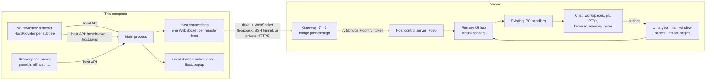

# Remote workspaces and chats (remote hosts) — design

Date: 2026-09-29. Branch: `feat/remote-workspaces-and-chat`.

## Goal

Everything a Maestrly profile does (standalone chats, workspaces, project conversations, Maestro, subagents, plans,
reviews, terminals, notes, memory, and the agent's browser) can run on a server instead of this computer, and keeps
running while this computer is off. From Maestrly on this computer, the owner:

- sees chats and workspaces of **this computer and of each server in one sidebar**, grouped by where they run;
- opens a remote conversation in the same chat view, drawer, and settings as a local one;
- reaches the server through the connection that the bot server already has (local Docker, SSH tunnel to a VPS, or
  private HTTPS).

Multi-gigabyte outputs (CSV files around 8 GB) must be browsable and downloadable to this computer. Isolation between
workspaces on one server is out of scope: the owner isolates by using separate servers.

## Decisions

| Topic | Decision |
| --- | --- |
| Where a remote profile runs | A **workspaces host**: a new environment kind (`workspaces`) of the bot gateway. One container per gateway, running the full Maestrly desktop in a new **server mode** (`MAESTRLY_SERVER_MODE=1`) instead of bot mode. It reuses the bot image, update flow, memory limit, keyring, home volume, and account provisioning (sign-in relay, API keys, skills, MCP servers). |
| How this computer drives it | The **same renderer**. Preload APIs are split into a **local API** (window, native views, sound, updates, bot fleet) and a **host API** (the Maestrly profile's backend). A host API instance runs over a transport: `ipcRenderer` for this computer, or a bridge to a remote host. |
| Sidebar | **Mixed**: the Chats and Workspaces tabs show one section per host. With no remote host, the sidebar looks exactly as it does today. |
| Bridge | One authenticated WebSocket per remote host: this computer's main process → gateway (`/v1/bridge?ticket=…`, a transparent passthrough) → the host's control server (`/v1/bridge`, environment control token). The host treats each renderer of this computer (main window, drawer panel) as a **virtual sender** and runs the existing IPC handlers unchanged. |
| Browser | The agent's browser always runs on the host, with its cookies and logins there, and keeps working while this computer is off. Viewing it on this computer (phase 2) streams only the page area through CDP screencast, not VNC; tabs, URL bar, and navigation stay native React. |
| Editor | VS Code runs on the host (`code serve-web`); this computer shows it through a local loopback proxy per host (phase 2). |
| Files | A host file browser plus a transfer queue in this computer's main process: parallel HTTP Range requests, zstd per range, resume after sleep, SHA-256 (phase 3). |
| Host folders | The gateway may bind-mount one host directory (`MAESTRLY_GATEWAY_WORKSPACES_ROOT`, `/srv/maestrly` on VPS installs) into the workspaces host at the same path. No per-request mounts: a paired device cannot mount arbitrary host paths. |
| Several servers | Phase 4. Phase 1 builds every identifier (`HostId`) so a host belongs to a server, and uses the single paired gateway. |
| Isolation | Deferred. Later, a server may run several workspaces hosts, one per environment. |
| Versions | This computer and each remote host must run the same app version; the bridge refuses a mismatch and the UI offers the existing **Update** flow. |
| Authority | Any paired device controls the workspaces host with the same authority as the local renderer controls this computer. |

## Non-goals

- Mounting arbitrary host paths, Docker inside the host, or sudo.
- Moving a local workspace or conversation to a server (a later migration feature can build on the bridge).
- Sharing one conversation's native views (browser, editor) across hosts.
- Offline use of a remote host: its section shows its connection state while unreachable.
- Isolation between workspaces on one server (see Phases).

## Terms

- **Host**: a Maestrly main process with its own profile. `local` is this computer. A **remote host** is a workspaces
  host on a server.
- **`HostId`**: `'local'`, or `<serverId>/<environmentId>` for a remote host. `serverId` is a UUID this computer
  assigns to a paired gateway (`fleet.serverId` in phase 1; the server registry in phase 4).
- **Host key**: an identifier made unique across hosts: `hostKey(hostId, id)` is `id` for `local` and `<hostId>#<id>`
  otherwise. Every renderer map, React key, and local presentation call that can mix hosts uses host keys; every host
  API call uses the host's own ids.
- **Origin**: one renderer of this computer (a `webContents` id) that uses a remote host.

## Architecture

### 1. Host API split (preload)

Each preload file keeps its local object and gains host factories. A factory takes an `IpcTransport`
(`invoke`, `send`, `on`, `removeListener`) and names its parameter `ipcRenderer`, so the source text keeps
`ipcRenderer.invoke('<channel>'` and the preload contract inventory keeps working. The local instance is built with
Electron's `ipcRenderer`.

- `makeHostApi(transport)` merges every host factory. `HostApi = ReturnType<typeof makeHostApi>`.
- `LocalApi` is the rest: `platformInfo`, app info, window and fullscreen, drawer presentation (layout, capture,
  suppress, detach and reattach, float, popup, visible conversation, panels, VS Code views), terminal-panel activity,
  memory-eviction handshakes, sound, UI preferences (sound, shortcuts, tab order, onboarding, locale), updates, bot
  fleet and its installer, microphone access and transcription, `openExternalUrl`, performance diagnostics, and the new
  `hosts*` and `hostApi` members.
- Some host members have desktop effects on the host (open in Finder/Terminal/VS Code, reveal a skill or memory source,
  open a PDF with the system viewer, native folder pickers, export and reset data). They stay in `HostApi` for the local
  host. A remote host refuses them, and the UI hides them when the host reports `desktopEffects: false`.
- `window.api` still carries every member at runtime (local host). Its renderer type becomes
  `LocalApi & { hostApi(hostId: string): HostApi }`, so any host call that ignores its host fails to compile.
- `hostApi(hostId)` returns a cached host API. For `local` it is the local object; for a remote host it uses a
  transport that calls `host:invoke(hostId, channel, args)` and `host:send(hostId, channel, args)`, and it
  demultiplexes the single `host:event(hostId, channel, args)` listener to per-host listener sets.

### 2. Renderer

- `renderer/lib/hosts/`: `HostProvider`/`useHostId`/`useHostApi` (context; the default is `local`), `useHosts()`
  (hosts, their state and epoch, from `hostsList`/`onHostsChanged`), `useHostInfo()` (`remote`, `desktopEffects`,
  `os`, `label`), and a per-host data store (workspaces, groups, standalone chats, statuses, attention, plans) that
  replaces the single-host hooks.
- `DesktopApp` keeps `active` as a hosted conversation (`Conversation & { hostId }`). Mounted chat views, drawer
  records, attention, plans, and statuses are keyed by host key. Each chat view and the drawer render inside the
  `HostProvider` of their host.
- The sidebar renders one **host section** per available host in the Chats and Workspaces tabs. Its header (name,
  connection state, a menu) appears only when there is more than one host. Pinned items stay per host section. New
  chat, new workspace, and new conversation act on the section they are started from.
- Settings keeps UI sections local (Appearance and sound, Tools and shortcuts, Privacy, Updates, Bot server). Sections
  about a profile (Chat, External bots, Platform, Usage, Execution) show a host selector (the app's custom Select)
  when a remote host exists.
- Drawer for a remote conversation: **Terminal, Notes, Plan, and Review** in phase 1. They are the existing panel views,
  opened with `panel.html?panel=…&conv=<id>&host=<hostId>`, so the panel renderer wraps itself in that host's
  provider. Browser and Editor come in phase 2 and are hidden until then.
- Adding a workspace on a remote host uses a **host folder dialog** (a React dialog over `host-fs:*`) instead of the
  native picker; cloning works as on this computer, with the host's Git credentials.
- When a remote host reconnects after a drop, its epoch increases. Its sidebar section, chat views, and panel views
  remount and hydrate again. A remote host that is unavailable keeps its section with its state and a retry action; its
  open conversations show a reconnecting overlay.

### 3. This computer's main process

- **Host registry** (`main/remote-host/client/host-registry.ts`): the local host plus each running workspaces
  environment of the connected gateway (from the fleet snapshot). It emits `hosts:changed` with each host's
  connection state (`connecting`, `online`, `reconnecting`, `incompatible`, `offline`), epoch, `desktopEffects`, OS,
  and label.
- **Host connection** (`host-connection.ts`), one per remote host: gets a bridge ticket through the fleet client, opens
  the WebSocket, exchanges `hello`/`welcome` (protocol, app version, device name, locale, OS), reconnects with backoff,
  and relays frames. It opens an origin on first use, closes it when that `webContents` is destroyed, and rejects
  pending invokes on disconnect.
- **IPC**: `host:invoke` (guarded), `host:send` (guarded), `hosts:list`; pushes `hosts:changed` and `host:event` to
  the origin's `webContents` only.
- **Drawer**: local presentation calls for remote conversations use host keys. Panel views of remote conversations
  get the `host` query parameter; the local drawer never calls backend services with a remote key.
- **Locale**: `hello` carries this computer's locale; the host applies it to main-process strings.

### 4. Bridge protocol

`apps/desktop/src/shared/remote-bridge.ts`, version 1, JSON text frames:

| From | Frame |
| --- | --- |
| client | `hello {protocol, appVersion, client: {deviceName, os, locale}}` |
| host | `welcome {protocol, appVersion, host: {os, hostName, homeDir, roots, desktopEffects: false}}` or `refused {reason: 'protocol' \| 'version', hostVersion}` then close |
| client | `open {origin, role: 'main'}`, `open {origin, role: 'panel', convId, panel}`, `close {origin}` |
| client | `invoke {id, origin, channel, args}` → host `result {id, ok: true, value}` or `result {id, ok: false, error: {message, code?}}` |
| client | `send {origin, channel, args}` |
| host | `event {origin, channel, args}` |
| both | `ping {n}` / `pong {n}` every 15 s; a peer silent for 45 s is dropped |

- **Values**: JSON, with binary values tagged as `{"$bin": "u8" | "ab" | "f32", "b64": "…"}` and `undefined` array
  entries kept as `{"$undef": 1}`. Frames are limited to 64 MiB; attachments and images fit, and bulk files use the
  transfer routes of phase 3.
- **Back-pressure**: the host drops a client whose socket buffers more than 32 MiB (it reconnects and hydrates again).
- **Errors**: handler errors become `{message}`, with `code: 'remote-unsupported'` for refused channels and
  `code: 'unknown-channel'` for channels the host does not register.

### 5. Server mode (the workspaces host)

- `MAESTRLY_SERVER_MODE=1` with the environment variables bot mode already uses (control host, port, token,
  environment id, gateway URL). `isServerMode()` and `isHeadlessInstance()` (bot or server mode) drive the shared
  headless behavior: hidden window, no app menu, hide on close, no updater, no automatic fleet client or installer.
- The hidden window loads the renderer with `platformInfo.serverMode`, which renders a small **server status page**
  instead of the desktop app. It stays the parent of native views (the agent's browser tabs, companion views) on the
  container display.
- **UI targets** (`window-ipc.ts`): a registry of remote UI targets next to the main window and panel targets. A remote
  `main` origin receives what the main window receives; a remote `panel` origin receives what a panel with its
  conversation and panel kind receives. `isTrustedSender` accepts registered remote targets. Remote targets are never
  registered for performance metrics. On this computer the registry is empty and nothing changes.
- **Chat events**: conversation-scoped chat channels (`chat:delta:`, `chat:permission:`, `chat:maestro-live:`,
  `chat:subscription-failover:`) also reach every **remote** subscriber of the conversation, so turns started by
  another client or by the host itself (plans, reviews, dispatch, executor) reach every connected computer. Main-window
  sends that carry profile data (`agent:status`, chat settings, auth and review-loop events) go through
  `sendToMainTargets`.
- **IPC handler table**: the registrar records every handler it registers. The **remote UI hub** dispatches bridge
  frames to recorded handlers with a synthetic event whose `sender` is the origin's virtual sender (`id` negative and
  unique, `send`, `isDestroyed`, `on`/`once`/`off`/`removeListener`, `getOSProcessId` returning 0), skipping the
  trusted-sender guard because the bridge is authenticated.
- **Channel policy**: the hub refuses local-only channels (window, drawer presentation, popup, float, sound, updates,
  fleet, UI preferences, microphone, performance) and host desktop effects (listed in section 1). A unit test derives
  each preload slice's channels with a recording transport and checks the policy against them.
- **Host file system API** (`host-fs:roots`, `host-fs:list`, `host-fs:mkdir`), registered in every mode: absolute paths
  only, resolved with `realpath` inside a root (home, and the workspaces root when mounted), directories first,
  hidden entries on request, 2,000 entries per listing.
- **Host environment**: implements the instance control API with no bots. Health reports `ready`, the capabilities
  `provisioning`, `environments`, and `workspaces-host`, and `busy` (active chat turns). Environment status reports no
  bots. Account, sign-in, skill, and MCP provisioning use the same code as a bot environment, extracted into
  `EnvironmentProvisioning`. Bot and screen routes answer `409 CONFLICT`.
- The control server accepts `GET /v1/bridge` with `Upgrade: websocket` after the usual origin, protocol, and
  control-token checks, and hands the socket to the hub.

### 6. Gateway

- Protocol: `fleetEnvironmentKindSchema = 'bots' | 'workspaces'`; the environment and its create request gain `kind`
  (default `bots`); instance health gains optional `busy`; feature `workspaces-host`; routes
  `POST /v1/environments/:eid/bridge-tickets` and the `GET /v1/bridge` upgrade.
- Store schema 9 adds `environments.kind` (default `bots`).
- Lifecycle: at most one active workspaces environment per gateway (`409 CONFLICT` otherwise). Its container gets
  `MAESTRLY_SERVER_MODE=1` instead of bot mode, and a bind mount of `MAESTRLY_GATEWAY_WORKSPACES_ROOT` at the same path
  when configured. Bots cannot be created in, moved to, or restored into a workspaces environment. A scheduled update of
  a workspaces environment waits until its health reports `busy: false` (polled every 30 s).
- **Bridge proxy**: one-use tickets bound to the device and environment, valid for 30 s, and at most 8 bridges per
  device. The upgrade is a transparent passthrough: the gateway forwards the client's WebSocket handshake to
  `<container>:7680/v1/bridge` with the control token, relays the host's `101`, then pipes bytes both ways. Revoking a
  device closes its bridges.
- The desktop UI hides workspaces environments from bot lists and pickers and shows them on the **Server** page as
  **Workspaces**, with start, stop, restart, update, memory, accounts, skills, and MCP servers.

### 7. Image, entrypoint, and installer

- The bot image serves both kinds. The entrypoint exports `MAESTRLY_BOT_MODE=1` only when `MAESTRLY_SERVER_MODE` is not
  `1`.
- `apps/desktop` depends on `ws` (the version the gateway uses) for the host's WebSocket server; this computer's side
  uses the global `WebSocket`, as the screen bridge does.
- VPS installs write `MAESTRLY_GATEWAY_WORKSPACES_ROOT=/srv/maestrly` and create that directory owned by uid 1000.
  Installs on this computer leave it empty, so the host keeps its files in its home volume.

## Security

- The bridge grants a paired device the host's whole IPC surface, as the local renderer has on this computer. Pairing
  already grants authority over every environment of the gateway, so this adds no new principal.
- Tickets are one-use, short-lived, bound to device and environment, and rechecked against revocation; the control
  token never leaves the gateway.
- The host runs as uid 1000 without the Docker socket or sudo. Its only host path is the configured workspaces root.
- The host refuses channels with desktop effects and local-only channels for remote origins.
- `host-fs:*` resolves symbolic links before checking roots.
- `docs/security-model.md` gains a "Remote workspaces" section; `docs/local-data.md` describes where a host keeps its
  profile (home volume) and files (workspaces root).

## Failure handling

| Situation | Behavior |
| --- | --- |
| Bridge drops | Pending invokes reject; the host section shows **Reconnecting…**; on reconnect the host's views remount. Turns keep running on the host. |
| Version mismatch | `refused {reason: 'version'}`; the host shows **Update required** with the existing **Update** action (it never downgrades). |
| Host stopped or starting | The section shows the environment state with **Start**. |
| Slow client | The host closes it above 32 MiB buffered; it reconnects. |
| Host restarts | Reconnect with backoff; interrupted turns follow the existing recovery of a restarted desktop. |
| Two computers on one host | Both receive streams and can answer permissions, questions, and plans; each keeps its own drawer layout. |
| Messages queued on this computer during a turn | The composer queue is renderer-local and is lost if this computer disconnects before sending it (phase 5 moves it to the host). |

## Compatibility

- Gateways without `workspaces-host` show no workspaces option; bots work as before.
- Desktop apps without remote hosts see a workspaces environment as an environment with no bots. The gateway refuses to
  add bots to it.
- Older bot images ignore `MAESTRLY_SERVER_MODE`; the gateway requires the image's health to report `workspaces-host`
  and marks the environment failed otherwise.
- Schema 9 cannot be opened by older gateways; back up the gateway volume before upgrading, as for earlier schemas.

## Testing

- **Unit**: bridge codec, host keys, transports, preload contract, host channel policy, UI targets, chat fan-out,
  handler table and hub, server config, host environment, `host-fs` roots, gateway store migration, lifecycle kind
  rules, bridge proxy, host connection and registry, renderer host store logic.
- **Bridge integration**: the real hub (`ws`) against the real host connection over loopback, with a fake handler table.
- **Electron end-to-end**: two Electron instances on one machine, one in server mode, the other connected through a
  development-only direct host target (`MAESTRLY_DEV_DIRECT_HOST`, honored only in unpackaged or E2E builds). It checks
  the mixed sidebar, a remote standalone chat turn with a deterministic model, a remote terminal, and that the sidebar is
  unchanged without remote hosts.
- **Container end-to-end** (`test:e2e:bot-fleet`): a workspaces environment on the real image, a bridge ticket and
  WebSocket through the gateway, a chat turn whose model calls `browser_navigate` and `browser_screenshot` on the host,
  a write under the workspaces root, and refusal of a second workspaces environment and of adding a bot to it.

## Phases

1. **Remote host core** (this spec's sections 1 to 7): server mode, workspaces environment, bridge, host API split, mixed
   sidebar, remote chats and workspaces, remote Terminal, Notes, Plan, and Review panels, host folder dialog, host
   settings selector, Server page integration, documentation.
2. **Browser and editor**: a `remote-browser` panel view renders CDP screencast frames (`Page.startScreencast`, JPEG,
   acked per frame) of the host's active tab at the drawer's size and device scale, sends input through
   `Input.dispatch*`/`insertText`, and uses the native browser chrome fed by the host's browser state. VS Code: gateway
   and control-server passthrough to the host's `serve-web`, plus a loopback proxy on this computer per host so the
   editor view loads `http://127.0.0.1:<port>/` at its own origin. The host forwards `shell.openExternal` to connected
   computers, and subscription sign-ins from host settings use the existing callback relay. ChatGPT Web companion views
   stream the same way.
3. **Files**: a Files drawer tab and host file browser (list, preview of the first lines, rename, delete, disk usage,
   upload by drag from Finder using `webUtils.getPathForFile`), and a transfer queue on this computer (ranges of 64 MiB,
   4–8 in parallel, zstd when the file compresses, `.part` files and a SQLite queue that resume after sleep or restart,
   SHA-256 per range and per file, pause, cancel, speed, and remaining time). Attachments such as PDFs open through a
   download.
4. **Several servers**: a server registry with its own pairing, tunnel, install record, and update state per server;
   installer and settings for more than one server; hosts from every server in the sidebar; bots from every server in
   the Bots tab.
5. **Parity**: alert sounds from remote hosts, a host-side message queue, floating and popup tool windows for remote
   panels, the **Apps** screen for `computer_*` tools, bringing accounts, skills, and MCP servers from this computer
   into a host from its settings, Git credential setup, and the Kanban executor on a host.
6. **Later: isolation**: several workspaces environments per server, chosen when a workspace or chat is created.

## Risks to settle during phase 1

- The agent's browser in server mode lives in offscreen views of a hidden window on Xvfb. Bot mode floats its browsers
  into their own windows instead. The container end-to-end check of `browser_screenshot` decides whether server mode
  must float browsers the same way.
- Electron's bundled Node must provide zstd for phase 3; checked when phase 3 starts.
- Local behavior must not change: the full desktop unit and Electron suites run unchanged after the preload split and
  the renderer migration, before any remote code lands.
