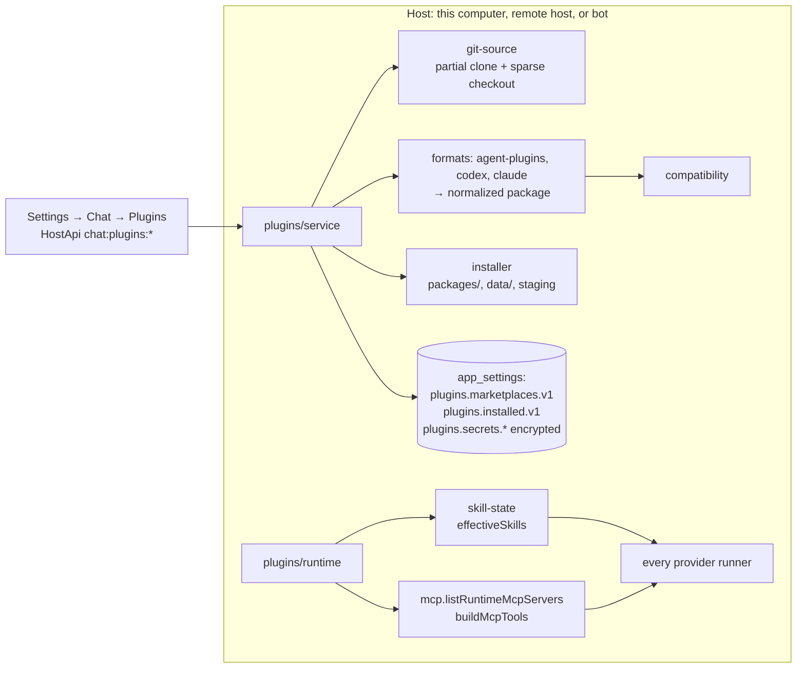

# Plugins (chats, workspaces, and bots) — design

Date: 2026-10-12. Branch: `task/plugins-na-maestrly-chat-workspaces-e-bo-622d4bb9`.

## Goal

Maestrly installs plugins from existing ecosystems and makes them available to every chat provider it supports, in
standalone chats, project chats (local and remote), and bot conversations. A plugin is managed once by Maestrly, which
downloads, validates, authenticates, and configures it. Each provider integration then receives the plugin's skills
and MCP tools in the form it accepts. There is no per-model version of a plugin.

## Premise: only what works with every provider

Added on 2026-10-12, after comparing with [Orca](https://github.com/stablyai/orca) (`9fcbb2ce`) and
[T3 Code](https://github.com/pingdotgg/t3code) (`0e7346cc`). Neither converts plugins for other models. Orca's
plugins extend the app itself (panels, commands, locales), and it leaves Codex and Claude Code plugins to the CLI that
owns them. T3 Code has no plugin system: it shares `~/.codex/plugins` with the Codex runtime. In both, a ChatGPT
connector works only while Codex runs the conversation.

Maestrly does the opposite: it offers only what works the same with every model, so switching models never changes
what a plugin does. Nothing runtime-specific is enabled anywhere: ChatGPT app connectors, native Codex apps and
plugins, native Claude Code plugins, LSP servers, and hook events Maestrly does not emulate. The portable core is
skills and MCP servers, plus what Maestrly adapts for every model (commands as skills, agents as subagents, hooks on
the events Maestrly controls). Plugins with nothing portable, or whose skills depend on a connector, are not offered.
The parts left out are still listed with their reasons.

## Decisions

| Topic | Decision |
| --- | --- |
| Portable core | Skills and MCP servers. Hooks, commands, agents, app connectors, and other runtime-specific parts are adapted for every model or listed as not included, with an explicit reason. Nothing is dropped silently. |
| Formats | Agent Plugins 1.0.0 (`plugin.json` + `skills/` + `mcp.json`), Codex (`.codex-plugin/plugin.json`), and Claude Code (`.claude-plugin/plugin.json` or a marketplace entry acting as the manifest). All three are normalized into one internal model. |
| Sources | Marketplaces are Git repositories, added with an optional ref and optional sparse paths, as in `codex plugin marketplace add`. Adding a source only lists its plugins. Install, enable, and sign-in happen per plugin. |
| Presets | `https://github.com/openai/plugins` and `https://github.com/openai/community-plugins` are listed by default and fetched from GitHub only when the user opens or refreshes them. Maestrly never bundles or redistributes their files. |
| Installation unit | A plugin is installed once per host (this computer, a remote workspaces host, or a bot environment) in that host's Maestrly data. It is enabled globally or for selected projects on that host. Nothing is written into repositories. |
| Delivery to providers | Plugin skills join the existing skill catalog and `use_skill`. Plugin MCP servers join the existing proxied MCP surface. No provider-native plugin feature is enabled. |
| MCP OAuth | Implemented as its own phase for every remote MCP server, not only plugin servers. The sign-in runs in the browser on the user's computer. The resulting tokens are stored encrypted on the host that uses them, and that host refreshes them. |
| Bots | A bot environment installs plugins from Git itself. The computer manages them through environment settings and can bring its installed plugins (source, pinned commit, settings, and inputs). Plugin files are never copied from the computer. |
| UI | A **Plugins** tab in Settings → Chat, next to Skills and Tools. It follows the host selector and is reused as a section of the bot environment settings. The composer links to it. |

## Non-goals

- Repository-local marketplaces (`<project>/.agents/plugins/marketplace.json`). Excluded by the owner for this delivery.
- Running hooks, LSP servers, monitors, output styles, themes, workflows, or `bin/` executables.
- npm, archive, and `command` plugin sources. They are listed as unsupported. `command` sources run a shell command
  and will not be supported.
- Private repositories and any interactive Git credential. Downloads use HTTPS without credentials.
- Automatic updates. Updates are always explicit.
- The OpenAI in-product plugin store, which has no known public API.
- The Platform runner executors in `packages/runner-core`, which do not use Maestrly skills or MCP.

## Catalog measurement

These numbers come from `openai/plugins` at commit `0722921d` (2026-10-08) and `openai/community-plugins` at `HEAD` on
2026-10-12. The survey followed each format's default component locations.

`openai/plugins` has 65 entries in `.agents/plugins/marketplace.json`: 62 local plugins, 2 `url` sources, and 1
`git-subdir` source. `api_marketplace.json` is a subset of 50.

| Measure | Count |
| --- | --- |
| Skills | 554 |
| MCP servers | 31: 26 remote HTTP servers, 5 stdio servers (`npx`, `node`, or a bundled script) |
| Plugins with an app connector (`.app.json`) | 34 |
| Plugins with hooks, `commands/`, or `agents/*.md` | 3, 6, and 3 |
| Licenses | 40 MIT, 11 none declared, 8 Proprietary, 6 other. 10 plugins ship a `LICENSE` file. |
| Largest plugin | 795 files (zoom). 6.1 MiB (shopify). Largest file 2.1 MiB. No symbolic links. |

Classification under the rules in [Compatibility](#compatibility):

| Level | Without adaptations | With commands → skills (Phase 1) |
| --- | --- | --- |
| Portable | 26 | 29 |
| Partial | 32 | 29 |
| Unavailable | 7 | 7 |

- **Unavailable (7):** lovable, outlook-calendar, outlook-email, sharepoint, and teams have only an app connector.
  gmail and google-calendar have only an app connector plus an MCP server whose OAuth `client_id` is a placeholder
  (`<GMAIL_PUBLIC_CLIENT_ID>`) that OpenAI fills in.
- **Partial:** 27 of these have an app connector beside usable skills or MCP servers.
- **OAuth clients:** the 26 HTTP servers fall into three groups.
  - 6 carry a placeholder OAuth client id that only OpenAI fills in: airtable, gmail, google-calendar, google-drive,
    shopify, and zoom. Maestrly treats these servers as unusable.
  - 2 embed a client registered by the publisher: github and slack. Maestrly must not reuse those clients, so these
    servers need a token the user supplies.
  - The other 18 rely on the server's own OAuth discovery, which Maestrly can complete once MCP OAuth lands. They
    include Linear, Notion, Figma, Sentry, Vercel, Supabase, and Atlassian.
- **Connector-only plugins:** 11 plugins have no skills at all. Without the MCP OAuth phase, they install but cannot
  connect.

`openai/community-plugins` has 4 plugins, all portable. All four are Apache-2.0. Two have a stdio `node` server, which
uses `cwd: "."` and Codex `env_vars`. The largest is 9.9 MiB.

**Conclusion:** 58 of the 65 `openai/plugins` entries are usable for their skills or MCP servers. Most of the value
of connector plugins depends on MCP OAuth.

**Under the premise (Phase 6).** The same commit, classified by the engine with the two-state rule, offers 49 of the 62
local plugins. 36 of the 62 declare app connectors (ChatCut's `.app.json` declares none, so it is no longer counted).
22 of those ship an MCP server for the same service, so they are offered with the connector noted as not included.
13 are not compatible:

- 7 depend on app connectors with nothing to replace them: adobe and public-equity-investing (their skills call
  connector tools), lovable, outlook-calendar, outlook-email, sharepoint, and teams.
- 6 ship an MCP server whose OAuth client is a placeholder: airtable, gmail, google-calendar, google-drive, shopify,
  and zoom. They stay not compatible until Phase 7 lets those servers sign in.

## Provider matrix

Each provider already receives skills as a catalog in its instructions plus a `use_skill` tool, with native discovery
disabled. User MCP servers are already proxied: Maestrly connects to them and re-exposes their tools. Plugin skills and
MCP servers therefore reach every provider without a provider-specific adapter. Phase 1 adds the
conversation-scoped filters and tests.

| Provider | Skills | MCP tools | Notes |
| --- | --- | --- | --- |
| API keys (AI SDK; also Grok) | Catalog in the system prompt + `use_skill` | `buildMcpTools` wrappers + `mcp_search`/`mcp_call` | The OpenAI Responses harness defers MCP tools behind tool search. |
| Claude (Agent SDK) | Catalog + `use_skill` (native `Skill` aliased) | Inside the in-process `maestrly` SDK MCP server | Native skills, plugins, and settings are off (`skills: []`, `plugins: []`, `settingSources: []`, `strictMcpConfig`). Long tool names use the legacy un-hashed form, so Phase 1 adds collision handling. |
| Codex (app-server) | Catalog in developer instructions + `use_skill` dynamic tool | `dynamicTools` with `deferLoading` | MCP tools exist only in Agent and Maestro modes (unchanged). Native `skills`, `plugins`, and `apps` features are off. |
| GitHub Copilot | Catalog in the system message + `use_skill` | SDK custom tools, deferred | `enableSkills: false`, config discovery off. |
| Cursor | Catalog in the harness envelope + `use_skill` | `customTools` (`mcp` kind) | No deferral. |
| Google AI (Antigravity ACP) | Catalog in the first prompt + `use_skill` | Loopback MCP per session; schemas pasted into the first prompt | MCP images are described, not passed through. |
| ChatGPT web | `read_skill` + list in `get_context` | `search_mcp_tools`, `call_mcp_read_tool`, `call_mcp_write_tool` | Per-conversation server scope (`off`, `read`, `write`; default `read`). |

Ask mode loads no skills for any provider, and ordinary subagents get no skills. Both are unchanged.

## Architecture



All code lives in the main process under `apps/desktop/src/main/plugins/`. Renderer DTOs live in
`apps/desktop/src/shared/plugins.ts`. The IPC channels are named `chat:plugins:*`. They are not local-only, so the
remote-host bridge serves them on the host of the selected profile or conversation.

### Normalized model

```ts
type PluginFormat = 'agent-plugins' | 'codex' | 'claude'
interface PluginPackage {
  name: string // manifest name, validated (1–64, a-z 0-9 . -)
  format: PluginFormat
  version: string | null
  description: string | null
  displayName: string | null
  publisher: string | null
  license: { spdx: string | null; file: string | null }
  homepage: string | null
  links: { privacy?: string; terms?: string; support?: string; repository?: string }
  capabilities: string[] // Codex interface.capabilities (Read, Write, Interactive)
  category: string | null
  skills: PluginSkillSpec[]
  mcpServers: PluginMcpServerSpec[]
  inputs: PluginInputSpec[] // userConfig, env_vars, bearer_token_env_var, ${VAR} references
  components: PluginComponent[] // every component found, with support status
  issues: PluginIssue[] // invalid entries, skipped files, unknown fields
}
```

`PluginComponent.status` is `supported`, `adapted`, `not-run`, `unavailable`, or `invalid`. It always carries a reason
code for the UI.

### Format detection

For a plugin root, the first match wins. This is the same order Codex uses:

1. `plugin.json` whose `$schema` starts with `https://agent-plugins.org/schemas/`. Only `1.0.0` is supported; other
   versions reject the plugin with "unsupported Agent Plugins version".
2. `.codex-plugin/plugin.json`.
3. `.claude-plugin/plugin.json`.
4. For a Claude marketplace entry with no manifest, the entry acts as the manifest.

Component locations per format:

| Component | Agent Plugins | Codex | Claude |
| --- | --- | --- | --- |
| Skills | `skills/<name>/SKILL.md` (immediate children only) | `skills` paths, default `skills/` | `skills/` plus manifest `skills` paths; a root `SKILL.md` alone means one skill |
| MCP | `mcp.json` (closed schema, version must match) | `mcpServers` path or object, default `.mcp.json` | `.mcp.json` merged with manifest `mcpServers` (path, object, or array); `.mcpb` and `.dxt` bundles are unsupported |
| App connectors | `extensions["com.openai"].apps` | `apps`, default `.app.json` | — |
| Hooks | `extensions["com.openai"].hooks` or `com.openai/` | `hooks`, default `hooks/hooks.json`; a root `hooks.json` is also reported | `hooks/hooks.json` + manifest `hooks` |
| Commands | — | `commands/` | `commands` (replaces `commands/`) |
| Agents | — | `agents/*.md` (`agents/openai.yaml` is UI metadata) | `agents` (replaces `agents/`) |
| Other | Extension directories of other namespaces are reported and ignored | — | `bin/`, `.lsp.json`, `monitors/`, `output-styles/`, `themes/`, `workflows/`, `settings.json`, `channels` reported |

Display metadata comes from Codex `interface` (or `extensions["com.openai"].interface` in an Agent Plugins manifest) and
from Claude `displayName` and marketplace-entry display fields. The entry wins for display fields; the manifest wins
for `version`.

### MCP normalization

```ts
type PluginMcpServerSpec =
  | { key: string; transport: 'stdio'; command: string; commandKind: 'bare' | 'plugin-relative';
      args: string[]; env: Record<string, string>; cwd: string /* plugin-relative or ${PLUGIN_DATA}… */;
      startupTimeoutMs?: number; toolTimeoutMs?: number; enabledByDefault: boolean;
      toolFilter?: { allow?: string[]; deny?: string[] }; auth: { kind: 'none' } }
  | { key: string; transport: 'http' | 'sse'; url: string; headers: Record<string, string>;
      startupTimeoutMs?: number; toolTimeoutMs?: number; enabledByDefault: boolean;
      toolFilter?: { allow?: string[]; deny?: string[] };
      auth: { kind: 'none' } | { kind: 'oauth'; resource?: string; scopes?: string[] }
          | { kind: 'manual'; reason: 'publisher-client' } | { kind: 'unusable'; reason: 'placeholder-client' } }
```

Rules:

- **`command`:** a single token. A bare name is resolved through `PATH`. A `./` path is resolved inside the plugin
  root, and it must be a regular file there. Claude `${CLAUDE_PLUGIN_ROOT}/x` becomes plugin-relative.
- **Placeholders:** `${PLUGIN_ROOT}`, `${PLUGIN_DATA}`, `${CLAUDE_PLUGIN_ROOT}`, and `${CLAUDE_PLUGIN_DATA}` are
  expanded once, non-recursively, in `args`, `env` values, and `cwd`. `${user_config.KEY}` becomes an input. Other
  Claude `${VAR}` and `${VAR:-default}` references become optional inputs. All other text stays literal.
- **`cwd`:** defaults to the plugin root. It must resolve inside the plugin root or inside the plugin data directory.
- **Codex fields:**
  - `env_vars` becomes optional inputs. Maestrly's own environment is never forwarded.
  - `bearer_token_env_var` becomes a sensitive input sent as an `Authorization` header.
  - `http_headers` are kept. `env_http_headers` become inputs.
  - `startup_timeout_sec` and `tool_timeout_sec` are kept, capped at 120 s and 1 h.
  - `enabled: false` sets `enabledByDefault: false`.
  - `enabled_tools` and `disabled_tools` become `toolFilter`.
  - `oauth_resource` and `scopes` become OAuth hints.
- **Credential safety:**
  - An `oauth.client_id` that looks like `<PLACEHOLDER>` makes the server `unusable`.
  - Any other publisher-provided client (`client_id` or `client_secret`) makes it `manual`. The user supplies a token,
    and the publisher's client is never used.
- **URLs:** HTTPS only, except loopback. No user information or fragment. A plain-HTTP non-loopback URL makes the entry
  invalid.
- **Transports:** an unknown `type` (for example `ws`) is reported as an unsupported transport.
- **Entry failures:** each invalid entry is skipped with an issue. The other entries still load.

### Compatibility

`classifyPlugin(pkg, source)` returns `{ level: 'portable' | 'unavailable', reasons: Reason[] }`. There is no partial
level (Phase 6): a plugin either works the same with every model or is not offered.

| State | UI label | When |
| --- | --- | --- |
| `unavailable` | Not compatible | The manifest is invalid; the source type is unsupported; the marketplace policy is `NOT_AVAILABLE`; the plugin declares app connectors and has no usable MCP server (`requires-app-connector`); or nothing usable remains, meaning no valid skill (adapted commands count as skills) and no usable MCP server (`no-usable-components`). |
| `portable` | Works with every model | Otherwise. |

The blocking codes are `BLOCKING_REASON_CODES`; the blocking reason comes first. Every other reason is a note on a part
that is not included (an app connector, hooks, a non-adapted agent, an unsupported component, an invalid or skipped
entry, an unsupported transport, a publisher or placeholder OAuth client). The catalog lists only portable plugins and
counts the rest with their first blocking reason; the details list blocking reasons and notes separately.

An installed plugin is reclassified at startup. One that is no longer compatible gets `blocked` reasons in its record
and never applies to any conversation, is never brought to a bot environment, and stays listed until it is updated or
uninstalled.

OAuth itself does not downgrade a plugin: the server becomes usable after sign-in. Each reason has a stable `code`, the
component it concerns, and parameters for the localized explanation shown in the catalog and the details.

Codex threads always start with `features.apps`, `features.plugins`, and `features.tool_suggest` off, so a ChatGPT
account's apps never reach a Codex conversation while being missing from every other model.

### Marketplaces

Marketplace files are looked for at the source root, or at each sparse path that is a directory:

- `.agents/plugins/marketplace.json`
- `.agents/plugins/api_marketplace.json`, merged by name with the first entry winning
- `.claude-plugin/marketplace.json`

A root holding a plugin manifest and no marketplace file is a single-plugin source.

Entry sources:

| Source | Codex | Claude | Support |
| --- | --- | --- | --- |
| Path inside the marketplace | `{source:'local', path}` or string | `"./path"`, bare name under `metadata.pluginRoot` | Yes; must stay inside the marketplace root |
| Whole Git repository | `{source:'url', url, ref?, sha?}` | `{source:'github', repo, ref?, sha?}`, `{source:'url', url, ref?, sha?}` | Yes (HTTPS) |
| Subdirectory of a Git repository | `{source:'git-subdir', url, path, ref?, sha?}` | same | Yes (HTTPS) |
| npm, archive, command | `npm` | `npm`, `archive`, `command` | Listed as unsupported |

Policy fields are shown: Codex `policy.installation`, `authentication` (`ON_INSTALL` prompts sign-in right after
install, `ON_USE` waits), `products`, and `category`. Claude `strict` is honoured when an entry adds components to a
manifest.

### Git download

`git-source.ts` uses the system `git`, which Maestrly already requires for projects. Every invocation:

- runs with `GIT_CONFIG_NOSYSTEM=1` and an empty `GIT_CONFIG_GLOBAL`, so no user rewrite, credential helper, or hook
  applies;
- passes `-c credential.helper= -c credential.interactive=never -c core.hooksPath=<empty dir> -c core.symlinks=false
  -c protocol.allow=never -c protocol.https.allow=always -c submodule.recurse=false -c core.fsmonitor=false`;
- sets `GIT_TERMINAL_PROMPT=0`, `GCM_INTERACTIVE=Never`, deny-only `GIT_ASKPASS` and `SSH_ASKPASS`, and
  `GIT_LFS_SKIP_SMUDGE=1`.

URLs must be `https://` without user information. `owner/repo` is shorthand for `https://github.com/owner/repo.git`.
Tests and e2e may allow `file://` URLs under one directory, through a constructor option or the
`MAESTRLY_E2E_PLUGIN_GIT_ROOT` variable, which is honored only with `AGENTS_E2E=1`.

Flow:

1. `git init` + `git fetch --depth 1 --filter=blob:none origin <ref|sha|HEAD>`, then resolve `FETCH_HEAD`. A tree
   listing (`ls-tree -r -z`, capped at 200,000 entries) gives the inventory without downloading blobs, including modes
   `120000` (symlink) and `160000` (submodule).
2. **Catalog:** a sparse checkout of the marketplace files and each plugin's manifests, MCP, app, and hook files, and
   license files. Git fetches them in one batch.
3. **Details:** a sparse checkout adds the plugin's `SKILL.md`, `commands/*.md`, and `agents/*.md`.
4. **Install:** a sparse checkout adds the whole plugin directory. The installer then copies it.

Timeouts are 120 s per command, and every step can be cancelled. Errors are classified as `git-unavailable`,
`network`, `not-found`, `auth-required`, `too-large`, `invalid-repository`, or `timeout`.

### Storage

| Data | Where |
| --- | --- |
| Marketplace sources | `app_settings` key `plugins.marketplaces.v1`: `{ id, url, ref, sparsePaths, preset, name, displayName, commit, fetchedAt, error, addedAt }[]` |
| Installed plugins | `plugins.installed.v1`: `Record<key, InstalledPluginRecord>` (below) |
| Plugin inputs and secrets | `plugins.secrets.<keyHash>`, encrypted through `secure-store`. Writes require secure storage; values never return to the renderer. |
| MCP OAuth state (Phase 3) | `chat.mcpOAuth.<serverId>`, encrypted. Kept apart from `chat.mcpServer.<id>` so that token refreshes never rewrite connection details. |
| Git caches | `<userData>/plugins/sources/<marketplaceId>/` and `<userData>/plugins/sources/ext/<sourceHash>/` |
| Installed files | `<userData>/plugins/packages/<keyHash>/<digest12>/`, immutable per version |
| Plugin data (`PLUGIN_DATA`) | `<userData>/plugins/data/<keyHash>/`, kept across updates |
| Staging | `<userData>/plugins/.staging/<uuid>/`, cleaned after 30 min |

```ts
interface InstalledPluginRecord {
  key: string // `${name}@${marketplaceName}`; one installed plugin per name on a host
  name: string
  marketplaceId: string
  source: { kind: 'marketplace'; path: string } | { kind: 'git'; url: string; ref: string | null; path: string | null }
  format: PluginFormat
  version: string | null
  commit: string // commit of the repository the files came from
  treeOid: string // Git tree of the plugin directory at `commit`; drives update detection
  digest: string // sha256 over sorted (path, mode, sha256(content))
  dirName: string
  enabled: boolean
  scope: { kind: 'global' } | { kind: 'projects'; workspaceIds: string[] }
  consent: { stdio: Record<string, string> /* serverKey → launch digest */; executables: boolean; acceptedAt: number }
  servers: Record<string, { id: string; enabled: boolean }> // serverKey → `plg_…` id
  status: 'ready' | 'installing' | 'updating' | 'removing'
  installedAt: number
  updatedAt: number
}
```

Identifiers:

- **Plugin MCP server ids:** `plg_<sha256(key \0 serverKey)[:20]>`. They are stable across updates, so per-conversation
  `mcpDisabled` and the tool catalog keep working.
- **Plugin skill names:** `<plugin>:<skill>`. Lookups keep one `:` separator. Skills found on disk still strip `:`, so
  a local skill cannot pose as a plugin.

### Runtime exposure

- **`plugins/runtime.ts`** answers which plugins apply to a conversation. A plugin applies when all of these hold:
  - it is `enabled` and `ready`;
  - its scope is global, or the conversation's `workspaceId` is in its scope. Standalone chats use only global
    plugins;
  - its consent matches the installed version.
  
  Settings, which has no conversation, sees every plugin.
- **Skills:** `skill-state.ts` composes disk skills with plugin skills (`listConversationSkills`). Disk skills win a
  name clash. The existing global disable list, groups, and per-conversation overrides apply unchanged.
  `ChatSkillInfo.scope` gains `'plugin'` and an optional `plugin: { key, displayName }`.
- **MCP:** `listMcpServers()` keeps returning user servers only, which keeps provisioning and settings unchanged. The
  new `listRuntimeMcpServers({ conversationId, includeInactivePlugins })` adds plugin servers.
  - `McpServer` gains `origin`, `cwd`, `startupTimeoutMs`, `toolTimeoutMs`, `toolFilter`, and the `sse` transport.
  - A stdio plugin server is active only when its launch digest is in `consent.stdio`.
  - `buildMcpTools` requires `conversationId`, so every provider forwards it.
  - Call sites that switch MCP off by listing every id use the runtime list, so plugin servers cannot leak into
    contexts that forbid MCP: `bot/native-host.ts`, `platform/project-chat-worker.ts`, `platform/desktop-executor.ts`,
    and ChatGPT web.
  - The MCP mutation handlers refuse `plg_` ids.
- **Tool names:** when an advertised MCP tool name would collide, the second tool gets the hashed name, instead of the
  silent overwrite the legacy names allow today.
- **Bot instance settings:** the skills listing keeps excluding plugin skills until Phase 4 adds a plugins feature,
  because its `source` enum is closed.

### Security

- **Before install**, the details show:
  - the manifest summary, publisher, version, source URL and commit;
  - the license identifier and text (up to 64 KiB), or "no license declared";
  - capabilities;
  - every external endpoint: MCP URLs, homepage, privacy, terms;
  - every stdio command line;
  - scripts and executables;
  - every component with its status.
- **Consent:**
  - Each stdio MCP server needs explicit consent. Without it, the plugin installs with that server off.
  - Plugins with executable files or `scripts/` require acknowledging that agents may run them through the normal
    `bash` permission gate.
  - Updates that change a stdio launch line or an HTTP endpoint, or that add executables, ask again.
- **Never run:** hooks, monitors, `bin/`, and `command` sources never run.
- **Package safety:**
  - A plugin-relative path must start with `./` and stay inside the root, checked lexically and with `realpath`.
  - Symbolic links and submodules are not installed; they are reported.
  - Files are copied with `lstat` checks, `wx` writes, and permissions 0644 (0755 for Git mode `100755`).
- **Limits:**

  | Item | Limit |
  | --- | --- |
  | Files per plugin | 4,000 |
  | Total size | 64 MiB |
  | Single file | 16 MiB |
  | Path length | 400 characters |
  | Directory depth | 24 |
  | Manifest and JSON files | 256 KiB |
  | Marketplace file | 1 MiB and 2,000 entries |

  The largest measured plugin uses 20% of the file limit and 15% of the size limit.
- **Secrets:**
  - Inputs and tokens are stored only through `secure-store`. If it is unavailable, they are refused (fail closed).
  - OAuth uses PKCE and dynamic client registration and never a publisher's embedded client. The browser opens only
    after the main process validates the authorization URL (HTTPS).
- **Remote hosts:** IPC runs on the host, so stdio servers run on the host. OAuth runs on this computer's browser, then
  only the token bundle crosses the bridge (Phase 3).

### Surfaces

- **This computer:** Settings → Chat → Plugins, with `HostApi` set to `local`.
- **Remote workspaces:** the same tab with the remote host selected. Remote conversations resolve plugins on their
  host, following memory `c676e8b2`.
- **Bots (Phase 4):** new environment-settings operations behind the gateway feature and instance capability
  `environment-plugins-v1`. The environment section reuses the same component through an environment data source.
  "Bring from this computer" lists installed plugins. It sends source, ref, pinned commit, scope, consent, and inputs;
  the environment fetches from Git and installs on its own. OAuth for bot servers uses this computer's browser and the
  new `setMcpOAuth` operation.

### Updates and removal

- **Refresh** fetches the source's ref again. A plugin has an update when its tree OID at the new commit differs from
  the installed one.
- **Update** installs the new version beside the old one and asks for consent again when the consent fingerprint
  changed. It then switches the record in one transaction and removes the old directory. Server ids persist by
  `serverKey`. Removed servers drop their catalog, pool entries, and OAuth state.
- **Uninstall:**
  1. Marks the plugin `removing`.
  2. Invalidates its MCP runtime, catalog, and OAuth state.
  3. Removes its names from skill disable lists and groups.
  4. Removes its secrets.
  5. Deletes the version directory, and the data directory when the user asks.
  6. Deletes the record.
- **Removing a marketplace** asks to uninstall its plugins.
- **Startup reconciliation:**
  - finishes `removing` records;
  - rolls back `installing` and `updating` records;
  - deletes unreferenced package directories and stale staging;
  - drops secrets and OAuth state that belong to no server.

### UI

- **Plugins tab:**
  - **Sources bar:** each source shows its name, commit, refresh time, and errors, with Refresh and Remove. An Add
    dialog takes a repository, optional ref, and sparse paths, and says that adding a source only lists plugins.
  - **Browse and Installed views:** search, compatibility filter, and category filter (the custom `Select`, never a
    native `<select>`).
- **Plugin details:** compatibility with reasons, components, license, capabilities, endpoints, requirements, inputs,
  and source.
- **Install dialog:**
  - consent checkboxes;
  - a scope picker (all conversations, or projects of the selected host);
  - inputs (sensitive ones masked).
- **Installed rows:**
  - an enable toggle and a scope summary;
  - the update badge;
  - setup-needed badges for missing inputs, consent, or sign-in;
  - Edit inputs, Change scope, and Uninstall (with "also delete plugin data").
- **Existing lists:**
  - Skills settings and the composer's skills menu group plugin skills under the plugin name, without edit or remove.
  - MCP settings and the composer's tools menu badge plugin servers as "Managed by <plugin>".
  - The composer has a **Browse plugins** link that opens Settings → Chat → Plugins.
- **Logos:** PNG, JPEG, or WebP files up to 256 KiB, checked by magic bytes. Anything else shows initials.

### MCP OAuth (Phase 3)

`chat/mcp-oauth.ts` implements the SDK's `OAuthClientProvider` over the encrypted store, so `connectMcpServer` passes
`authProvider` to the Streamable HTTP and SSE transports. The SDK then refreshes tokens on 401.

Background turns never open a browser. A server that needs interactive sign-in becomes `needs-auth`, and its tools
return "Connect <server> in Settings".

Connect flow:

1. The local-only channel `mcp-oauth:connect { hostId, serverId }` asks the host for a credential-free descriptor
   through `chat:mcp-oauth:descriptor`.
2. It starts a loopback callback on `127.0.0.1:<random>`.
3. It runs discovery, dynamic client registration, and PKCE, then opens the browser.
4. It exchanges the code for tokens.
5. It stores `{ clientInformation, tokens, redirectUri, resource, scopes }` on the host through
   `chat:mcp-oauth:store`, or the bot's `setMcpOAuth`. This computer keeps no copy.

An authorization server without dynamic registration fails with a clear message, and the user can paste a token as a
header instead.

### Adaptations

- **Commands (Phase 1)** become user-invocable skills named `<plugin>:<command>`. They are not model-invocable. The
  skill renderer already replaces `$ARGUMENTS` and `$1`–`$9` (`applySkillArguments`), so the command body is used
  as is.
- **Agents (Phase 5)** become subagents through the existing `.md` agent loader. Claude tool names map to Maestrly
  tools; unknown tools and model aliases are dropped with a diagnostic.
- Adapted components are marked `adapted`.
- **Catalog value:** before Phase 6, adapting commands alone moved three plugins to Portable (build-macos-apps,
  cloudflare, expo). Under the two-state rule, figma and vercel are offered (their connectors are noted), and zoom
  waits for Phase 7.

## Phases

1. **Engine and provider exposure** (no UI): formats, compatibility, marketplaces, Git download, storage, installer,
   runtime exposure including commands as skills, IPC, and tests.
2. **Plugin center and remote workspaces:** the Plugins tab, composer integration, local and remote-host e2e, and user
   documentation.
3. **MCP OAuth:** local and remote-host sign-in, token storage, and refresh.
4. **Bots:** protocol, gateway, instance, environment section, "Bring from this computer", bot OAuth, and container
   e2e.
5. **Agent adaptation:** plugin agents become subagents. Delivered as Phase 8.
6. **Only what works with every model:** two compatibility states, incompatible plugins counted outside the catalog,
   installed plugins reclassified at startup, third-party sources marked, and native Codex apps and plugins off.
7. **MCP sign-in for every server:** placeholder clients, an own OAuth client per server, and several accounts.
8. **Plugin agents as subagents** for every model.
9. **Plugin hooks emulated by Maestrly** for every model.

Each phase is one PR, validated with `npm run verify:pr -- --title "<title>" --full`.

## Testing

- **Unit tests:**
  - parsing of the three formats and both marketplace formats, built on synthetic fixtures written for this repository;
  - MCP normalization and placeholders;
  - compatibility (table-driven, covering every reason code);
  - Git download against local repositories (URL policy, ref, SHA, sparse paths, symlink and submodule modes, timeouts,
    no prompts);
  - installer limits, path traversal, symlinks, crash recovery, and update and uninstall cleanup;
  - runtime scoping;
  - exposure through `effectiveSkills`, `use_skill`, `buildMcpTools`, and each provider's MCP bridge test;
  - IPC channel routing.
- **E2E:**
  - **Local:** add a fixture source, inspect, install with consent, and see plugin skills in the composer. A scripted
    model sees the plugin skill catalog and calls a plugin stdio tool.
  - **Remote host:** the same through the host selector.
  - **Bots:** environment settings against the fake gateway, plus the container fleet script.
- **Fixtures:** test fixtures never copy files from `openai/plugins` or other third-party plugins.
