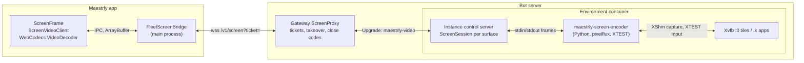

# Video screens: replace the bots' VNC with an H.264 stream

## Goal

Make the bots' screens (the environment screen, each bot's browser area and each bot's apps display) fast first and
sharp second, over any link the owner uses: the same machine, a tailnet, or Tailscale Funnel. The VNC pipeline
(x11vnc in the environment, noVNC in the app) is replaced end to end by an H.264 stream with acknowledged frames and
adaptive quality. The gateway, its tickets, takeovers and close codes stay as they are.

This is the first of two projects. The second gives each conversation of a workspaces host the same desktop a bot has
(see [Next](#next-desktops-for-workspaces-conversations)); it reuses everything built here.

## Non-goals

- No WebRTC. Media keeps flowing through the gateway's HTTPS WebSocket, so it works behind Funnel and any HTTP proxy
  without ICE, TURN or open UDP ports.
- No resolution change. Remote screens stay 1280×800 (`FLEET_SCREEN`), the computer-use tools keep their
  coordinates, and the 3×3 tile grid of the environment display stays.
- No audio, file transfer, or GPU encoding.
- No fallback to RFB. Environments on an older image ask to be restarted, as screens already do for images from before
  environments.

## What the measurements say

A prototype on 2026-10-13 compared the bots' x11vnc + noVNC with Selkies 2.0 (pixelflux, x264 in software) on the bot
image, through simulated links. All numbers are from that prototype, measured once per combination: a link proxy with
delay and bandwidth caps per connection, an Electron client sampled through `beginFrameSubscription` (which saw at most
30 frames per second), and a 4 vCPU arm64 container.

| Link (simulated) | VNC: scroll fps, click while scrolling | H.264: scroll fps, click while scrolling |
| --- | --- | --- |
| Same machine | 27 fps, 85 ms | 30 fps, 59 ms |
| 30 ms, 20 Mbit/s | 8 fps, 221 ms | 30 fps, 121 ms |
| 300 ms, 10 Mbit/s | 2 fps, 860 ms | 30 fps, 385 ms |
| 300 ms, 1.5 Mbit/s | 0.8 fps, 1987 ms | 30 fps, 373 ms at a fixed 1 Mbit/s (12.7 fps, 2783 ms uncapped) |

VNC's frame rate falls with latency because each update waits for the viewer's request. Scrolling cost VNC 54 Mbit/s
on the same machine against 1.8 Mbit/s for H.264. An uncapped H.264 stream on a narrow link queued and its clicks
took seconds: the rate has to follow the link.

A second probe, on the same day, drove pixelflux 2.1.0 directly on the bot image (1280×800 Xvfb, scrolling xterm):

- **Start:** the module imports in about 85 ms and the first frame comes about 10 ms after the capture starts.
- **CPU:** 7–10% of one core while scrolling at 30 fps, and 1% on a still screen when it encodes changes only
  (`video_streaming_mode = False`).
- **Still-screen quality** (PSNR of the last decoded frame against the screen):
  - quality-based rate (CRF 25) with paint-over: 44.4 dB;
  - CRF 25 without paint-over: 42.9 dB;
  - a fixed 1 Mbit/s rate without paint-over: 38.6 dB, the blocky text seen in the prototype;
  - a fixed rate with paint-over: 18.2 dB, reproducibly broken. **The fixed-rate mode is not used.**
- **Capped CRF does not exist in 2.1.0.** A 300 kbit/s cap left scrolling at 1.3 Mbit/s, the same as uncapped, and the
  live bitrate change did nothing in CRF mode. The pixelflux README describes a capped CRF that is not released yet.
- **Live CRF changes work** (`update_tunables`): CRF 40 took the same scroll from 1.3 to 0.47 Mbit/s. **Live frame-rate
  changes work** (`update_framerate`).
- **Dropping frames works:** three frames dropped mid-scroll, each followed by `invalidate_reference(frame_id)`. The rest
  of the stream decoded without an error and ended identical to the full stream. No frame after a dropped one
  referenced it.
- **Frames report their reference** (`reference_frame_id`), and a key frame reports -1.
- **A paint-over is a key frame of the whole region** on a full frame: 110–165 KB at 1280×800, ten captured frames
  after any change, even a 140-byte one. `use_paint_over_quality` and `paint_over_trigger_frames` change live through
  `update_tunables`; a burst of 0 does not turn it off.
- **Invalidating a key frame makes the encoder code another key frame** at once. Invalidating a delta frame on a still
  screen makes it code nothing: only a later change or a key frame brings a client back.
- **Frame ids count captured frames**, so ids skip while the screen is still.
- **A 1280×800 region at (1280, 0) of a 3840×2400 display** captures at 49.5 dB, so a bot's browser tile works.
- **The cursor callback** delivers `('png', bytes, hot_x, hot_y)` and fires again when the shape changes.
- **python-xlib 0.33** offers XTEST input and XFixes selection notifications.

## Architecture

The gateway and the main process stay byte pipes. All of the protocol lives at the two ends:

- the instance's `ScreenSession`, which fans the stream out and paces it;
- the app's `ScreenVideoClient`, which decodes and sends input.

## Wire protocol (`maestrly-video`, version 1)

The instance and the app exchange a byte stream of messages. Each message is a type byte, a big-endian 32-bit
payload length, then the payload. The gateway splits the stream arbitrarily into WebSocket messages, so a reader
reassembles messages across chunks. `FLEET_SCREEN_UPGRADE` becomes `maestrly-video`.

| Type | Direction | Payload |
| --- | --- | --- |
| `0x01` hello | instance → app | JSON `{ "version": 1, "width", "height", "mode": "view" or "control" }`, always first |
| `0x02` frame | instance → app | u32 frame id, u8 flags (bit 0: key frame), then one H.264 Annex-B access unit |
| `0x03` cursor | instance → app | u16 hot x, u16 hot y, PNG bytes; empty PNG: hide the cursor |
| `0x04` pointer | instance → app, viewers only | i32 x, i32 y in screen pixels; -1, -1 when the pointer is off this screen |
| `0x05` clipboard | instance → app, controllers only | u8 flags (bit 0: over 1 MiB, text left out), then the UTF-8 text of the screen's CLIPBOARD after it changed |
| `0x41` ack | app → instance | u32 id of a frame the app decoded and drew |
| `0x42` key frame | app → instance | empty: the decoder needs a key frame |
| `0x43` pointer | app → instance, control only | u16 x, u16 y, u8 buttons (bit 0 left, 1 middle, 2 right) |
| `0x44` wheel | app → instance, control only | i16 dx, i16 dy in wheel steps (positive: right, down) |
| `0x45` key | app → instance, control only | u32 X keysym, u8 down |
| `0x46` clipboard | app → instance, control only | UTF-8 text for the screen's CLIPBOARD, up to 1 MiB |

The rules:

- **Unknown types and wrong sizes end the session.** An instance message is at most 16 MiB and an app message at most
  1 MiB plus its header.
- **Input from a view connection is dropped** by the instance, never forwarded to the encoder. The read-only guarantee
  no longer depends on which process a socket reaches.
- **The app sends long payloads in pieces.** The gateway takes WebSocket messages of at most 256 KiB, so the main
  process splits what the app sends into WebSocket messages of at most 64 KiB.
- **The codec string comes from the stream.** The app configures WebCodecs from the profile and level in the first key
  frame's SPS (`avc1.PPCCLL`), with no description, so chunks are Annex-B.

## Encoder process

`maestrly-screen-encoder` is a Python 3.11 program in the image, with pixelflux 2.1.0, python-xlib 0.33 and six
1.17.0. They are installed in their own virtual environment, pinned by hash, from wheels only. The instance runs one
encoder per surface with arguments `--display :N --region X,Y,W,H`, and talks to it over stdin and stdout with the same
framing as the wire protocol and these internal types:

| Type | Direction | Payload |
| --- | --- | --- |
| `0x01` ready | encoder → instance | JSON `{ "width", "height", "capture", "encoder" }` once the capture runs |
| `0x02` frame | encoder → instance | u32 frame id, i32 reference id (-1 key frame, -2 untracked), u8 flags, access unit |
| `0x03` cursor | encoder → instance | u16 hot x, u16 hot y, PNG |
| `0x04` pointer | encoder → instance | i32 x, i32 y relative to the region, or -1, -1 |
| `0x05` clipboard | encoder → instance | u8 flags (bit 0: over 1 MiB, text left out), then UTF-8 text |
| `0x06` log | encoder → instance | UTF-8 diagnostic line |
| `0x81` key frame | instance → encoder | empty: `request_idr_frame()` |
| `0x82` invalidate | instance → encoder | u32 frame id: `invalidate_reference(id)` |
| `0x83` tune | instance → encoder | JSON `{ "crf", "fps", "paintoverCrf", "paintoverBurst", "paintover", "paintoverAfterFrames" }`: `update_tunables`, and `update_framerate` when the rate changes |
| `0x84` pointer | instance → encoder | u16 x, u16 y, u8 buttons |
| `0x85` wheel | instance → encoder | i16 dx, i16 dy |
| `0x86` key | instance → encoder | u32 keysym, u8 down |
| `0x87` clipboard | instance → encoder | UTF-8 text |
| `0x88` watch | instance → encoder | u8 flags: bit 0 pointer position, bit 1 clipboard |
| `0x89` release | instance → encoder | empty: let go of every key and button the encoder holds down |

Capture settings:

- `codec = 'h264'`, `video_fullframe = True` and `omit_stripe_headers = True`, so every callback is one Annex-B access
  unit.
- `video_streaming_mode = False`: changes only.
- `capture_cursor = False`, because the cursor goes out of band.
- `use_paint_over_quality = False` and `paint_over_trigger_frames = 10` until the session's first `tune`.
- CRF, frame rate and paint-over come from the session.

Input goes through XTEST on a connection of its own:

- **Pointer:** moves are absolute, offset by the region's origin and clamped to the region. A browser area's
  controller can never move the pointer into another tile.
- **Wheel:** steps are clicks of buttons 4 to 7.
- **Keys:** a keysym maps to a keycode at shift level 0 or 1. The encoder presses or releases Shift around the key so
  the keysym's case wins over the Shift the app holds. A keysym missing from the keymap is bound to a spare keycode,
  as x11vnc does. Caps_Lock, Shift_Lock and Num_Lock are ignored, which keeps x11vnc's `-skip_lockkeys` behaviour: the
  case is already in the keysym and the display's lock stays off.

Clipboard: only CLIPBOARD, never PRIMARY, as x11vnc's `-noprimary` did. Setting it runs
`xclip -selection clipboard -in -target UTF8_STRING`. While watching, an XFixes selection-owner notification triggers
`xclip -selection clipboard -out -target UTF8_STRING`, with a 2 s limit and a 1 MiB limit on the text. Text is UTF-8
both ways, so the Latin-1 limit of RFB cut text goes away.

Pointer position: while a viewer is connected, a thread reads `query_pointer` 30 times a second and reports changes,
so viewers can draw the bot's pointer.

## Instance: one session per surface

`ScreenSession` (in `apps/desktop/src/main/fleet/instance/screen-session.ts`) owns one encoder and its clients, up to
four viewers and one controller per surface. The existing per-surface limits and the one-controller rule of the shared
display `:0` stay in the control server.

- **Joining.** A client gets `hello`, then the current cursor, and is marked as needing a key frame; the session asks
  the encoder for one. The client receives no frame until a key frame.
- **Deliverable frames.** A key frame always goes to every client: a client that missed one could decode nothing until
  the next, and invalidating one makes the encoder code another at once. A delta frame goes to a client that holds the
  frame it references (for `-2`, the previous frame). A delta frame that a client cannot decode is skipped for that
  client and invalidated, so the encoder stops predicting from it.
- **Flow control.** Each client has a window of delta-frame bytes in flight: sent and not yet acknowledged.
  - It starts at 256 KiB and stays between 64 KiB and 4 MiB.
  - A delta frame that would overflow the window is dropped for that client and invalidated. A client with nothing in
    flight always gets the next deliverable frame, even one larger than its window.
  - Key frames in flight do not count against the window. Their transfer is a one-off, not a queue that delta frames
    build.
  - Every other ack gives a round-trip sample. The session keeps the minimum of the last 10 s. When the delay over
    that minimum exceeds 100 ms, the window shrinks to 70% (at most once per minimum round trip). Below 30 ms it grows
    by a quarter of the acknowledged bytes. A key frame's ack, and the acks of frames sent while a key frame was in
    flight, leave the window alone: their delay is the key frame's transfer.
  - So the queue stands at no more than about 100 ms over the link's base latency, instead of the seconds an
    unacknowledged stream builds behind the gateway's and Funnel's buffers.
- **Paint-over.** It makes a still screen sharp, but each one is a key frame of the whole region that input waits
  behind.
  - The session estimates how long a key frame holds each client's link. It uses the latest frame of 16 KiB or more
    sent with nothing in flight: its round trip over the client's minimum, scaled to the size of the encoder's latest
    key frame.
  - Paint-over turns on while that time is at most 150 ms for every client, and off above 200 ms, or while a client
    has not measured its link. The session checks every 500 ms and tells the encoder through `tune`.
  - It starts off.
- **Catching up.** A client is stale when the newest frame was dropped or skipped for it. Once the screen has been
  still for 250 ms and a stale client has nothing in flight, the session asks for a key frame (at most one a second),
  so the client converges on the still screen. While paint-over is on, the session first waits for the paint-over's
  key frame: ten frames at the level's frame rate.
- **Quality ladder.** One level for the whole session, set through `tune`:

  | Level | CRF | fps | Paint-over CRF | Paint-over burst |
  | --- | --- | --- | --- | --- |
  | 0 | 25 | 60 | 18 | 3 |
  | 1 (start) | 25 | 30 | 18 | 3 |
  | 2 | 30 | 30 | 18 | 3 |
  | 3 | 34 | 20 | 22 | 1 |
  | 4 | 38 | 12 | 22 | 1 |
  | 5 | 42 | 8 | 22 | 1 |

  - **Down.** It goes down one level when more than 20% of the last 2 s of frames were dropped for any client. It is
    checked every 500 ms and moves at most once every 2 s.
  - **Up.** It goes up one level after at least 60 frames and 5 s without a drop, so a still screen does not climb
    while nothing measures the link.
- **Input.** Pointer, wheel, key and clipboard messages from the controller go to the encoder. Those from viewers are
  dropped. When the controller leaves, the session sends `release` so no key or button stays down.
- **Cursor and pointer.** The latest cursor goes to every client. Pointer reports run only while a viewer is
  connected and go to viewers only. The controller draws its own pointer, so its cursor moves without the round trip.
- **Clipboard.** Watched only while a controller is connected; its changes go to the controller only.
- **Failures.**
  - A client whose oldest frame in flight is 10 s old is closed.
  - An encoder that does not answer `ready` within 5 s, or that exits, ends the session and its clients.
- **Idle.** The encoder stops a minute after the last client leaves, as the VNC servers did.

`DisplayManager` keeps the display side (which display and which region a surface is). It replaces its VNC servers with
these sessions: `acquireScreen(surface)` returns a lease on the surface's session, and `stopBot` ends that bot's
sessions. The VNC ports 5900–5967 and the probe go away. Nothing listens on TCP for screens any more.

The instance advertises the capability `video-screens` (`FLEET_VIDEO_SCREENS_FEATURE`).

## Gateway

The tickets, takeover rules, viewer limits and close codes 4001, 4002 and 4003 stay as they are.

- **Old images.** A ticket for an environment whose capabilities lack `video-screens` is refused with the existing
  `RESTART_TO_OPEN_SCREEN` conflict. The legacy single-bot routes `/v1/screen/view|control` and their upstream mapping
  are removed.
- **Upgrade token.** The upstream request asks for `Upgrade: maestrly-video`.
- **Feature.** `meta.features` adds `video-screens`. That makes 19 of the 20 that `fleetFeaturesSchema` allows: the next
  feature needs a plan for the cap.

## App

### Main process

- **Old gateways.** `resolveScreenTarget` requires the gateway's `video-screens` feature. Without it, the screen fails
  with a new marker, `FLEET_SCREEN_UPDATE_REQUIRED`, shown as "Update the bot server to open this screen."
- **Sending.** `FleetScreenBridge.send` splits a payload into WebSocket messages of at most 64 KiB. Everything else in
  the bridge stays.

### Renderer

`ScreenVideoClient` (`apps/desktop/src/renderer/lib/fleet/screen-video-client.ts`) replaces noVNC's RFB client. It keeps
the surface that `ScreenFrame` and `attachScreenClipboard` use: `viewOnly`, `focus()`, `disconnect()`,
`clipboardPasteFrom(text)`, `sendKey(keysym, code, down)`, and the `connect`, `disconnect` and `clipboard` events.

- **Drawing.**
  - One `<canvas>` of the remote size from `hello`, kept for the session's life.
  - It scales with `object-fit: contain`. It is drawn with `image-rendering: pixelated` when the drawn size in device
    pixels is a whole multiple of the remote size, and smoothed otherwise.
- **Decoding.**
  - WebCodecs `VideoDecoder` with `optimizeForLatency`. The frame id is the chunk's timestamp.
  - Each output is drawn at once, closed and acknowledged.
  - A decoder error resets the decoder, asks for a key frame and drops delta frames until one arrives.
- **Input** (control only):
  - Pointer coordinates are mapped through the letterboxed content box.
  - Wheel deltas accumulate into steps of 50 px, as noVNC did.
  - Keys go through noVNC's `Keyboard` class (`@novnc/novnc/core/input/keyboard.js`), which turns browser key events
    into keysyms with its Mac and Windows fixes. It is imported with `VideoDecoder` hidden, as `load-novnc.ts` does
    today, because noVNC's `browser.js` probes H.264 decoding when it loads.
- **Cursor.**
  - Under control, the canvas's CSS cursor is the remote sprite at its hot spot.
  - A viewer gets an overlay image at the reported pointer position, scaled with the canvas. The local pointer keeps
    `not-allowed`.
- **Clipboard.** `attachScreenClipboard` keeps its shortcuts and copy flow. It drops the Latin-1 refusal and the
  x11vnc-specific comments.

noVNC stays a dependency only for its keyboard module. The RFB typings, `loadNoVnc` and the RFB H.264 decoder workaround
leave with it.

## Compatibility and rollout

- **Version match.** The app, the gateway and the environment image ship together, as the fleet protocol already
  requires (`FLEET_PROTOCOL_VERSION` stays 1).
- **Old environments.** After an update, environments on the old image show "Restart this environment to update it
  before opening this screen" until they restart onto the new image.
- **Old gateways.** A gateway that predates `video-screens` gets "Update the bot server to open this screen".
- **Everything else** in the fleet keeps working across this change.

## Security

- **Input stays read-only for viewers.** The instance enforces it per connection.
- **No screen ports.** The passwordless loopback VNC ports go away: with x11vnc, any process in the container could
  connect to 127.0.0.1:59xx and see or control a screen.
- **Contained pointer.** Pointer injection is clamped to the surface's region.
- **The encoder is reachable only through its parent's pipes.** It runs as the environment's user and has no socket.
- **Bounded inputs.** Clipboard text is limited to 1 MiB both ways, and messages have hard size limits. A malformed
  message from the app closes its connection.

## Packaging and licences

- **Image changes.** The image drops `x11vnc` and its `EXPOSE 5900 5901`. It adds `xclip`, the libraries the wheel
  loads even without a GPU (`libva2`, `libva-drm2`, `libva-x11-2`, `libgbm1`, `libpixman-1-0`, `libxkbcommon0`,
  `libegl1`), and the encoder's virtual environment (about 55 MB).
- **Bundled code.** pixelflux is MPL-2.0. Its wheels bundle x264 and x265 (GPL-2.0-or-later) and other libraries in
  `pixelflux.libs`. The encoder is a separate program that Maestrly talks to over pipes; Maestrly's own code does not
  link it.
- **Notices.** `THIRD_PARTY_NOTICES.md` gains entries for pixelflux and each library the wheel bundles, python-xlib
  (LGPL-2.1-or-later) and six (MIT).
- **Licence review before release.** The GHCR image is distributed. Before release, someone has to review what shipping
  the GPL libraries inside the wheel requires, such as a source offer.
- noVNC's notice stays, for its keyboard module.

## Testing

- **Protocol package:** framing across arbitrary chunk splits, size limits, every message's encoding, SPS-to-codec
  string, and the new constants.
- **Instance unit tests, with a fake encoder and fake sockets and clock:**
  - join and key frame;
  - reference skipping and invalidation;
  - window drops, and key frames sent outside the window and never invalidated;
  - window growth and shrink from round-trip samples, except those a key frame delays;
  - the paint-over choice from each client's link;
  - catch-up key frames, after the paint-over when it is on;
  - ladder moves;
  - input gating for viewers;
  - clipboard and pointer routing;
  - `release` on controller exit;
  - idle stop, encoder crash, and ready timeout.
- **Display manager and control server:** they keep their tests with the encoder in place of x11vnc: arguments and
  region per surface, sharing, idle stop, `stopBot`, upgrade checks, limits, takeover ends and the new token.
- **Gateway:** capability gating, the new upgrade token, and removal of the legacy path. The existing ticket and close
  code tests stay.
- **Renderer unit tests:** message handling, coordinate mapping with letterboxing, button and wheel mapping, cursor
  CSS, the decoder configuration, and the keyboard loader's decoder hiding.
- **Electron E2E** (Linux, macOS and Windows CI): the fake gateway speaks `maestrly-video`.
  - It sends a committed 640×480 synthetic H.264 key frame. The tests assert the canvas size, a decoded pixel, the
    single canvas across layout changes, the reconnect after 4003, and the cursor style under control and when
    watching.
  - The clipboard spec keeps its noVNC-shaped stub, which the new client implements.
- **Container E2E** (`scripts/test-bot-fleet-e2e.mjs` on amd64): a Node client built on the protocol package replaces
  the RFB client.
  - It checks `hello` at 1280×800, a key frame with an IDR NAL unit, and that a view leaves the pointer alone.
  - It checks control pointers at tile offsets and the apps pointer, the 4001 closes on release, and the 4003 at use.
  - It checks Caps Lock typing (`ABCd`), and a UTF-8 clipboard round trip (`ação ✓`).
  - It checks that no TCP listener in 5900–5999 ever appears, and that the encoders stop when idle.
  - `scripts/test-bot-fleet-focus.mjs` moves to the same client. The orphaned `rfb-cursor.mjs` and the legacy
    `bot-fleet-vnc-probe.mjs` are removed.
- **Measurement before release:** the prototype's link profiles, with the new stack, recording click-to-frame latency
  and frame rate while scrolling. It is reported against the VNC rows above, not added to CI.

## Risks

- **Encoder efficiency.** An invalidation may make the encoder code a larger frame. The probe checked correctness,
  not size. The ladder and the window bound the cost.
- **Paint-over key frames** are large (110–165 KB at 1280×800). The first measurement of this design, on a 300 ms,
  1.5 Mbit/s link, showed the window dropping them along with the delta frames behind them. Each drop invalidated
  a key frame or left a still screen stale, which cost another key frame, so clicks took 1.5–2 s. Key frames now
  bypass the window, and paint-over is on only where its key frame crosses the link in 150 ms. On narrow links a
  still screen stays at the level's CRF.
- **WebCodecs H.264 must work in Electron on all three CI platforms.** The E2E decode assertion proves it, or fails the
  plan early.
- **Upstream.** pixelflux is young and moves fast: pin it, and re-run the probe before raising the pin. The capped CRF
  in its unreleased README could later replace the CRF ladder.

## Next: desktops for workspaces conversations

The second project gives each conversation of a workspaces host its own desktop, as each bot has one, so the owner can
run and test the code a conversation produced: a dev server opened in that desktop's browser, a GUI app, a terminal.
Decided so far: one desktop per conversation, started when the owner opens it or the agent uses the browser or the
mouse, and given back after a few idle minutes. At most eight are active at a time, on the tiles of the environment
display. It reuses this project's sessions and client, and generalizes the display manager, presenter and desktop
service from bots to conversations. It gets its own design.
