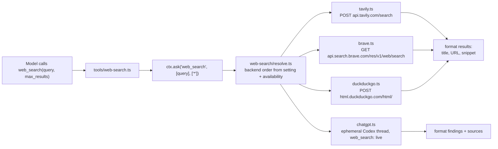

# Web search tool — design

Date: 2026-10-13 · Status: approved

## Goal

Give every chat runtime a general web search tool. Today models can read a URL
with `webfetch`, but only Codex (ChatGPT subscription) can search, and only when
its native search is enabled: Agent/Plan with a permission mode other than Ask,
outside Maestro, reviewer, remote and fleet bot turns
(`codex-subscription/runner.ts`). Claude, Copilot, Cursor, Antigravity, Grok and
BYOK models have no search at all, so they tell the user they cannot search.

Add a host-managed `web_search` tool, sibling of `webfetch`, with pluggable
backends and the same permission gate.

## Decisions

| Question | Decision |
| --- | --- |
| Tool shape | Host built-in `web_search`, read-only, registered in `ALL_TOOLS`. It reaches every runtime that consumes the host tool set, including subagents and Maestro workers. |
| Backends | Tavily API (key), Brave Search API (key), ChatGPT subscription (ephemeral Codex thread with native search), DuckDuckGo HTML (no key). |
| Selection setting | `chat.webSearch.provider`: `auto` (default), `tavily`, `brave`, `chatgpt`, `duckduckgo`, `off`. |
| `auto` order | Tavily (key set) → Brave (key set) → ChatGPT (Codex account connected) → DuckDuckGo. A configured key is an explicit choice, is faster, and does not spend subscription quota. |
| Fallback | In `auto`, any non-abort backend failure tries the next backend. An explicit provider never falls back. When every backend fails, the error lists each backend and its reason. |
| Keys | Secure store (`secureSet`/`secureGet`) under `chat.webSearch.apiKey.tavily` and `chat.webSearch.apiKey.brave`; the `apiKey` name keeps them out of data exports. The renderer only learns whether each key is set. |
| Permission | New action `web_search`; resource is the query; the "always" save pattern is `*`. Default rules mirror `webfetch`: ask in the BYOK/Ask ruleset, allow in Auto and Full. Remote and autonomous policies treat it like `webfetch` (`allowWeb`). Reviewer turns never receive it. |
| Codex | Codex native search keeps its current behavior where it is enabled. When native search is disabled for the thread (Ask, Maestro, Ask permission, remote), the host `web_search` is bridged as a dynamic tool instead. The two are never offered together, because both use the name `web_search`. |
| `off` | Removes `web_search` from every tool set and also forces Codex native `web_search: 'disabled'`. |
| Claude alias | `WebSearch` maps to `web_search` in the Claude tool alias map (`WebFetch` already maps to `webfetch`). Claude native search stays disallowed. |
| ChatGPT backend mode | Codex `web_search: 'live'` (accepted values: `live`, `indexed`, `cached`, `disabled`), smallest catalog model (same `mini` heuristic as image generation). |

## Out of scope

- Provider-native search for BYOK Anthropic/OpenAI models or the Claude
  subscription. These bypass the permission broker and vary per provider.
- Search filters (recency, domains, region) and result caching.
- Syncing the provider choice or keys to fleet bots and remote hosts. The tool
  runs where the turn executes; without local keys, `auto` falls through to
  ChatGPT or DuckDuckGo there.
- Extracting a shared ephemeral Codex thread helper out of image generation and
  the portable summarizer. The search runner follows the same lifecycle; a
  shared helper can be a later refactor.

## Architecture



### Units

- `main/chat/tools/web-search.ts`: the tool definition. Validates input, asks
  permission, calls the resolver, formats model text.
- `main/chat/web-search/settings.ts`: reads and writes the provider setting and
  the keys; reports key presence for `ChatConfig`.
- `main/chat/web-search/resolve.ts`: builds the ordered backend list for the
  current setting and runs it with fallback. Pure apart from the backends it
  receives, so it is unit-testable.
- `main/chat/web-search/{tavily,brave,duckduckgo}.ts`: one HTTP client each,
  using Electron `net.fetch`, a timeout and the caller's abort signal. Each
  returns `WebSearchResult[]` (`title`, `url`, `snippet`).
- `main/chat/web-search/chatgpt.ts`: ephemeral Codex search through
  `runCodexEphemeralWithFailover`. Returns the model's findings text, which
  ends with the numbered sources list the instructions require.

### Tool contract

Input:

- `query`: string, 1–400 characters.
- `max_results`: integer 1–10, default 5. The ChatGPT backend treats it as a
  hint for the number of sources.

Model text for list backends:

```text
Web search via Tavily for "electron vibrancy":

1. BrowserWindow | Electron
   https://www.electronjs.org/docs/latest/api/browser-window
   Create and control browser windows...

Use webfetch to read a result in full.
```

The ChatGPT backend returns the model's findings as written, ending with a
numbered `Sources:` list; Maestrly does not parse or rewrite them.
Output passes through the existing `boundText`. The tool input keeps the
`query` field, which the renderer already uses for the "Searched the web" card
(`renderer/lib/agent-activity.ts`).

### Backends

- **Tavily**: `POST https://api.tavily.com/search`, `Authorization: Bearer
  <key>`, body `{ query, max_results, search_depth: 'basic' }`; reads
  `results[].{title,url,content}`.
- **Brave**: `GET https://api.search.brave.com/res/v1/web/search?q=…&count=…`,
  headers `X-Subscription-Token` and `Accept: application/json`; reads
  `web.results[].{title,url,description}`. Descriptions contain inline HTML, so
  they go through the `webfetch` HTML-to-text extractor (exported for reuse).
- **DuckDuckGo**: `POST https://html.duckduckgo.com/html/` with form field `q`
  and the browser user agent used by `webfetch`. Parse with `parse5`: result
  links (`a.result__a`), snippets (`.result__snippet`), skip ads
  (`.result--ad`), and decode `uddg` from `//duckduckgo.com/l/?uddg=…` redirect
  links. A page with no results and a bot challenge raises "DuckDuckGo blocked
  the request".
- **ChatGPT**: same lifecycle as `generateImageWithCodexRuntime`: ephemeral
  thread, `dynamicTools: []`, `environments: []`, read-only sandbox, shell,
  apps, plugins, multi-agent and image generation off, `web_search: 'live'`.
  Developer instructions: search the web for the query, answer concisely with
  the facts found, end with a numbered list of source titles and URLs, never
  answer from memory. The run fails if no `webSearch` item completed, so the
  tool never reports a search that did not happen. Usage is recorded through
  `recordModelCallUsage`, as image generation does. Not connected →
  "Connect your ChatGPT (Codex) account…".

HTTP errors map to clear messages: 401/403 invalid key, 429 rate limit or quota
exhausted, other statuses `HTTP <status>`. Timeouts: 20 s for HTTP backends and
90 s for ChatGPT, always combined with the turn's abort signal.

### Permissions

- `permission.ts`: add `web_search` to `PermissionAction`, an `ask` rule to
  `BYOK_DEFAULT_RULESET`, and `titleFor` → `Search the web: <query>`.
- `remote-policy.ts` and `autonomous.ts`: same branch as `webfetch`.
- `tool-policy.ts`: add `web_search` to the parallel-safe host tools.

### Runtime wiring

- Registry: `ALL_TOOLS` and `READ_ONLY_TOOL_NAMES` pick it up automatically.
  `builtinToolNamesForMode` drops it when the setting is `off`.
- Codex runner: add `web_search` to the bridged reader names whenever the thread
  has native search disabled and the turn is not a reviewer turn. When the
  setting is `off`, force native `web_search: 'disabled'`. The same rule applies
  to the Codex subagent runner.
- Claude bridge: alias `WebSearch` → `web_search`.
- Prompts and docs: update the standalone contract in `harness/host-contracts.ts`
  and `docs/chat-context.md` to point online research to `web_search` when it is
  available. Add `web_search` to `READ_TOOLS` in the post-tool read guidance.
- Existing tests that assert the absence of `web_search` in standalone Ask
  chats were written against provider-native search. They change to assert the
  host tool is present and permission-gated, while Codex native search stays
  disabled there.

### Settings UI

The Tools tab gets a "Web search" section:

- A provider select (Automatic, Tavily, Brave, ChatGPT subscription, DuckDuckGo,
  Off). The description explains the automatic order and that queries are sent
  to the selected provider.
- Password fields for the Tavily and Brave keys with Save and Remove. They show
  only "configured" or "not configured".

IPC: `chat:set-web-search-provider` and `chat:set-web-search-key`;
`ChatConfig.webSearch = { provider, keys: { tavily: boolean, brave: boolean } }`.
Strings in `en` and `pt-BR`. `PRIVACY.md` gains a line about search queries
being sent to the selected provider.

## Testing

- Unit tests per HTTP backend with a mocked `net.fetch`: request shape, result
  mapping, error mapping, abort.
- DuckDuckGo parser against a small synthetic HTML fixture: redirect decoding,
  ad skipping, challenge detection.
- Resolver: order per setting and availability, fallback in `auto`, no fallback
  for explicit providers, aggregated error.
- ChatGPT backend with a fake Codex client, following `chat-image-gen.test.ts`:
  thread config, findings and sources, failure without a `webSearch` item,
  thread deletion on success, failure and abort.
- Tool: permission request (`web_search`, query, `*`), model text formatting.
- Policy: rulesets per permission mode, remote and autonomous branches, reviewer
  exclusion, `off` removing the tool.
- Codex runner: host `web_search` bridged only when native search is disabled;
  `off` disables native search.
- Updated standalone adapter tests.
- Verification: `npm run verify:pr -- --full`.
