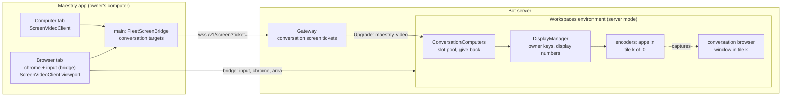

# Computers for workspaces conversations

## Goal

A conversation on a server's workspaces environment gets its own Linux computer, as each fleet bot has one. The owner
watches and controls it from a **Computer** tab of the conversation, to run and test what the conversation produced: a
dev server in the conversation's browser, a desktop app, a terminal. The agent drives the same computer with its
`computer_*` tools. The conversation's **Browser** tab stays, and its pixels move from JPEG frames to the H.264 video
of the bots' screens (#182), which the measurement below shows is several times faster on every remote link.

## Decisions

Taken with the owner on 2026-10-13 and 2026-10-14:

- One computer per conversation, started on demand and given back when idle. At most eight are active at a time.
- **The agent keeps working while the owner controls the computer.** Nothing pauses; their inputs may interleave.
- **The Browser tab and the Computer tab coexist.** The Browser tab keeps its own address bar, tabs and input; only
  its picture changes, and it falls back to the current JPEG frames where video is unavailable.
- **A computer is given back one minute after it became idle** (see [Giving a computer back](#giving-a-computer-back)).

One earlier decision changes: the computer starts when the owner opens the Computer tab or the agent uses a
`computer_*` tool, **not** when the agent uses its browser. The browser needs no computer (the agent drives it through
the DevTools protocol), and a computer shows the browser as soon as it starts, so starting one for every browsing
conversation would cost 80–150 MiB each for nothing.

## What the measurements say

The current Browser tab was measured on 2026-10-14 the way the video screens were before release
([video screens](2026-10-13-video-screens-design.md#what-the-measurements-say)):

- a server-mode container of the local bot image;
- a Node client on the bridge, straight at the instance with no gateway, behind the same link proxy;
- the same workload page at 1280×800;
- each JPEG frame acknowledged once decoded, as the app acknowledges it once drawn, with permessage-deflate on.

A click's latency runs from the click to the arrival of the first decoded frame that shows it. Each profile ran once,
with 15 clicks on the still page and 10 while it scrolled. The video columns are the measurement of #182.

| Link (simulated) | JPEG: click, still / scrolling (median) | JPEG: scrolling | Video: click, still / scrolling | Video: scrolling |
| --- | --- | --- | --- | --- |
| Same machine | 31 / 25 ms | 60 fps, 63 Mbit/s | 19 / 22 ms | 62 fps, 0.77 Mbit/s |
| 30 ms, 20 Mbit/s | 113 / 215 ms | 19 fps, 20 Mbit/s (link full) | 57 / 56 ms | 62 fps, 0.76 Mbit/s |
| 300 ms, 10 Mbit/s | 379 / 538 ms | 5.6 fps, 2.8 Mbit/s | 325 / 325 ms | 62 fps, 0.77 Mbit/s |
| 300 ms, 1.5 Mbit/s | 665–1013 / 1064 ms | 3 fps, 1.5 Mbit/s (link full) | 336 / 339 ms | 62 fps, 0.77 Mbit/s |

- **Why JPEG stalls.** The Browser tab keeps at most two frames in flight (`BROWSER_STREAM_LIMITS.maxFramesInFlight`),
  so its frame rate is at most two per round trip: 6.7 fps at 300 ms. Each frame is a whole JPEG picture, 136 KB at
  1280×800 and 64 KB once it drops to quality 50 at 960 px.
- **Why video does not.** Scrolling costs a few KB per frame, and the screen session's window bounds the delay instead
  of a frame count.
- **Verdict.** The switch is worth it on every remote link, including the tailnet: there the JPEG fills 20 Mbit/s at
  19 fps and doubles the click latency.

The implementation was measured the same way on 2026-10-14, with the same page, links and clicks, against a server-mode
container of the local image. The Browser tab asked for video and sent its clicks over the bridge, as the app does; its
pictures came from the conversation's tile through the instance's conversation screen route, decoded with PyAV and
cropped to the page's area. The Computer tab showed Chromium with the page full screen on the conversation's computer,
clicked through its screen's control connection. Each profile ran once; no click was missed.

| Link (simulated) | Browser tab on video: click, still / scrolling (median/p90) | Scrolling | Computer tab: click, still / scrolling | Scrolling |
| --- | --- | --- | --- | --- |
| Same machine | 35/41 / 64/73 ms | 61 fps, 0.76 Mbit/s | 27/48 / 36/54 ms | 62 fps, 0.77 Mbit/s |
| 30 ms, 20 Mbit/s | 61/73 / 73/93 ms | 62 fps, 0.77 Mbit/s | 53/61 / 86/99 ms | 61 fps, 0.77 Mbit/s |
| 300 ms, 10 Mbit/s | 328/340 / 358/368 ms | 62 fps, 0.76 Mbit/s | 327/367 / 367/393 ms | 61 fps, 0.76 Mbit/s |
| 300 ms, 1.5 Mbit/s | 338/400 / 378/433 ms | 61 fps, 0.76 Mbit/s | 346/456 / 406/457 ms | 61 fps, 0.75 Mbit/s |

Against the JPEG frames above, the Browser tab keeps about 61 fps on every link instead of 19, 5.6 and 3, and its
clicks while scrolling take 73 instead of 215 ms on the tailnet and 378 instead of 1064 ms on the narrow link, using
under 1 Mbit/s.

## Architecture

The screen stream, its session, its encoder and the app's video client are the ones of #182. This project adds the
host side that owns computers per conversation, a conversation target on the gateway and in the app, the Computer tab,
and a second picture source for the Browser tab.

## Host

### Slots

A workspaces host has eight **slots**, tiles 1 to 8 of the environment display `:0` (3840×2400, 3×3 tiles of
1280×800, as `fleetEnvironmentTile`). In server mode no bot uses them. A conversation holds one slot while:

- its computer runs; or
- its Browser tab is streamed as video.

The slot is free again when neither holds it. While a conversation holds a slot, its browser window sits at the top
left of the slot's tile and is kept above other windows of `:0`. Programs that the agents of other conversations start
on `:0` cannot cover it, and that is what the tile's encoder captures. With all eight slots taken:

- a computer is refused, with the titles of the conversations holding the slots;
- a Browser tab gets JPEG frames, as today.

`ConversationComputers` (new, `apps/desktop/src/main/remote-host/server/computers.ts`) owns the pool, the computers and
the Browser tab's tile leases. It is created only on Linux, when `:0` and the image's display programs exist.

### The computer

A computer is a fleet bot's apps desktop, keyed by the conversation:

- **Programs.** It runs the same set as a bot's apps display, from `DisplayManager`: `dbus-daemon`, Xvfb at
  1280×800, openbox, tint2 with **Browser**, **Terminal** and **Files**, and `maestrly-browser-presenter`, which shows
  the conversation's browser tile as a window of the desktop.
- **Wallpaper.** It has the conversation's title on a neutral tint.
- **Owner key.** `DisplayManager` takes an owner key instead of a bot id. For a conversation it is `c` followed by the
  first 31 hex digits of the SHA-256 of the conversation id. It names the bus, the desktop socket and the Chromium
  profile folder under `~/.cache/maestrly-desktops/` and `~/.config/maestrly-desktops/`.
- **Display number.** It is no longer the slot for conversations. Each conversation gets one from `:10` up, the first
  time it starts a computer, and keeps it while Maestrly runs; numbers are not reused for another conversation. A
  shell or terminal opened while the computer ran keeps that `DISPLAY` after the computer is given back. With display
  numbers bound to slots, a window it opens could land on another conversation's computer. With this rule it fails to
  open the display instead, and a later computer of the same conversation answers on the same number.
- **Desktop services.** They come from `startBotDesktop` with the conversation as its target:
  - links opened by programs (`BROWSER`) open in the conversation's Maestrly browser;
  - **Terminal** opens a window on the conversation's terminals;
  - **Files** opens the conversation's working folder instead of the home folder.
- **Browser window.** While the computer runs, the conversation's browser is the frameless floating window a bot's
  browser is, with its address bar and tabs, in the conversation's tile. The checks that tie that presentation to bot
  mode (`floating-manager.ts`, `drawer/float.ts`) also accept a conversation whose computer runs. Popups stay inside
  the tile.
- **Shells.** The conversation's shell variables (`DISPLAY`, the bus, `BROWSER`, the desktop socket, `GTK_THEME`) are
  set while the computer runs and cleared when it is given back.
  - Maestrly's own `bash` tool and new terminals read them at each start, so they follow at once.
  - Claude Code and Codex take them when a turn starts, so they follow from the next turn. Within the turn that
    started a computer, the `computer_*` tool result gives the agent the display to use.

### Starting

A computer starts:

- when the owner opens the Computer tab (the bridge call `drawer:computer-open`);
- when the agent calls any `computer_*` tool.

Starting takes the conversation's slot, or a new one, and waits for the display as a bot's display start does. If the
Browser tab streams at that moment, the browser window keeps the stream's size.

### Giving a computer back

The host checks every 5 seconds. A computer is given back once, for one whole minute, all of these held:

- no Computer tab of any device watches or controls it;
- the agent called no `computer_*` tool, and no device opened it;
- no program window is open on it except the desktop's own.
  - The desktop's own windows are its presenter's, tint2's, the terminal windows and the file manager its services
    started, matched by `_NET_WM_PID` against the processes the host started.
  - A window of any other program holds the computer, as does a window without a process id. A desktop app the agent
    started, or the owner's test of it, therefore stays until it is closed.

Giving a computer back stops its programs and its encoder, clears the conversation's shell variables, moves the
browser back to its JPEG stream window or offscreen, and frees the slot if the Browser tab does not hold it. A
conversation that is closed or deleted gives its computer and its slot back at once.

### Agent tools

`computer_*` tools are registered in server mode when computers are available. Their scope is the conversation's
computer, never `:0`:

- A call with no computer running starts one, and its result says so with the display.
- With all slots taken, the call fails with the titles of the conversations that hold them.
- Each call marks the computer as used.
- While a device controls the computer, the result notes that the owner is using it too, so their inputs may
  interleave.
- While a device controls the computer, the agent's tools do not bring the browser or a terminal window forward on
  it, as a takeover keeps them from doing on a bot's desktop. Their actions still run.

The tool descriptions in server mode say:

- the computer is the conversation's own, and the owner can watch and control it;
- it starts on first use and is given back when idle;
- graphical programs started from the conversation's shells show on it while it runs.

### Control API

- **Routes.** New instance routes: `GET /v1/conversations/:conversationId/screen/:surface/view` and `…/control`.
  - `apps` is the computer.
  - `browser` is the conversation's tile, view only.
  - `:conversationId` is 1–64 characters of `[A-Za-z0-9-]`, and the conversation must exist on the host.
- **Refusals.**
  - An `apps` upgrade for a conversation without a running computer is refused with 409, and so is a `browser` upgrade
    without a tile lease.
  - `control` of `browser` is refused with 400.
- **Limits.** Four viewers and one controller per conversation and surface. No takeover is needed: workspaces have no
  bot to hold.
- **`HostEnvironment.acquireScreen`.** It hands these surfaces to `ConversationComputers` and still refuses bot
  surfaces.
- **`DisplaySurface`.** It gains a surface for a tile by slot, which needs no apps display.
- **Capability.** The host advertises `conversation-computers` (`FLEET_CONVERSATION_COMPUTERS_FEATURE`) in its health
  and status when `ConversationComputers` exists. It is an instance capability, not a gateway feature: `meta.features`
  stays at 19 of 20.
- **Bridge.** The bridge's host information gains `computer: boolean` with the same meaning.

### Browser tab over video

`drawer:browser-stream-start` takes a fourth argument, `{ video: true }`, from apps that can play it:

- **Choice.** The host answers `{ streamId, transport }`. `transport` is `'video'` when it got a tile lease, and
  `'jpeg'` otherwise, including on hosts without computers. An older host ignores the argument and answers with no
  transport, which means JPEG.
- **Video transport.** The host does not start the DevTools screencast. It moves the browser to the tile and sends
  `drawer:browser-stream-area` `{ convId, streamId, area }`. `area` is the active page's (or popup's) rectangle in the
  tile, sent when the stream starts and whenever the size, the source or the window holding the browser changes.
- **What stays on the bridge.** Input, cursor names, `<select>` lists, the file chooser notice, copy and paste. They
  work as today.
- **Resizing.**
  - Without a computer, a resize of the Browser tab resizes the browser window, as today.
  - While the computer runs, its window's size is the computer's: the Browser tab's resizes are ignored, and the tab
    shows the area scaled to fit.
- **Fallback.** If the video connection fails before its first frame, or later with an error other than the stream's
  end, the app sends `drawer:browser-stream-transport(convId, streamId, 'jpeg')`. The host then releases the tile
  lease and starts the screencast.
- **Release.** The tile lease is released with the stream, after the current 15-second grace.

## Gateway

- **Route.** `POST /v1/environments/:eid/conversations/:cid/screen-tickets` takes `{ mode, surface }` and answers like
  the other screen tickets. Its rules:
  - the environment must be a running workspaces environment;
  - its capabilities must include `video-screens` and `conversation-computers`, or it fails with
    `RESTART_TO_OPEN_SCREEN`;
  - `browser` takes `view` only.
- **Proxying.** `ScreenProxy` gains the target `{ environmentId, conversationId, surface }`. Its upstream path is the
  instance's conversation route.
  - Its limits are per conversation and surface: four viewers and one controller.
  - A second controller from any device is refused (4003 at use).
  - No takeover applies.
  - Stopping the environment or revoking a device closes these connections as it closes the other screens.
- **Old gateways.** A gateway from before this answers 404. The app maps that to `FLEET_SCREEN_UPDATE_REQUIRED` for
  the Computer tab, and to the JPEG fallback for the Browser tab.

## App

### Main process

- **Targets.** `FleetScreenTarget` gains `{ environmentId, conversationId, surface }`. `FleetScreenBridge` asks the
  conversation ticket route for it. The remote host's id `<serverId>/<environmentId>` gives the environment, and the
  host conversation id comes from the window-side id.
- **Other errors.** `RESTART_TO_OPEN_SCREEN` and the offline closes map to the markers the bot screens already use.

### Computer tab

- **Availability.** The tab is `computer`, a new drawer tab available only for remote conversations whose host
  advertises `computer`. It is rendered in the DOM like the remote Browser tab, and cannot be detached.
- **Opening.** Opening it calls `drawer:computer-open` on the host. The host answers:
  - `{ ok: true }`;
  - `{ ok: false, reason: 'busy', holders: string[] }`, the conversations' titles;
  - `{ ok: false, reason: 'unavailable' }`.

  Then the tab plays the `apps` surface through `useFleetScreen` with a conversation target.
- **Watching and control.** Watching comes first, under the environment screen's control bar:
  - **Take control** switches to control; **Release** goes back to watching.
  - A line says that the agent keeps working while the owner controls.
  - The controlled frame turns green, as for bots.
  - Clipboard, keyboard and the remote cursor work as on the bots' screens.
- **States.**
  - starting;
  - all computers busy, naming the conversations;
  - unavailable on this server;
  - update the bot server, or restart the environment;
  - offline, with reconnection as the bot screens do.

### Browser tab

`RemoteBrowserSurface` separates its picture from the rest:

- **JPEG source.** The current one: it draws frames and acknowledges them.
- **Video source.** A `ScreenVideoClient` in view mode on the `browser` surface, with a new viewport option that draws
  only `area` of each frame onto a canvas of the area's size.
- **Coordinates.** Input maps through the area exactly as it maps through a JPEG frame today, because the area is the
  page in page pixels.
- **Source choice.** The app asks for video. It uses JPEG when the host answers JPEG, and falls back to it as described
  above. Nothing changes in the address bar, tabs, keyboard, IME, clipboard or lists.

### Text

The tab name and every new message go in the `en` and `pt-BR` catalogs.

## Compatibility

| App | Host image | Gateway | Result |
| --- | --- | --- | --- |
| new | new | new | Computer tab; Browser tab over video, JPEG when slots are full |
| new | new | 0.18 | Computer tab says to update the bot server; Browser tab on JPEG |
| new | older | any | no Computer tab (no `computer` flag); Browser tab on JPEG |
| older | new | any | as today: no Computer tab, Browser tab on JPEG |
| new | macOS development host | — | no Computer tab; Browser tab on JPEG |

`FLEET_PROTOCOL_VERSION` stays 1. Nothing changes for bots.

## Security

- **Who can reach a computer.** Only devices paired with the gateway, through tickets. The instance requires the
  control token, as for every screen.
- **Not a security boundary.** Computers separate conversations for clarity, not for security. Every conversation of a
  workspaces host runs as the same user, as they already share its files and shells, so a shell of one conversation
  could open another's display. This is the trust model of a workspaces host today.
- **Viewers.** View connections never inject input. Pointer input to a computer stays on its own display.
- **Clipboard.** It is per computer: each display has its own CLIPBOARD, synchronized only while a device controls it
  and the computer's frame has focus, as on the bots' screens.

## Testing

- **Protocol.**
  - The new routes and the `conversationId` pattern.
  - The ticket request and its surfaces.
  - The capability constant.
  - The `computer` host information flag in the bridge codec.
- **Host unit tests**, with fakes:
  - **Pool:** take, reuse and free; eight at most; the busy refusal with titles; Browser tab leases and computers
    sharing a slot.
  - **Display numbers:** stable per conversation and never reused.
  - **Owner keys and paths.**
  - **Start triggers:** opening and the agent's first `computer_*` call.
  - **Give-back:** the one-minute idle rule with each holder (a lease, agent use, an opening, a foreign window, a
    window without a process id, the desktop's own windows not holding it), and closing or deleting the conversation.
  - **Shell variables:** set and cleared.
  - **Browser placement:** moves between the main window, the stream window and the computer's window, kept above, in
    its tile.
  - **`computer_*` in server mode:** scope, start, busy, and the owner-control note.
  - **Control routes:** limits, the 409 and 400 refusals, and the capability.
- **Browser stream unit tests:**
  - the transport choice;
  - no screencast on video;
  - area events on start, resize, source change and computer start or stop;
  - ignored resizes while a computer runs;
  - the switch to JPEG.
- **Gateway:**
  - the ticket route and its refusals (kind, lifecycle, capabilities, `browser` control);
  - limits, revocation and stop closes;
  - the 404 an old route gives.
- **App unit tests:**
  - the target and the ticket call;
  - error markers;
  - the tab's availability;
  - the video client's viewport;
  - `RemoteBrowserSurface`'s source choice and fallback.
- **Electron E2E** (`remote-hosts.spec.ts`). It connects the app straight to a host in server mode, without a
  gateway, so it can't play conversation screens. It checks that:
  - a host without computers offers no Computer tab;
  - a Browser tab that asks for video and gets JPEG keeps working as today.

  The app's video paths are covered by the unit tests above. The whole chain (app main process, gateway, host,
  encoder) is covered by the container E2E, whose client speaks the same protocol as the app.
- **Container E2E** (`scripts/test-bot-fleet-workspaces.mjs`), on real images:
  - **Computer:** open it, see the hello and a key frame, control the pointer on its display, a terminal window and a
    link through the desktop, and a `computer_screenshot` from a chat turn.
  - **Giving back:** after the idle minute, unless a program window holds it.
  - **Busy:** a ninth computer refused.
  - **Browser tab on video:** key frames, area, input, and the fallback when slots are full.
- **Measurement before release:** the Browser tab and the Computer tab on the four links, against the tables above.
  It is not added to CI.

## Risks

- **Memory.**
  - A computer costs 80–150 MiB idle, plus its encoder while watched; eight cost up to about 1.5 GiB of an environment
    whose default limit is 4 GiB.
  - Each Browser tab on video adds an encoder, measured on 2026-10-13 at about a fifth of a core while scrolling.
  - The owner can raise the environment's memory limit in its settings.
- **Above-window stacking** relies on openbox honoring `_NET_WM_STATE_ABOVE`. A program that makes its own window
  always-on-top can still cover a tile; it only spoils that tile's picture.
- **Window ownership.** The give-back rule trusts `_NET_WM_PID`. A program that reports another process's id could
  let its computer be given back while it runs; its window then closes with the display.
- **Mid-turn display.** An agent that starts a computer during a Claude Code or Codex turn gets its display from the
  tool result, not from its shell, until the next turn.
- **Encoders per tile.** A Browser tab and a computer of the same conversation each need an encoder: two per
  conversation while both are watched.

## Non-goals

- A computer for local conversations: the owner's own computer is that.
- Pausing the agent while the owner controls, or an approval flow for it.
- More than eight active computers, or computers that survive a restart of the host's Maestrly.
- Audio, file drag and drop, and file upload into the computer.
- Changes to bots' screens and desktops.
