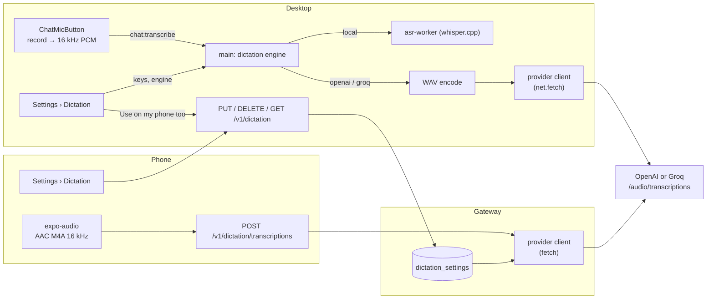

# Dictation through a speech-to-text API — design

Date: 2026-10-18 · Status: proposed

## Goal

Phone dictation uses the phone's recognizer: Apple's SpeechTranscriber or
SFSpeechRecognizer on iOS, Google's on Android. Both get mixed Portuguese and
English technical speech wrong. The desktop's local Whisper is accurate, but it
cannot serve phones from a bot server: on CPU in a container the same model
takes 10–40 s per dictation (see [Spike evidence](#spike-evidence)).

Add a second dictation engine on the desktop and the phone: a speech-to-text API
(OpenAI or Groq) called with the person's own key. The desktop calls the API
directly. The phone records the audio and sends it to its bot server, whose
gateway calls the API with a key stored on the server. Today's engines stay
unchanged and remain the default, because they are free.

## Decisions

| Question | Decision |
| --- | --- |
| Engines | Desktop: **This computer** (local Whisper, today's) or an API. Phone: **This phone** (today's recognizer) or **Server**. |
| Providers | OpenAI with `gpt-4o-transcribe` and Groq with `whisper-large-v3-turbo`, both through the OpenAI-compatible `POST {base}/audio/transcriptions` (multipart `file`, `model`, optional `language`, `response_format=json`). Base URLs `https://api.openai.com/v1` and `https://api.groq.com/openai/v1`. No other providers, models, or base URLs in this version. |
| Desktop setting | `chat.dictation.engine`: `local` (default), `openai`, or `groq`. |
| Desktop keys | Secure store under `chat.dictation.apiKey.openai` and `chat.dictation.apiKey.groq`; the `apiKey` name keeps them out of data exports. Without a keyring (Linux), a key is kept in memory for the process, as chat API keys are. Keys never reach the renderer, which learns only whether each is set. Keys are separate from chat provider accounts, so a dictation key never adds models to the chat. |
| Server key | The gateway stores one provider and key in its database, in plaintext like its other secrets. No route returns it: reads return the provider and the key's last four characters. |
| Setting the key once | Desktop **Settings → Maestrly Chat → Dictation** shows the server's dictation state and offers **Use on my phone too**, which sends this computer's provider and key to the gateway, and **Remove from server**. The phone can also set, replace, or remove the server key, for a person who pairs only a phone. |
| Key check | Saving a key, on the desktop or the server, calls `GET {base}/models` with it. 401 or 403 rejects it; any other failure refuses the save with "Couldn't check the key", so a key is never stored unchecked. |
| Phone engine choice | Stored on the phone per paired server. Default: **Server** when the server reports a key, otherwise **This phone**. When the server lacks the feature or a key, **Server** is unavailable and says why. |
| Phone recording | `expo-audio`: AAC in M4A, mono, 16 kHz, 32 kbit/s (about 240 KB per minute). Its metering drives the listening indicator. No live text: after stopping, the composer shows **Transcribing…** until the text arrives. |
| Phone upload | New public gateway route `POST /v1/dictation/transcriptions`: JSON `{ audio (base64), mediaType: 'audio/mp4', language }`, where `language` is a two-letter code or null. Body limit 8 MiB. The response is `{ text }` or `{ error }` with a dictation error code, always HTTP 200. HTTP errors stay for transport problems (authentication, body too large), so the gateway's closed error-code list does not change. Only paired-device tokens may call it, never host or bot tokens. |
| Desktop upload | The renderer keeps decoding to 16 kHz mono PCM and sends it through the existing `chat:transcribe`. For an API engine, main encodes 16-bit WAV (32 KB/s) and calls the API. One IPC path for both engines, and today's silence check in main keeps working. |
| Length | 10 minutes per dictation with an API engine: recording stops at the limit, on the desktop and the phone. WAV for 10 minutes is 19.2 MB, under both providers' 25 MB file limit. The local engine keeps its current behavior. |
| Silence | A recording whose level never rises above a threshold is not sent and shows today's "Didn't hear anything". Desktop: the existing RMS check in main. Phone: the peak of the metering samples. Silero VAD stays with the local engine only. |
| Language | Desktop: today's choice; `pt` or `en` from the app language, omitted with **Detect automatically**. Phone: the two-letter language subtag of the first tag from `dictationLanguages` (`pt` for `pt-BR`); a tag without one is omitted, so the provider detects the language. |
| Context prompt | None in this version. The provider client takes an optional `prompt`, so adding conversation vocabulary later stays local to the callers. The real-voice comparison decides whether it is worth it. |
| Failures | Mapped to `key-rejected` (401, 403), `quota` (429), `too-long` (413 or over the limit), and `unavailable` (network, 5xx, 60 s timeout). The recording is kept until the next one starts, so **Try again** resends it without speaking again. |
| Concurrency | The gateway runs at most four transcriptions at once and answers `busy` beyond that. |
| Audit | The gateway logs who set or removed the server key: device name and provider, never the key. It adds no activity entry, because `fleetActivityKindSchema` is a closed enum and older clients would reject a new kind. |
| Feature detection | The gateway announces `dictation` in `/v1/meta`. `GET /v1/dictation` returns `{ configured, provider, keyHint }`. Older gateways lack the feature, so phones and desktops hide the server options. |
| Privacy | An API engine sends the audio to the provider under the person's key and that provider's terms. Settings say so next to the choice. `PRIVACY.md`, `docs/mobile.md` and `docs/chat-context.md` change their "audio never leaves" statements to depend on the engine. |

## Spike evidence

Measured on 2026-10-18 in an OrbStack Linux arm64 VM on Apple silicon (8 cores,
heavily contended by other containers, so CPU time is reported) with
`@fugood/node-whisper-linux-arm64@1.1.3` and the desktop's pinned model:

| Engine, about 6 s of speech | CPU time per dictation | Estimated wait with 8 / 4 / 2 free cores | Peak memory |
| --- | --- | --- | --- |
| Whisper large-v3-turbo q5, 30 s window (desktop settings) | 60–105 s | ~10 / ~20 / ~40 s | ~1.0 GB |
| Same, `audio_ctx` sized to the audio (needs an upstream build) | 22–29 s | ~4 / ~7 / ~13 s | ~1.0 GB |
| Parakeet TDT 0.6B v3 q8_0 | 1.3–1.5 s | ~1 s | 0.7–1.1 GB |

Parakeet is fast but worse on technical terms in Portuguese ("timealt" for
"timeout", "Merd na MEN" for "merge na main"), so it would not improve on
Apple's recognizer. The local options on a server are therefore either slow or
no better, while hosted models run on data-center GPUs: Groq serves the same
Whisper model the desktop uses, and OpenAI's `gpt-4o-transcribe` is reported to
be more accurate than Whisper. Published prices (2026-10): Groq US$0.04 per
audio hour (10 s minimum per request), OpenAI US$0.006 per minute.

## Out of scope

- A context prompt built from the conversation.
- Live text while speaking with an API engine.
- Other providers (Deepgram, Mistral, ElevenLabs), model choice, and custom base
  URLs.
- Usage or cost tracking in Maestrly.
- Local Whisper or Parakeet on the bot server.
- Routing phone audio through a desktop that is online.
- Per-environment dictation keys.
- Removing the phone recognizers or `modules/maestrly-speech`.

## Architecture

### Units

**Shared: `packages/bot-fleet-protocol/src/dictation.ts`**

- The provider table: id, label, base URL, model, and file limit.
- Zod schemas for the four gateway routes, added to `FLEET_GATEWAY_ROUTES`, and
  `FLEET_DICTATION_FEATURE`.
- `transcribeWithProvider({ provider, key, file, fileName, language, prompt,
  signal, fetch })` returns `{ text }` or throws a `DictationError` with one of
  the mapped codes. `checkDictationKey({ provider, key, signal, fetch })`.
- Uses only web-standard `fetch`, `FormData` and `Blob`, injected or global, so
  it runs in Electron main and in the gateway's Node 24.

**Desktop main**

- `main/dictation/settings.ts`: engine setting, keys in the secure store, and the
  renderer-safe status `{ engine, keys: { openai, groq }, storage }`.
- `main/dictation/api-engine.ts`: WAV encoding (pure helper next to
  `floatToPcm16` in `asr-audio.ts`), the 10-minute check, and the call through
  `transcribeWithProvider` with `net.fetch`.
- `chat:transcribe` picks the engine. With an API engine it skips the model check
  and returns `{ error: 'key-missing' | 'key-rejected' | 'quota' | 'too-long' |
  'unavailable' | 'silent' }` or `{ text }`. `chat:asr-support` reports
  supported for API engines on every platform, so Intel Macs, macOS before 15,
  and Linux arm64 gain dictation.
- Server calls through the fleet client: read the server state, send this
  computer's key, remove it.
- IPC: `chat:dictation-config`, `chat:set-dictation-engine`,
  `chat:set-dictation-key`, `chat:dictation-server-use-local`, and
  `chat:dictation-server-remove`. Main validates every input.

**Desktop renderer**

- `renderer/components/chat/DictationSettings.tsx` in Maestrly Chat settings,
  next to web search:
  - the engine choice (This computer, OpenAI, Groq) with a line on cost and on
    where the audio goes;
  - password fields with Save and Remove for each key;
  - with a bot server that supports it, the server's state ("OpenAI, key
    …a1b2" or "No key") and its two actions.
- `ChatMicButton`:
  - with an API engine, no model card. A missing key opens a card that links to
    the settings.
  - With the local engine and the model missing, the existing card also offers
    "Use an API key instead".
  - Errors show their mapped message, and a failed transcription offers **Try
    again** with the kept audio.
  - The menu names the engine in use.

**Gateway**

- Store: table `dictation_settings (id INTEGER PRIMARY KEY CHECK (id = 1),
  provider TEXT NOT NULL, api_key TEXT NOT NULL, updated_at TEXT NOT NULL,
  updated_by TEXT NOT NULL)`, schema 20 with an in-place migration from 19.
- Routes, device tokens only:
  - `GET /v1/dictation`;
  - `PUT /v1/dictation` with `{ provider, key }`, which checks the key first;
  - `DELETE /v1/dictation`;
  - `POST /v1/dictation/transcriptions`.
- Transcription answers `{ error: 'not-configured' }` without a key and
  `{ error: 'busy' }` past the cap. It decodes the base64 audio, enforces the
  8 MiB body and the 25 MB file limit, and maps provider failures to the same
  codes as the desktop. `PUT` answers `{ provider, keyHint }` or `{ error:
  'key-rejected' | 'unchecked' }`.
- Uses global `fetch`. The gateway already reaches the internet for push
  notifications, and the bot egress guard applies only to environments.

**Phone**

- `src/dictation/recorder.ts`: `expo-audio` recording with metering, the
  10-minute limit, and the M4A file read as base64.
- `src/dictation/server-engine.ts`: uploads through the gateway client and maps
  the errors.
- The session gains a recorded-engine path: `listening` (with a level, no text),
  then `transcribing`, then `idle` with the text or an issue. **Try again** after
  a failure resends the kept file. Cancel during `transcribing` drops the result.
- `useDictation` picks the engine from the active server's preference and
  status.
- **Settings → Dictation**:
  - the engine (This phone or Server) and the server's state;
  - a form for the provider and key with Save and Remove;
  - the privacy and cost line.
- Strings in `en` and `pt-BR`.
- `expo-audio` is added as a dependency. The microphone permission text already
  exists. A new app build is needed.

**Docs**

- `docs/chat-context.md` (dictation engines and settings).
- `docs/mobile.md` (Server dictation, privacy).
- `docs/bot-fleet.md` and `apps/bot-gateway/README.md` (the routes, the schema 20
  migration, and the key in the gateway data).
- `PRIVACY.md`.

## Error handling

| Condition | Desktop | Phone |
| --- | --- | --- |
| No key for the chosen engine | Card linking to Settings › Dictation | **Server** unavailable, with the reason |
| Key rejected (401/403) | "The OpenAI key was refused. Check it in Settings." with **Try again** after fixing | Same text, pointing to the phone's Settings |
| Quota or rate limit (429) | "The provider's limit was reached." | Same |
| Too long | Recording stops at 10 min; the text arrives normally | Same |
| Network, 5xx, timeout | "Couldn't transcribe. Try again." The audio is kept | Same |
| Gateway at its four-transcription cap (`busy`) | — | "The server is busy. Try again." The audio is kept |
| Silent recording | "Didn't hear anything" (today's) | Same |
| Server too old | Server section hidden | **Server** hidden |

## Testing

- Provider client:
  - the request shape per provider (URL, `Authorization`, multipart fields);
  - `language` omitted for automatic detection;
  - error mapping for 401, 403, 413, 429, 500, network failure, timeout, and
    abort.
  - Uses an injected fake `fetch`.
- WAV encoder: header fields and data length.
- Desktop:
  - engine routing in `chat:transcribe`;
  - keys stored only through the secure store, under names that data export
    excludes, with a test like web search's;
  - status that never contains a key;
  - server actions calling the right routes.
- Gateway:
  - migration from 19 to 20;
  - device-only access, with host and bot tokens refused;
  - the key never in a response, and the key hint;
  - proxying to a fake provider;
  - the body limit;
  - `not-configured`;
  - the concurrency cap.
- Phone:
  - engine choice per server (feature absent, no key, key);
  - session transitions of the recorded path (stop, transcribe, retry, cancel
    while transcribing);
  - the silence gate.
- Desktop E2E: `composer-dictation.spec.ts` already replaces the `chat:transcribe`
  handler. New cases make it answer `key-missing` and `unavailable`, then check
  the key card, the error, and **Try again** resending the same audio.
- No standard test calls a real provider. An opt-in script checks the two real
  providers with `MAESTRLY_LIVE_DICTATION=1` and keys from the environment.
- Acceptance, outside the repository: 10–15 dictations in the owner's real voice
  compared across Apple's recognizer, OpenAI and Groq, with and without a context
  prompt, to confirm the gain and decide the prompt.
- Verification: `npm run verify:pr -- --full`, and `--package` because the phone
  gains a native module.
