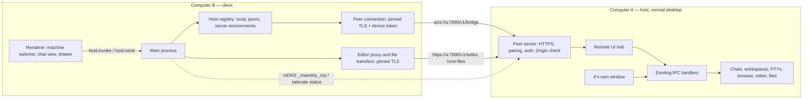

# Connect computers (peer hosts) — design

Date: 2026-10-19. Branch: `feat/connect-computers`.

## Goal

The owner has several computers (for example two laptops). Each one keeps its own chats and workspaces, and any of
them can show and use the chats and workspaces of the others, in the same window and machine switcher that remote
workspaces already use:

- on the same network, the computers find each other and connect directly;
- away from home, they connect over [Tailscale](https://tailscale.com) (or any network where one reaches the other);
- no bot server is involved.

A computer that connects to another gets **full access** to it, as if its owner sat at it: chats, workspaces,
terminals, Notes, Plan, Review, Files, Code, the agent's **Browser**, and the profile's settings.

## Decisions

| Topic | Decision |
| --- | --- |
| What a peer is | A **peer host**: another computer's Maestrly desktop, in its normal mode, reached through the same bridge, host API, and machine switcher as a workspaces host ([remote hosts design](2026-09-29-remote-hosts-design.md)). Every computer can be a host and a client at once. |
| Transport | **Direct**: this computer dials the peer's **peer server** over HTTPS and a WebSocket. Same network or Tailscale; no relay through the bot server. |
| Encryption and identity | Each profile has a **peer identity**: a device id, a P-256 key, and a self-signed certificate. A client pins the peer's certificate fingerprint at pairing and refuses any other certificate. |
| Pairing | Once per pair of computers. On B, choose A (found on the network, on Tailscale, or typed) and **Connect**. A shows a 6-digit code, which the owner types on B. A **PAKE** (SPAKE2, RFC 9382, P-256) keyed by the code and bound to both certificate fingerprints authenticates both sides and resists a man in the middle on the network. One pairing covers both directions. |
| Authentication after pairing | A per-device bearer token over the pinned TLS connection. A stores only its SHA-256 hash, as the gateway does for devices. |
| Who may connect | Off by default. **Let my other computers use this computer**, in Settings → Computers, turns the peer server on. Only paired computers that have not been removed can connect. |
| Access | Full: the bridge gives a peer the whole host API, as the local renderer has. `desktopEffects` is false, as for a workspaces host: a peer cannot open Finder, a terminal app, or VS Code desktop on the host's screen. |
| Visibility on the host | While a peer is connected, the host shows who is using it, with **Disconnect**. |
| Scope of version 1 | Chats, workspaces, Terminal, Notes, Plan, Review, Files, Code, the **Browser** tab, profile settings. No **Computer** tab. |
| Versions | Both computers run the same app version; the bridge already refuses a mismatch. |

## Non-goals

- A relay through the bot server, or reaching a peer that neither network path reaches (Wi-Fi with client isolation
  needs Tailscale).
- Waking a peer that sleeps or is off (Wake-on-LAN).
- Transitive hosts: a peer shows its own profile only, not its peers or the workspaces environments of its bot server.
- Phones connecting to a peer directly. The [mobile app](../../mobile.md) keeps using the bot server.
- Signing in to the host's model subscriptions from a peer. API keys can be set from a peer; subscription sign-ins
  happen on the host itself.
- Moving a conversation between peers. The move flow of remote hosts may later work with peer hosts, but it is not
  part of this design.
- The **Computer** tab, and alert sounds for conversations of a peer (not available for any remote host yet).

## Terms

- **Peer**: another computer of the owner, paired with this one.
- **Peer host**: a peer that lets this computer use it. Its `HostId` is `peer/<deviceId>`, which fits the existing
  host-id pattern and never collides with `<serverId>/<environmentId>` (server ids are UUIDs).
- **Peer server**: the HTTPS server a computer runs while **Let my other computers use this computer** is on.
- **Peer identity**: `{ deviceId, name, key, certificate }` of this profile; the fingerprint is the SHA-256 of the
  certificate's DER encoding.

## Architecture

### 1. Peer identity and store

- Created the first time the owner turns hosting on or connects to a computer. The device id is a UUID v4, and the
  name defaults to the bot-server device name or the OS host name. The certificate is self-signed, has the device id
  as its common name, and is valid for ten years.
- The private key, the tokens this computer uses to reach its peers, and the hashes of the tokens it issued are kept
  with `secure-store` (OS keyring). Without a keyring, hosting and pairing are unavailable and Settings says why; no
  secret is stored in plain text.
- Each peer record holds `{ deviceId, name, os, fingerprint, port, addresses, tint, pairedAt, lastSeenAt, token,
  issuedTokenHash }`. `addresses` lists where it was last reached, newest first, at most 8.
- Removing a peer deletes its record on this side and asks the peer to forget this computer too
  (`DELETE /v1/peer/self`, best effort).

### 2. Peer server (host side)

`main/peer/server.ts`: an `https` server with the peer identity's certificate, on `0.0.0.0:<port>` (default `7690`,
or the next free port, recorded and advertised), started while hosting is on and stopped when it is turned off.

| Route | Auth | Purpose |
| --- | --- | --- |
| `GET /v1/peer/hello` | none | `{ deviceId, name, os, appVersion, fingerprint, hosting, pairing }`, for discovery and probing. |
| `POST /v1/peer/pairings` | none | Ask to pair (section 3). |
| `POST /v1/peer/pairings/:id/exchange` | none | SPAKE2 exchange and key confirmation. |
| `POST /v1/peer/pairings/:id/confirm` | none | The client's confirmation; tokens are exchanged under the pairing key. |
| `DELETE /v1/peer/self` | token | The caller removed this computer. |
| `GET /v1/bridge` (upgrade) | token | The remote UI hub. |
| `/v1/editor/…` | token | The host editor (`remote-host/server/host-editor.ts`). |
| host-files routes | token | `remote-host/server/host-files.ts`. |

- Requests that carry an `Origin` header are refused, as the instance control server does, so web pages on the
  network cannot drive it. Request bodies are limited, and the pairing routes are rate-limited per remote address.
- The host-files and editor dispatch of `fleet/instance/server.ts` moves into a shared module both servers use, so
  the routes and their limits stay the same.
- The hub tags each session with the peer's device id. Removing or disconnecting a peer closes its sessions, its
  editor connections, and its transfers.

**The hub on a desktop.** `RemoteUiHub` runs next to A's own window:

- `hostInfo`: the real OS, `desktopEffects: false`, `editor: true` when A can run serve-web, `browser` as in
  section 6, `computer: false`, `folderTransfers: true`, `roots` from `hostFsRoots()` (the home folder).
- `applyLocale` does nothing: A keeps its own language.
- The checks that today read `isServerMode() && isRemoteUiTarget(sender)` (browser stream viewer, host editor
  viewer) become `isRemoteUiTarget(sender)`. On a computer without peers the remote target registry is empty, so
  local behavior does not change. Artifacts keep the desktop's own sources; `artifact_open` from A's agents opens on
  A, which has a screen.
- While a peer is connected, the power manager holds `prevent-app-suspension`, as it does during turns. A laptop
  whose lid is closed still sleeps; its peers then show it as **Offline**.

### 3. Pairing protocol

B already knows A's address and has its `hello` (with the fingerprint `fpA` seen in that TLS session).

1. B → A `POST /v1/peer/pairings` `{ deviceId, name, os, appVersion, fingerprint: fpB }`. A refuses while hosting is
   off, while another pairing is pending, during a cooldown, or on a version mismatch. Otherwise it makes a 6-digit
   code (valid 2 minutes) and shows **"<B> wants to connect to this computer. Type this code on <B>: 482 913"** with
   **Cancel**, plus a system notification when its window is hidden or not focused. It answers `{ pairingId }`.
2. The owner types the code on B. B computes SPAKE2 message `X` with the code as the password, and sends
   `exchange { X }`. A computes `Y` and the shared key `K`, and answers `{ Y, confirmA }`, where
   `confirmA = HMAC(K, "maestrly-peer A" ‖ transcript)` and the transcript holds both device ids, `fpA`, `fpB`, `X`,
   and `Y`, each as the TLS session saw it.
3. B checks `confirmA`. A wrong code or a man in the middle fails here, and B says the code did not match. Otherwise B
   sends `confirm { confirmB, sealed }`, where `sealed` is AES-256-GCM under a key derived from `K` (HKDF) holding the
   token A will use to reach B and B's port and addresses. A checks `confirmB`, stores B with the pinned `fpB`, and
   answers with its own sealed token for B. B stores A with the pinned `fpA`.

- Each code allows **one** exchange. A failed exchange ends the pairing on both sides, and A's dialog says the code did
  not match on B. After three failed pairings in 10 minutes, A refuses new requests for 10 minutes.
- A man in the middle must run SPAKE2 with each side without the code: one online guess per pairing, a chance of 1 in
  a million. Binding the fingerprints into the transcript stops it from relaying the confirmations.
- SPAKE2 uses `@noble/curves` (P-256, with the RFC's M and N points) and is checked against the RFC 9382 test vectors.
- Pairing again with a known device id replaces its record (a reinstalled computer has a new key and must pair again).

### 4. Discovery and addresses

- **Same network**: while hosting is on, A advertises `_maestrly._tcp.local` (named after the device), with TXT
  `id=<deviceId>`, `v=<appVersion>`, and `fp=<first 16 hex digits of the fingerprint>`. B browses while the
  **Connect a computer** dialog is open, and briefly (3 s) when a paired peer cannot be reached at its known
  addresses.
- **Tailscale**: when the `tailscale` CLI is found (on `PATH`, in `Tailscale.app` on macOS, or in Program Files on
  Windows), the dialog runs `tailscale status --json` and probes `GET /v1/peer/hello` on each online peer's MagicDNS
  name, with a 1.5 s timeout. Peers that answer are listed under **Tailscale**. Probing ignores the certificate;
  pairing and every later connection pin it.
- **Typed address**: `host[:port]` (a LAN IP, `name.local`, a MagicDNS name, or a Tailscale IP).
- **Reaching a paired peer**: B tries its addresses in order: the last that worked, the mDNS answer, then the
  Tailscale name and IP. It starts the next one every 300 ms while earlier ones are pending, and keeps the first that
  completes TLS with the pinned fingerprint. Addresses are found again after a sleep or a network change, and on each
  reconnection.
- The first time hosting starts, macOS and Windows may ask whether Maestrly may accept incoming connections; the
  documentation says to allow it.

### 5. Client side

- **Host registry** (`remote-host/client/host-registry.ts`): it lists, in this order, the local host, the peer hosts
  of the peer store, the workspaces environments of the paired bot server, and the development direct host. A peer
  host has `server: ''`, `environment: null`, its tint, and states `connecting`, `online`, `reconnecting`,
  `incompatible`, `offline` (unreachable or asleep), plus two new ones:
  - `not-hosting`: it answers but hosting is off. The UI says **<A> does not let other computers use it**.
  - `removed`: it answered 401. The UI says **<A> removed this computer**, with **Remove** to forget it here.
- **Peer connection**: a `HostConnection` whose `connect` picks an address (section 4) and opens the WebSocket with
  `ws`, pinned (`ca` = the peer's certificate, `checkServerIdentity` comparing the fingerprint) and the device token.
- **Files and editor**: `resolveHostFilesEndpoint` and the editor upstream (`remote-host/client/editor.ts`) gain a
  peer case next to the direct host. The upstream gets origin, headers, and a pinned agent: an undici `Agent` for the
  transfers' `fetch`, and an `https.Agent` for the editor proxy. The development direct host becomes one more entry
  of the same endpoint lookup.

### 6. Browser on a desktop host

The stream already works on a desktop host's display. `drawer/stream-window.ts` shows an unfocusable window that
ignores the mouse, at `opacity: 0` on macOS, where WindowServer still supplies frames, and frames reach the peer over
the bridge as JPEG (the video transport needs the environment display, so a peer always gets frames).

- **Windows**: the same transparent window (`opacity` is supported).
- **Linux desktop**: Electron has no window opacity there. A spike places the window outside every display's bounds
  (`enableLargerThanScreen`). When the window manager clamps it back onto a display, a Linux desktop host reports
  `browser: false`: the agent still uses its browser, and the peer's drawer has no **Browser** tab.
- **Takeover on the host**: when a peer starts streaming a conversation's browser, the host's own drawer, floating
  window, or pop-up for that browser closes, and the host's drawer shows **This browser is open on <B>** with
  **Show here**. **Show here** releases the stream; the peer then shows its existing **open on another device** state.
  `presentBrowserForStream` therefore reattaches a floating or pop-up browser before streaming, instead of throwing.
- macOS: the spike also checks that the transparent window takes no focus and does not show in Mission Control,
  Stage Manager, or the Dock.

### 7. UI

- **Settings → Computers** (a local section, with no host selector):
  - **Let my other computers use this computer** (off by default), **This computer's name**, and under **Advanced**,
    the port;
  - the paired computers: name, OS, color, **Connected now** or last seen, **Disconnect** (while connected), and
    **Remove**;
  - **Connect a computer…**: a dialog listing computers on this network and on Tailscale, a field for an address,
    **Connect**, then **Type the code shown on <A>**, then **Paired**.
- **On the host**: the pairing dialog of section 3. While peers are connected, a chip at the bottom of the sidebar says
  **In use by <B>**; it opens a popover with each connected computer, **Disconnect**, and a link to the settings.
- **Machine switcher**: peer hosts are listed after **This computer**, with their name, OS icon, color, and state.
  Opening a peer conversation works as for a workspaces host. The **Settings of** selector lists peers too.

## Security

- Turning hosting on is the owner's explicit choice, and only computers they paired by typing a code shown on this
  one can connect. A paired computer can do everything the owner can do on this one: read and change any file of the
  home folder, run commands, and use the profile's accounts, keys, and Git and SSH credentials. Settings and the
  documentation say so in those words.
- TLS with a pinned certificate protects the bridge, files, and editor on untrusted networks. The token only travels
  inside that connection. A copied token without a network path to the host is useless, and a stolen key alone is not
  enough to connect without a token.
- Removing a computer on either side stops it at once: its sessions close, and its token stops working.
- Requests with an `Origin` header are refused, and pairing is rate-limited with a cooldown. Unauthenticated routes
  reveal only what mDNS already advertises.
- `docs/security-model.md` gains a "Connected computers" section, and `docs/local-data.md` describes the peer
  identity and records.

## Failure handling

| Situation | Behavior |
| --- | --- |
| Host asleep, off, or out of reach | **Offline**; reconnect with backoff, and again after this computer wakes or changes networks. Open conversations show the reconnecting overlay. |
| Host turned hosting off | `not-hosting`; the sessions it had close. |
| This computer was removed by the host | `removed`, with **Remove**. |
| Different app versions | `incompatible`, **Update required**: update the older computer. |
| Wrong code or interference while pairing | The pairing ends on both sides; try again with a new code. |
| Certificate does not match the pin | The connection is refused and the peer shows **Offline**, with a detail that its identity changed and it must be paired again. |
| Host's keyring unavailable | Hosting and pairing are unavailable, with the reason. |

## Testing

- **Unit**: SPAKE2 against the RFC 9382 vectors; the pairing state machine (expiry, single exchange, cooldown, wrong
  code, fingerprint binding); sealed token exchange; the peer store with `secure-store`; peer server auth (missing,
  bad, removed token; `Origin` header); pinned clients refusing another certificate; address racing; a registry that
  merges local, peers, environments, and the direct host; hub sessions closed per device; viewer checks accepting
  remote targets in desktop mode; `applyLocale` doing nothing on a desktop host.
- **Integration**: peer server, hub, and `HostConnection` over real TLS on loopback.
- **Unchanged local behavior**: the existing desktop unit and Electron suites, including `remote-hosts*.spec.ts`,
  run unchanged with hosting off.
- **Electron end-to-end** (`apps/desktop/test/e2e/connect-computers.spec.ts`): two instances in **normal** mode on
  loopback, paired with a typed address, where Playwright reads the code from A's dialog and types it on B. Then: the
  machine switcher on B, a chat turn on A from B with a deterministic model, a terminal, Files upload and download,
  Code with the serve-web stand-in, Browser frames and A's **open on <B>** state, the **In use by** chip on A, and
  removal on A cutting B off. mDNS and Tailscale stay in unit tests with injected transports.

## Phases (for the plan)

1. Peer identity, store, SPAKE2, and the pairing state machine, with no UI.
2. Peer server and the hub on a desktop: the hosting setting, shared host-files and editor routes, sessions per
   device, viewer checks, and the power hold.
3. Client: peer hosts in the registry, pinned connections, and the files and editor endpoints.
4. UI: Settings → Computers, the connect and pairing dialogs, the **In use by** chip, and machine switcher states.
5. Discovery: mDNS and Tailscale.
6. Browser on a desktop host: takeover on the host, plus the spikes for Linux and macOS.
7. Documentation (`docs/connect-computers.md`, security model, local data) and end-to-end tests.

## Risks

- **Two UIs on one profile.** The hub was built for a host nobody looks at. Here A's window and a peer act on the
  same profile at once. Handlers that change A's own window as a side effect (focusing a drawer, opening a pop-up) are
  audited in phase 2. Ones a peer triggers must not take over A's screen beyond showing what happens.
- **Browser presentation** on Linux desktops and the macOS transparent window (section 6).
- **New dependencies**: `@noble/curves` (SPAKE2), `bonjour-service` (mDNS advertising and browsing), and
  `node-forge` (the self-signed certificate; already in the lockfile, becomes a direct dependency). They need
  `THIRD_PARTY_NOTICES.md` and a `--package` run.
- **Networks that block LAN peers** (client isolation, corporate Wi-Fi): Tailscale is the documented answer.
