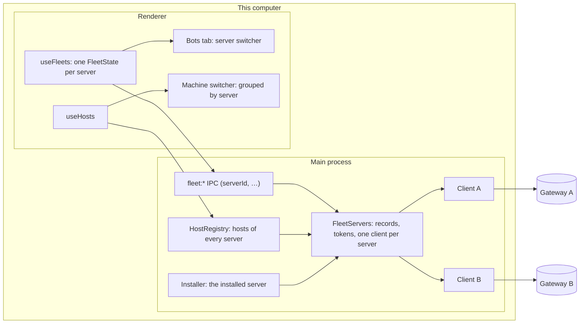

# Several bot servers — design

Date: 2026-10-19. Branch: `feat/many-servers`.

## Goal

The owner pairs this computer with several bot servers at once: the one this app installed (on this computer or on a
VPS), and servers that already run elsewhere (another VPS, another computer). Every paired server stays connected at
the same time:

- the sidebar's machine switcher (Chats and Workspaces tabs) lists the workspaces hosts of **every** server together;
- the Bots tab shows **one** server at a time, chosen in a server switcher at its top, in the same place and style as
  the machine switcher.

This is phase 4 of the [remote hosts design](2026-09-29-remote-hosts-design.md#phases), which already gives every host
an id that names its server (`<serverId>/<environmentId>`).

## Decisions

| Topic | Decision |
| --- | --- |
| Server identity on this computer | A **`serverId`**: a UUID this computer assigns when it pairs a server. The server paired before this change keeps its `fleet.serverId`, so the ids of its hosts, and everything stored under them (sidebar selection, drafts, layouts), do not change. |
| Connections | One fleet client per paired server, all connected at once: events, snapshot, workspaces bridges, the desktop bridge, screens and downloads are per server. |
| Machine switcher | **Merged**: this computer, then the workspaces hosts of every server, grouped under each server's name when they come from more than one server. |
| Bots tab | **One server at a time**: a server switcher at the top of the tab, shown when more than one server is paired. The server page, inbox, owner memory, bots and their windows belong to the server chosen. |
| Installer | **One installation**, as today: on this computer, or on a VPS over SSH. Any number of other servers are **paired** with an address and a code. The install record names the server it installed. |
| Adding a server | Settings → Bot servers → **Add server**: install (only while nothing is installed) or connect to a running server. An address that is already paired is refused. |
| Removing a server | Disconnecting one server stops its client, makes the server forget this device, removes its hosts from the switcher and deletes the media cached from it. The other servers are untouched. |
| Bot and environment ids | They stay the server's own slugs, unique only within one server. Whatever this computer keeps across servers keys them with the server too. |
| Access to this computer's projects | Grants stay per pairing (this computer's device on one server) and bot: a grant given to a bot of one server never reaches the bots of another. |
| Artifacts | One artifact source per server. The Artifacts center lists all of them; conversations of this computer publish to the server chosen in Settings → Artifacts (by default the installed server, else the first paired). |
| Gateway identity | `/v1/meta` gains an optional stable `serverId` per installation, so this computer refuses pairing one server twice under two addresses. Older gateways omit it. |
| Phones | Unchanged: the mobile app already pairs with several servers itself. |

## Non-goals

- Installing more than one server from this app.
- One list of the bots of every server in the Bots tab.
- Moving bots, owner memory or devices between servers; moving a conversation between hosts of two different servers.
- A name for a server chosen on this computer: a server is named by the host name it reports (its `displayName`
  setting, or the machine's name), with its address as secondary text.
- Changes to the mobile app.

## Terms

- **Server**: a bot gateway this computer is paired with.
- **`serverId`** (`FleetServerId` in code): this computer's id for one paired server. A UUID, valid as the first part
  of a `HostId`.
- **Installed server**: the server whose install record this app keeps.
- **Default server**: the installed server when it is paired, otherwise the first server paired. The Bots tab and
  artifacts start on it.
- **Bots server**: the server the Bots tab shows.
- **Fleet key**: `fleetKey(serverId, id)`, an id of a server's bot or environment made unique across servers:
  `<serverId>/<id>`.

## Architecture



### 1. Server records

- App setting `fleet.servers`: a JSON list of `{ id, url, deviceId, deviceName, pairedAt }` in pairing order, checked
  with zod when read; an invalid entry is dropped.
- The device token of each server is kept with `secure-store` under `fleet.deviceToken.<id>`. Without a keyring it is
  kept in memory for the session, as today, and the server asks to be paired again after a restart.
- **Migration**, once, when `fleet.servers` is absent and `fleet.url` is set: one record with `id = fleet.serverId`
  (or a new UUID when absent), the URL, the device id and the device name; the token moves from `fleet.deviceToken` to
  `fleet.deviceToken.<id>`; the old keys are cleared. A downgraded app then finds no pairing and asks to pair again.

### 2. One client per server

`FleetClientService` becomes one instance per server, created with its `serverId`, its record accessor, and the
media cache and media URLs every client shares. `FleetServers` (`main/fleet/client/servers.ts`) owns them:

- `start()` creates and starts one client per record.
- `list()` → `FleetServerView[]`: `{ id, installed, connection }`, where `connection` is today's
  `FleetConnectionView`.
- `get(id)` and `require(id)`; `require` throws `FLEET_SERVER_UNKNOWN`.
- `pair({ url, code, deviceName }, id?)`: without `id`, pairs a new server; an origin already paired is refused
  (`FLEET_SERVER_ALREADY_PAIRED`). With `id`, pairs that server again (after `unauthorized`, or a token lost without a
  keyring) and keeps its id, when the address is the same; another address pairs a new server and removes the old
  one, so a host id never names two servers.
- `retarget(id, url)`: same pairing, another address (the local end of the SSH tunnel to the installed VPS).
- `remove(id)`: the client disconnects (the server forgets this device, the desktop bridge ends the access this
  pairing gave, the media cached under this device is deleted), then the record and its token are removed.
- Every change is broadcast as `fleet:servers` with the list.

Every broadcast of a client names its server: `fleet:connection { serverId, connection }`,
`fleet:event { serverId, event }`, and `serverId` in `fleet:download`, `fleet:mediaProgress` and
`fleet:desktop-access`.

What must not leak between servers:

- **Desktop bridge**: one per client. Reconnecting revokes only the connections of device ids that no paired server
  uses any more; today it revokes every one but its own, which would end the grants given to the bots of the other
  servers.
- **Bot sign-ins**: disconnecting or reconnecting one server ends only its sign-ins. The Codex queue (callback port
  1455) stays shared.
- **Media**: the cache stays shared and keyed by device id; disconnecting deletes only that device's entries. Media
  URLs name the server: `maestrly-media://fleet/<serverId>/<botId>/<fileId>/<capability>`.
- **Downloads, alerts, bot windows and image caches** key bots with `fleetKey(serverId, botId)`. A bot's chat window
  is `{ kind: 'bot', serverId, id }`, with the window key `bot:<serverId>/<botId>`.
- **Screens**: `fleet:screenOpen` names the server; sending, closing and the clipboard find their channel by its id
  among the channels of every client.

### 3. Fleet IPC

Every `fleet:*` channel that reaches a server takes the server first. `fleetIpcRegistrar(reg, resolve)` checks the id
and gives the handler that server's client:

```ts
reg.handle('fleet:getBot', (fleet, _event, botId: unknown) => fleet.call('botGet', { params: { id: id.parse(botId) } }))
```

- Unscoped channels: `fleet:servers`, `fleet:connect` (pairs, with an optional server to pair again),
  `fleet:provisioning:inventory` (this computer's accounts), `fleet:attendDownloads` (each file names its server),
  `fleet:revealDownload`, the screen channels other than `fleet:screenOpen`, `fleet:installer:*` and
  `fleet:instance:*`.
- `fleet:disconnect(serverId)` removes that server.
- The preload keeps today's method names with the server first. `FleetServerId` is a branded string, so a call that
  forgets it does not compile.
- `fleet:` is already local-only for remote windows (`shared/host-channels.ts`).

### 4. Workspaces hosts of every server

- `HostRegistry` follows every paired server: the workspaces environments of each become hosts
  `<serverId>/<environmentId>`, dialed with a bridge ticket from their own server, and leave when it is removed.
- `HostView` gains `serverId` (null for this computer and the development host) beside `server`, the server's name.
- Host files and the host editor find the gateway from the host id's server (`parseRemoteHostId`).
- The machine switcher keeps one flat list for one server; with hosts of two or more servers, it shows each server's
  name above its hosts, and the selected host's server beside its name. Selecting a host works as today
  (`sidebar.host`).
- **Manage** and **Start** on a host act on the host's own server: Manage switches the Bots tab to it before opening
  the environment.

### 5. Bots tab

- `useFleets()` keeps one `FleetState` per paired server in one reducer: the events of every server apply, and
  transcripts load only when shown. `controller(serverId)` returns today's `FleetController` plus its `serverId`, so
  the existing views stay as they are; a missing server gives an unconfigured controller.
- The Bots server is stored in `localStorage['fleet.server']` and falls back to the default server.
- The **server switcher** sits where the machine switcher sits on the other tabs: each item shows the server's name,
  its address, a status dot, and its pending inbox items; the last item, **Add server…**, opens Settings → Bot
  servers. Switching closes the open bot or environment view.
- A bot window keeps the server of its bot: the views kept mounted for open and detached bots are keyed by
  `fleetKey(serverId, botId)`, each with its own server's controller.
- The Bots tab's badge counts the pending inbox items of every server.

### 6. Settings → Bot servers

- The section is named **Bot servers**. At its top, a server selector (with two or more servers) and **Add server**.
- Below, the panel of the selected server: status, devices, **Pair a phone**, dictation key, **Disconnect**. Installer
  controls (update, private network, tunnels, **Remove**) show on the installed server only.
- **Add server**: while nothing is installed, today's choice (this computer, a VPS, a running server); otherwise only
  the form for a running server (address, code, device name).
- A server in `unauthorized` or without a token shows the pairing form for that server, which pairs it again.
- The server's dictation key (Settings → Chat → API keys) shows one row per paired server.

### 7. Installer

- The install record gains `serverId`. A record without one, from an earlier version, takes the paired server whose
  address is the install's origin.
- Installing pairs through `FleetServers.pair` (a new server, or the record's server again); a tunnel that moved
  retargets the record's server; disconnecting and removing remove the record's server. Installing is offered only
  while there is no record.
- What the installer reads (gateway version, environments to update, artifacts setup) comes from the installed
  server's client. Other servers report `behind` or `current` from their own version, as servers this app did not
  install do today.

### 8. Artifacts

- One `ServerArtifacts` per paired server, each a source keyed by its `serverId`; only the installed server uses the
  installer's viewer port.
- The Artifacts center lists the artifacts of every server, each with its server's name; detail, sharing and tickets
  go to the artifact's own server (`serverId` with the artifact id in the renderer and IPC).
- Settings → Artifacts chooses where conversations of this computer publish, the default server by default.
  Conversations of a workspaces host keep publishing on their own server with the host's token.
- `artifacts:server-status` and the agent tool messages name the server they are about.

### 9. Gateway identity

- `/v1/meta` returns `serverId`: a UUID the gateway creates once and keeps in its `meta` table (`server_id`).
- `fleetMetaResponseSchema` gains `serverId: z.string().uuid().optional()`; older desktops strip it.
- The desktop stores it in the server's record (`gatewayId`) when pairing and on each reconnect, and refuses pairing a
  gateway id that is already paired under another address (`FLEET_SERVER_ALREADY_PAIRED`).

## Errors

- A call for a server that is no longer paired fails with `FLEET_SERVER_UNKNOWN`; the window says the server was
  disconnected.
- An unreachable server: its hosts show **Offline** and its Bots view shows its connection state; the other servers
  are unaffected.
- A revoked device (`unauthorized`): that server shows the pairing form, and pairing again keeps its id.

## Testing

- Unit:
  - Server records and the migration.
  - `FleetServers`: pairing, pairing again, refusals, retarget, removal.
  - IPC routing by server.
  - `HostRegistry` with two servers.
  - Host files and editor resolution by server.
  - Desktop bridge revocation with two pairings.
  - Sign-ins per server.
  - Media URLs with a server.
  - Chat window keys.
  - The installer's link to its server.
  - The renderer reducer per server.
  - Switcher grouping.
  - The Bots server switcher.
  - Artifact sources per server.
  - The gateway's `serverId`.
- E2E: pair two fake gateways, see the hosts of both grouped in the machine switcher, switch the Bots tab between
  them, open a bot of each in its own window, disconnect one and keep the other.

## Status

Plan 1 shipped in PR #278. Plans 2 and 3 are built, with these choices made along the way:

- The installation id each server announced is kept in `fleet.gatewayIds`, apart from `fleet.servers`, which 0.24
  reads with a strict schema: an unknown field there would drop the record after a downgrade.
- Pairing a server again at another address keeps its id when it announces the same installation id.
- Artifact lookups by id search every server, as artifact ids are unique; IPC carries a server only for a server's
  settings and status. `artifacts.publishServer` keeps the server chosen in **Publish to**.
- The machine switcher names each server above its hosts once hosts come from two or more servers.

## Plans

1. **Server registry and server-scoped fleet API**: identifiers, IPC with a server, records and migration, one client
   per server, hosts of every server, the installer's server, bot windows by server. With one server, nothing visible
   changes.
2. **Several servers in the UI**: Settings → Bot servers, the Bots server switcher, the grouped machine switcher,
   dictation per server, the inbox badge, documentation.
3. **Artifacts per server and gateway identity**.
