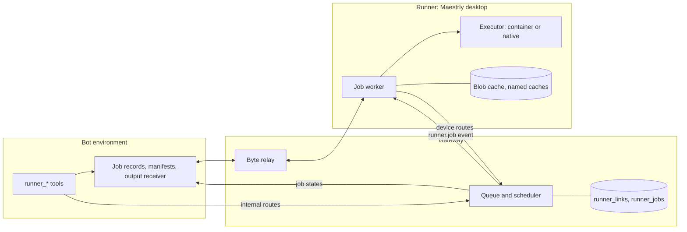
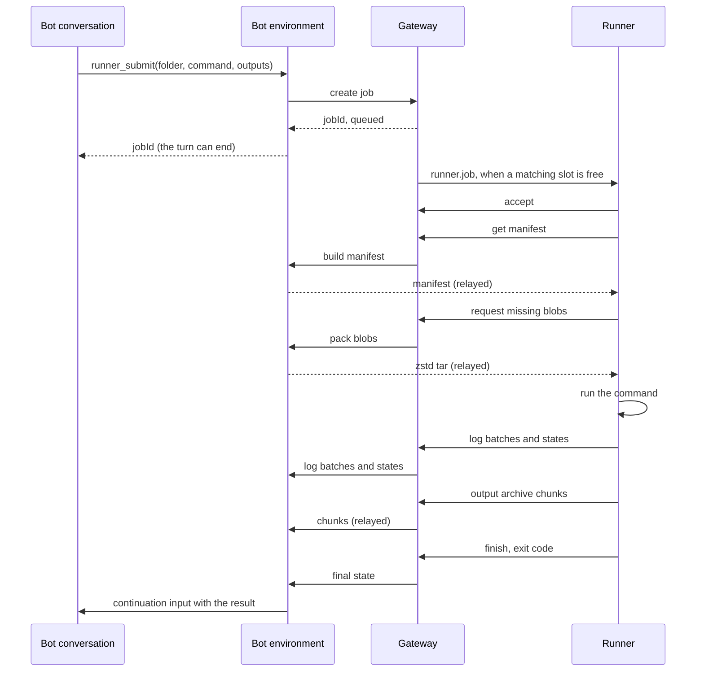

# Runners for heavy bot jobs — design

Date: 2026-10-29. Branch: `feat/improve-render`.

## Goal

Fleet bots render videos, run models, build and test projects, and process files in batches inside their environment
container. Every bot of an environment shares that container's CPU and memory with the Maestrly process and up to
eight Chromiums. Two video renders at once already take about 90% of the CPU and 22 GB of memory, and a job that runs
out of memory can end the processes of every bot in the environment.

A **runner** moves that work to another computer, for example a second Mac or a PC with a GPU. A bot submits a
**job**: a command, an input folder, and the outputs it wants back. The job runs on the runner, its outputs land back
in the bot's folder, and the conversation that submitted it continues with the result. No model runs on the runner.
Video rendering is one use; nothing in this design is specific to it.

## Decisions

| Topic | Decision |
| --- | --- |
| What a runner is | A paired computer whose Maestrly desktop has **Run jobs for bots** on, in Settings → Runner. The app keeps its normal mode and serves jobs while it runs and is connected to the bot server. |
| Executor | Chosen per runner. **Container**: each job runs in a Docker container on that computer, by default from the bot environment image of the app's version, with CPU and memory limits and, with the NVIDIA Container Toolkit on Linux or Windows, the GPU. **Native**: each job runs with `/bin/sh` in its own folder as the signed-in user, on macOS and Linux only, with the computer's GPU (Metal, VideoToolbox, CUDA) and installed tools. A Windows runner offers Container only. |
| Who submits jobs | Fleet bots only. Workspaces conversations and local conversations can become clients of the same broker later. |
| Access | Per bot, given on the runner itself in the bot's Settings → **Runners**. Only that computer can link itself, as with project access; any paired device can remove a link. |
| Broker | The gateway keeps the queue and each job's state in its database, assigns jobs to runners, and relays bytes without storing them. It keeps a job's command, image, and environment variables only until the job ends. |
| Transport | A runner receives jobs on the event stream it already holds, opened with `runners=1`, and calls device-token routes. A bot calls internal routes with its gateway token. Files stream through the gateway between the environment's control server and the runner. |
| Inputs | The bot names a folder. Its environment sends a manifest of paths, sizes, modes, and SHA-256 digests. The runner keeps a blob cache per bot and asks only for the blobs it lacks, which arrive as one zstd-compressed tar stream. |
| Outputs | Globs relative to the folder. After the command ends, the runner sends the matching files that differ from the inputs as a chunked, SHA-256-checked, resumable archive, which the environment writes back into the folder. |
| Caches | A job names caches, such as `node_modules` or model weights, at paths inside its folder. A runner keeps each bot's caches across jobs; they never travel. |
| Completion | The bot's environment adds a `continuation` input to the conversation that submitted the job, with its state, exit code, duration, outputs, and log tail. Bots do not poll. |
| Bot tools | `runner_list`, `runner_submit`, `runner_status`, `runner_logs`, `runner_cancel`. Submitting and cancelling follow the bot's approval ceiling. |
| Compatibility | Gateway feature `runners` in `moreFeatures`, environment capability `runner-jobs`, and a job protocol version the runner states when it connects. Until all three match, the bot has no runner tools and Settings says what is missing. Adds gateway schema 23. |

## Non-goals

- Clients other than fleet bots.
- Runners that are not a desktop app: a workspaces environment, a container the gateway creates, or a standalone
  `maestrly-runner` program for computers without a screen. The broker does not depend on what a runner is, so these
  can follow.
- Transfers that bypass the gateway, such as a direct connection on the local network.
- Splitting one job across several runners, or choosing among runners by load beyond the first free match.
- Interactive jobs: no stdin, terminal, or screen on the runner.
- CPU and memory limits for native jobs.
- Native jobs on Windows.
- Jobs in the mobile app.

## Terms

- **Runner**: a computer that runs jobs for bots. `runnerId` is an opaque `rnr_…` id the gateway mints per bot and
  computer, as `desktopId` is for project access.
- **Job**: one command run once on one runner. `jobId` is an opaque `job_…` id.
- **Executor**: how a runner runs a job, `container` or `native`.
- **Job folder**: the folder the bot names. Inputs come from it and outputs go back to it.
- **Blob**: a file's content, named by its SHA-256 digest.
- **Named cache**: a folder a runner keeps for one bot across jobs.
- **Slot**: room for one running job. A runner has 1 to 8.

## Architecture





### 1. Protocol (`packages/bot-fleet-protocol`)

- Constants: `FLEET_RUNNERS_FEATURE = 'runners'` (announced in `moreFeatures`, since `features` is full),
  `FLEET_RUNNER_JOBS_CAPABILITY = 'runner-jobs'`, the event-stream query flag `FLEET_RUNNERS_QUERY = 'runners'`, the
  job protocol version, and `FLEET_RUNNER_LIMITS`:

  | Limit | Value |
  | --- | --- |
  | Runners linked to one bot | 10 |
  | Queued and running jobs per bot | 20 |
  | Slots per runner | 1 to 8 |
  | Command | 64 KiB |
  | Environment variables | 64 entries, 32 KiB |
  | Output globs, caches, excludes | 64 each |
  | Input files | 200,000 |
  | Input bytes | 100 GiB |
  | Output bytes | 50 GiB |
  | Run timeout | default 60 min, at most 24 h |
  | Queue timeout | default 60 min, at most 24 h |
  | Accept timeout | 30 s |
  | Grace for a disconnected runner | 10 min |
  | Log tail in results | 200 lines, 16 KiB |

- Schemas: the job spec (`folder`, `command`, `outputs`, optional `runner`, `requires: {gpu?: boolean, executor?:
  'container' | 'native', os?: 'macos' | 'linux' | 'windows'}`, `image` (Container only), `env`,
  `caches: [{name, path}]` with paths relative to the folder, `exclude`, `timeoutMinutes`, `queueTimeoutMinutes`); runner
  capabilities (job protocol version, OS, architecture, logical CPUs, memory, executor, GPU `{vendor, name, memory}` or
  none, slots); job states `queued`, `assigned`, `running`, `finishing`, `succeeded`, `failed`, `cancelled`,
  `expired`, `lost`; error codes; gateway events `runner.job` and `runner.cancel` (to one runner), and `runner_link.updated` and
  `runner_job.updated` (to every stream with `runners=1`). Unknown
  events are already ignored by older apps.
- Route families, each added to the route tables and their pinning tests:
  - **Internal, bot token**: list the bot's runners; create, read, and cancel its jobs.
  - **Public, the runner's device token**: report runner state; accept a job; read its manifest; request blobs; send
    log batches; upload output chunks and commit them; finish the job.
  - **Public, any paired device**: list a bot's runners and jobs; remove a link. Creating a link
    (`PUT /v1/bots/:id/runner-link`) is accepted only from the computer being linked.
  - **Instance, gateway to environment with the control token**: build a manifest; pack blobs; receive log batches,
    output chunks, commits, and job states.

### 2. Gateway (`apps/bot-gateway`)

- **Schema 23** adds:

  ```sql
  runner_links(bot_id, device_id, runner_id UNIQUE, name, linked_at, updated_at, PRIMARY KEY (bot_id, device_id))
  runner_devices(device_id PRIMARY KEY, capabilities_json, updated_at)
  runner_jobs(id PRIMARY KEY, bot_id, requested_runner_id, runner_id, device_id,
              state CHECK (state IN ('queued', 'assigned', 'running', 'finishing', 'succeeded', 'failed',
                                     'cancelled', 'expired', 'lost')),
              spec_json, requires_json,
              created_at, queue_deadline, assigned_at, started_at, ended_at,
              exit_code, error_code, error_message, cancel_requested, seq, notified_seq)
  ```

  The environment names each job (`job_…`), so its record exists before any runner asks for the job's files; a repeated
  create with the same id returns the same job. `runner_id` and `device_id` stay empty until assignment.
  `runner_devices` keeps each runner's last reported capabilities, so a submit is checked while the runner is offline.
  `spec_json` is cleared when the job ends. `seq` counts the job's changes and `notified_seq` the last one its
  environment received. Ended jobs are deleted after 7 days.
- **Runner presence** is in memory: a computer runs jobs while a stream it opened with `runners=1` is open and its last
  state report says it accepts jobs, with that report's capabilities, slots, and held jobs.
- **Scheduler** (`runners.ts`) runs on a submit, a runner state report, a job's end, and every 15 s. Jobs go out in
  creation order. A job can go to any online runner linked to its bot (or only to the one it names) that meets its
  requirements and has a free slot; among several, the one with the most free slots, then the one linked first. The
  gateway sends `runner.job` and marks the job `assigned`; the runner's accept makes it `running`, which covers the
  input transfer and the command. Without an accept in 30 s, the job returns to `queued` and that runner is skipped for
  it for 5 minutes.
- **Submit** fails with `runner_not_linked` when the bot has no runner, `runner_unmatched` when no linked runner's
  last known capabilities meet the requirements, and `runner_busy` past the per-bot job limit. Otherwise the job is
  `queued`, and it becomes `expired` at its queue deadline.
- **Reconciliation.** When a runner's stream closes with jobs assigned, running, or finishing, those jobs wait for the
  grace period and then become `lost`. A reconnecting runner reports the jobs it holds: the gateway marks those it
  does not report `lost` and sends `runner.cancel` for reported jobs that already ended on the gateway.
- **Cancel** from the bot or the owner ends a queued job at once. For an assigned or running job it sends
  `runner.cancel`; the job becomes `cancelled` when the runner finishes it, or after the grace period.
- **Job states reach the environment** through its control server. While the environment is unavailable, the job's
  latest state stays unsent (`seq` above `notified_seq`) and is sent when the bot is ready again, as peer messages are.
- **Relay.** Manifest, blob, log, and output routes pipe bodies between the runner and the environment as host-files
  does: no buffering, a
  `Content-Length` cap per route, and SHA-256 checked by the endpoints. Each route checks that the caller is the job's
  runner and that the job's state allows the transfer.
- Removing a link, revoking the device, or deleting the bot cancels that bot's jobs on that runner.

### 3. Transfers

**Inputs**

1. The environment walks the job folder, skipping excludes and named-cache paths. Links that stay inside the folder
   travel as links; links that leave it are refused. A digest index per folder, keyed by path, size, modification time,
   and inode, avoids hashing unchanged files again.
2. The runner compares the manifest with the bot's blob cache and requests the missing blobs in batches of bounded
   size, so a failed stream resends little.
3. The environment streams them as a tar compressed with zstd level 1 (media barely compresses). The runner checks each
   blob's digest before adding it to the cache.
4. The runner builds the job folder from the cache with copy-on-write clones where the filesystem supports them (APFS,
   Btrfs, XFS) and plain copies elsewhere, so a job that changes a file never changes the cache.

The default excludes are `.git/`, `node_modules/`, `.venv/`, and `__pycache__/`; `exclude` replaces them.

**Outputs**

1. After the command ends, whatever its exit code, the runner matches the output globs, drops files whose digest equals
   an input's, and builds a tar of the rest plus the job log at `.maestrly/runner-jobs/<jobId>.log`.
2. It uploads the archive in 16 MiB chunks with a SHA-256 each, at explicit offsets. The environment reports the offset
   it has, so an interrupted upload resumes. The commit carries the whole archive's digest.
3. The environment extracts into a staging folder inside the job folder, refusing absolute paths, `..`, links that
   leave the folder, and special files, then renames each file into place. Files are replaced; nothing else in the
   folder is removed.
4. Outputs over the limit fail the job with `outputs_too_large`; the log still returns.

### 4. Bot environment (`apps/desktop/src/main/fleet/instance`, `apps/desktop/src/main/mcp/tools`)

- **Tools** live in `mcp/tools/bot-runners.ts` and are registered by `registerBotInstanceTools` when the gateway
  announces `runners` and the image has `runner-jobs`. `runner_list`, `runner_status`, and `runner_logs` are reads;
  `runner_submit` and `runner_cancel` are changes under the bot's ceiling (`chat/tool-policy.ts`).
  - `runner_list`: linked runners with name, online state, executor, OS, CPUs, memory, GPU, slots, busy slots, and
    queued jobs.
  - `runner_submit`: the job spec, with `folder` absolute or relative to the conversation's working folder. Returns the
    job id, state, queue position, and runner once assigned.
  - `runner_status`: one job, or the jobs of this conversation.
  - `runner_logs`: the tail of the environment's copy of the log.
  - `runner_cancel`: one job.
- **Job records** are written before the job is submitted, under the id the environment mints, and kept per bot under
  `fleet-instance/bots/<botId>/runner-jobs/`: the submitting conversation
  (primary, routine run, or thread), the folder, the output globs, the state, and the log as batches arrive. The gateway
  never learns the conversation.
- **Completion.** On a final state the runtime adds a `continuation` input to the recorded conversation, targeting its
  run or thread as `release()` does, with the job id and state as idempotency key. The text gives the state, exit code,
  duration, runner, output files with sizes, and the log tail, within the 16,000-character input limit.

### 5. Runner (`apps/desktop/src/main/runner`)

- **Connection.** While **Run jobs for bots** is on, the app opens its event stream to every paired bot server with
  `runners=1` and reports its state on connect and whenever its slots or jobs change.
- **Capabilities.** OS, architecture, logical CPUs, and memory; the GPU from `nvidia-smi` or the Apple silicon chip;
  Docker's status from the installer's `fleet/installer/docker-host.ts`, and whether `--gpus` works, probed once.
- **Storage.** A runner folder, by default inside the app's data folder and configurable, holds `blobs/<bot>/`,
  `caches/<bot>/`, and `jobs/<jobId>/`. Blobs have a size cap (default 50 GB) with least-recently-used eviction between
  jobs. Named caches are listed separately with their sizes and a **Clear** action. A job's folder is deleted once its
  outputs are committed or it fails.
- **Durability.** The worker records its jobs on disk. After the app restarts, it reports a job that was running as
  `failed` with `runner_restarted`; its native process ended with the app and its container is removed.
- **Sleep.** The app blocks app suspension while a job runs.
- Uploads reuse the chunk, retry, and verification logic of `host-transfers`.

### 6. Executors

**Native** (macOS and Linux)

- Runs `/bin/sh -c <command>` in the job folder, in its own process group, at niceness 10.
- The environment is built from scratch: `PATH` from the user's login shell, resolved once; `HOME`; `LANG`; `TMPDIR`
  inside the job folder; `MAESTRLY_JOB_ID`; `MAESTRLY_JOB_DIR`; and the job's `env`. The app's own variables never
  reach a job.
- Named caches are folders linked at their paths in the job folder.
- Timeout and cancel send SIGTERM to the group and SIGKILL after 10 s.
- There is no CPU or memory limit; slots bound how many jobs run at once.

**Container**

- Runs `docker run --rm --init` with the entrypoint `/bin/sh -c <command>`.
- The job folder is mounted at the same absolute path it has in the bot environment, so scripts with absolute paths
  keep working.
- Named caches are Docker volumes `maestrly-runner-<bot>-<name>`, mounted at their paths.
- `--cpus` and `--memory` come from the runner's per-job limits. `--gpus all` is added when the runner allows the GPU
  and the probe passed. `--shm-size 2g`, the default bridge network, no privileges, and no Docker socket.
- The image is the job's `image`, or else the bot environment image for the runner app's version, pulled on first use.
  On Linux the job runs with the runner user's uid and gid, and `HOME` is a writable folder of the job.
- Timeout and cancel run `docker stop -t 10`, then `docker rm -f`. Containers carry the job id as a label; at startup
  the runner removes those of jobs it no longer holds.

### 7. UI

On the runner computer:

- **Settings → Runner**:
  - **Run jobs for bots**, off by default, with a warning that linked bots run code on this computer.
  - The executor. Container shows Docker's status and the installer's guidance when Docker is missing.
  - Simultaneous jobs, and the CPU and memory of each job with Container.
  - **Let jobs use the GPU**.
  - The storage folder, the blob cache cap, usage, and **Clear caches**.
  - The job list: bot, server, first line of the command, state, duration, and **Cancel**.
- **Bot Settings → Runners**:
  - On a runner, **Let this bot run jobs on this computer**, with the name the bot sees (the computer's name by
    default).
  - On every computer, the runners linked to the bot, each with **Remove**.
  - While the gateway, the bot's image, or this app lacks support, the tab says which.

All text goes in the shared translation catalogs.

### 8. Bot guidance

The tool descriptions, and the bot identity prompt when the tools exist, tell the bot to:
- use a runner for work expected to take minutes of CPU or a lot of memory: video renders, model inference, large
  builds and test suites, and batch processing;
- keep the command self-contained, installing dependencies in it and using relative paths;
- declare its outputs;
- put dependencies and model weights in named caches;
- end its turn after submitting instead of waiting.

## Security

- Linking a bot to a runner lets the bot run any command on that computer: as the signed-in user with Native, inside a
  container with Container. Settings says so. A link exists only after the owner turns it on, on that computer, and only
  that computer can create it.
- The bot's approval ceiling applies to `runner_submit` and `runner_cancel`. Under **Ask for approval**, the owner
  approves in **Awaiting you**.
- The gateway accepts runner routes only from the device the job is assigned to, and bot routes only from the bot that
  owns the job. Transfer routes work only in the job states that need them.
- The gateway stores links (bot, device, opaque id, name) and job metadata. It stores a job's command, image, and
  environment variables only until the job ends. It never stores file contents, logs, or conversations. Logs and errors
  redact environment variable values. The policy test that pins what the gateway stores for bridge links covers the
  runner tables too.
- Native jobs get a clean environment, not the app's. Container jobs run without privileges or the Docker socket.
- The environment checks manifests and output archives for path traversal, links that leave the folder, and special
  files. The runner checks every blob's digest.
- Removing a link, revoking the device, or deleting the bot cancels the bot's jobs on that runner. The runner then
  deletes that bot's blobs and caches.
- One bot's blobs and named caches are never used by another bot's jobs.

## Failure handling

| Situation | Behavior |
| --- | --- |
| No linked runner can meet the requirements | `runner_submit` fails with `runner_unmatched` and lists the linked runners' capabilities. |
| Matching runners are offline or busy | The job stays `queued` until its queue timeout, then becomes `expired`. |
| A runner does not accept within 30 s | The job returns to `queued`; that runner is skipped for it for 5 minutes. |
| A runner's stream drops | Its jobs wait for the grace period, then become `lost`. A reconnecting runner reconciles them. |
| The runner app quits or crashes during a job | After the restart, the job is reported `failed` with `runner_restarted`. |
| The command exits with a non-zero code | `failed` with the exit code. Outputs and log still return. |
| The run timeout passes | The command is stopped; `failed` with `timeout`. Outputs and log still return. |
| A blob's digest does not match | The batch is requested again up to 3 times, then `failed` with `transfer_failed`. |
| The environment is unavailable while outputs upload | The job stays `finishing` and the runner retries with backoff for up to 24 h, then `failed` with `outputs_undelivered`. |
| The gateway restarts | Queue and states persist; assigned and running jobs reconcile when runners reconnect. |
| The runner's disk fills | Blob eviction first; then `failed` with `runner_disk_full`. |
| Docker is missing or the image pull fails | `failed` with `executor_unavailable` and the reason. |

## Testing

- **Protocol**: schemas, error codes, and the pinned route tables (`test/contracts.test.ts`).
- **Gateway**:
  - the schema 22 to 23 migration (`test/store-environments.test.ts`);
  - the scheduler with a fake clock: order, requirements, slots, accept timeout, expiry, loss, reconciliation, and
    cancellation;
  - route authorization for the wrong device, the wrong bot, and the wrong state;
  - the relay streaming without buffering;
  - a harness with a fake environment and a fake runner device.
- **Bot environment**:
  - the manifest walk: excludes, caches, links, and the digest index;
  - blob packing;
  - the output receiver: traversal, links, special files, resume at an offset, and digest mismatch;
  - continuations into the primary conversation, a routine run, and a thread;
  - the tool policy.
- **Runner**:
  - the blob cache and eviction, and copy-on-write assembly;
  - the native executor: clean environment, timeout, cancellation, and process group;
  - the container executor against a fake `docker`: arguments, labels, and cleanup;
  - reporting after a restart, and upload resume.
- **End to end**: a Linux Docker fleet test with a gateway, a bot environment, and a desktop in runner mode with
  Native. A job receives its inputs and writes an output, and the bot's conversation continues with the result.
- **Docs**: [bot fleet](../../bot-fleet.md), [security model](../../security-model.md), and
  [local data](../../local-data.md).

## Phases (for the plan)

1. Protocol and gateway broker: schema 23, links, queue, scheduler, routes, and events, tested with a fake runner and
   a fake environment.
2. Bot environment: job records, manifests and blob packing, the output receiver, completion continuations, and the
   tools with their policy.
3. Runner with the Native executor: settings, capabilities, stream, blob cache, assembly, uploads, Settings → Runner,
   and bot Settings → Runners.
4. Container executor and GPU.
5. Documentation, bot guidance, and the end-to-end test.

Each phase leaves the app working: the feature stays hidden until the gateway, the image, and the desktop support it.

## Risks

- **Bytes cross the gateway on their way.** With a server on the local network this costs little: a gigabit network
  moves 300 MB in about 3 s. With bots on a VPS and the runner at home, the home connection's upload speed bounds how
  fast outputs return. A direct path can come later without changing the job model.
- **Toolchain drift with Native.** A command that works in the bot's environment can lack a tool on the runner. The bot
  sees each runner's OS and executor in `runner_list`, and the log tells it what failed. Container avoids this, but on a
  Mac it gives up Metal and VideoToolbox.
- **The default container image is large**, with Chromium and the toolchain; its first pull takes minutes.
- **Inputs are copied** on filesystems without clones (ext4, NTFS), which costs disk and time for large inputs.
- **A runner computer can sleep.** The app keeps it awake during jobs, not while idle; queued jobs wait for it or
  expire.
- **GPU jobs in Docker on Windows** depend on WSL2 and the NVIDIA driver; the probe reports what works.
