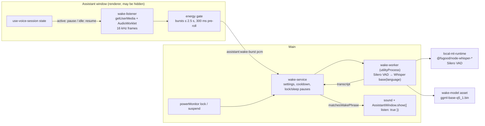

# Assistant wake word — design

Date: 2026-11-13 · Status: proposed

## Goal

Open the assistant hands-free by saying a phrase the person chooses ("Oi Maestro" by
default), as an alternative to the global shortcut. Detection runs entirely on the
computer: no audio leaves it until the phrase is heard, and the phrase only opens the
assistant, which then listens as the shortcut does (agent mode or a Realtime call).

Today the assistant opens from the global shortcut or the tray. In Realtime mode the call
is full duplex and closes after two minutes without anyone talking
(`REALTIME_IDLE_CLOSE_MS`); that rule stays, so a wake word is what lets the person keep
the assistant within reach all day without streaming the room to OpenAI.

## Decisions

| Question | Decision |
| --- | --- |
| Availability | Opt-in setting, off by default, in Settings → Assistant → Voice. Requires the assistant to be enabled and a host with a local ML runtime target (`mac-arm64`, `linux-x64`, `win-x64`). |
| Phrase | Free text chosen by the person, 2–40 characters. Absent means the app language's default: "Oi Maestro" (`pt-BR`), "Hey Maestro" (`en`). |
| What the phrase does | Exactly what the shortcut does with "the shortcut starts listening" on: show the assistant window and start the voice. Words said after the phrase in the same breath are not used. |
| Feedback | A short system sound plays when the phrase is recognized, before the window shows. |
| Engine | whisper.cpp through the existing `@fugood/node-whisper-*` addon in `local-ml-runtime`, gated by the bundled Silero VAD. Free-form phrases in any language need no training, which rules out Porcupine (license key, per-phrase training) and sherpa-onnx KWS (no Portuguese model). |
| Wake model | New runtime asset `wake-model`: multilingual `ggml-base-q5_1.bin` from `ggerganov/whisper.cpp`, pinned to an immutable Hugging Face revision with its SHA-256. Installed only by an explicit click, like `whisper-model`. The dictation model (`large-v3-turbo`, 574 MB) is too heavy to run on every utterance in the room, and its memory would stay resident all day. |
| Worker | A separate `wake-worker` utilityProcess holding the wake model and its own VAD context, so dictation and the wake word never queue behind each other and the large model is not kept loaded. |
| Capture | In the assistant window's renderer, which main creates hidden at startup while the wake word is on. An AudioWorklet produces 16 kHz mono frames, so a hidden window's timer throttling does not affect it. |
| Segmentation | A cheap energy gate in the renderer cuts speech bursts with 300 ms of pre-roll; only bursts are sent to main, truncated to their first 2.5 s. Silence costs nothing beyond the gate. |
| Matching | In main, a pure function: the transcript, normalized (lowercase, accents and punctuation removed), must start with the phrase's words, compared by normalized edit distance with a threshold of 0.8. The phrase in the middle of a sentence does not trigger. |
| Language | Whisper runs in the app language (`pt` or `en`), not auto-detection, which is slower and less reliable on short clips. |
| Pauses | The listener releases the microphone while the voice session is active (listening, transcribing, thinking, speaking, or any Realtime call) and resumes when it is idle again. Main pauses it while the screen is locked or the system sleeps. A trigger is followed by a 3 s cooldown. |
| Memory reclaimer | The wake worker is not reclaimable: it must stay loaded while the wake word is on. It registers as an owned process (key `wake`, kind `asr`) so the performance view shows it. |
| Privacy statement | The setting says that the system microphone indicator stays on while the wake word is on, and that audio stays on the computer until the phrase is heard. |

## Out of scope

- Using the request said in the same breath as the phrase ("Oi Maestro, how are my bots?").
- Several phrases, per-phrase training, speaker identification.
- A sensitivity setting; the threshold is tuned during acceptance and fixed.
- Pausing while the main window's dictation records.
- The wake word on mobile or while the app is not running.

## Architecture

### Settings

- `assistantVoiceSchema` gains `wakeWord: boolean` (default `false`) and
  `wakePhrase: string | null` (trimmed, 2–40 characters, default `null` for the
  language's default). Stored settings without them parse to the defaults; the
  field-by-field voice merge keeps working.
- `AssistantSection` shows, under Voice: a switch "Open by voice", the phrase field
  (placeholder shows the default), the wake model's install card (size, "runs on this
  computer", Download / progress / Cancel / Retry, through the existing runtime-asset
  IPC), and the privacy note. Unsupported hosts show the switch disabled with the reason
  from `currentAsrSupport()`.
- Turning the switch on with the model missing opens the install card; the listener
  starts once the model is ready.

### Wake model asset

- `RuntimeAssetId` gains `wake-model`, defined like `whisper-model` (format `file`, the
  same targets, exact byte size and SHA-256, version `base-q5-1`), and listed in
  Settings → runtime components as "Wake word model" / "Required by Open by voice".
  The stale-temp cleanup pattern includes the new id.
- `THIRD_PARTY_NOTICES.md` lists the Whisper base weights (MIT, downloaded on demand).

### Wake worker and service

- `wake-worker.ts` follows `asr-worker.ts`: `init {moduleUrl, modelPath, useGpu}`,
  `detect {id, audio, language}` → `detect:result {id, text, silent}`; Silero VAD
  first, no Whisper call without a speech segment, `cleanTranscript` on the output.
- `wake-service.ts` owns the worker's lifecycle (leases on `local-ml-runtime` and
  `wake-model`, owned-process registration, generation handling, request timeout of
  5 s), the cooldown, and the lock/sleep pauses. It starts the worker when the wake
  word is on and the model is ready, and stops it when the setting goes off or the
  assistant is disabled.
- `wake-phrase.ts` (shared, pure): `normalizeSpeech(text)`, `defaultWakePhrase(locale)`
  and `matchesWakePhrase(transcript, phrase)`.
- IPC accepted only from the assistant window: `assistant:wake-burst` (Float32 PCM,
  0.25–2.5 s at 16 kHz, validated in main), `assistant:wake-mic-failed`, and
  `assistant:wake-state` (invoke) for the initial state. Main → renderer
  `assistant:wake-state` `{ listening: boolean }` follows settings, model readiness and
  lock/sleep. `assistant:wake-status` (invoke, read-only, any app window) returns
  `{ listening, error: 'mic' | 'worker' | null }` for Settings.
- On a match, main plays the trigger sound and calls `AssistantWindow.show({ listen: true })`.

### Renderer

- `wake-listener.ts` (assistant window): opens the microphone with the device chosen for
  dictation and echo cancellation, runs the AudioWorklet and the energy gate, and sends
  bursts. It exposes `start()` / `stop()`; `stop()` stops the tracks so the system
  indicator reflects it.
- `AssistantApp` runs the listener when `assistant:wake-state` says listening and the
  voice session is idle with no Realtime call; any other voice state stops it.
- Main creates the assistant window hidden at startup when the wake word is on, so the
  listener runs before the window is first shown.

## Error handling

| Situation | Behavior |
| --- | --- |
| Unsupported host | Switch disabled with the reason; nothing downloads. |
| Model missing, failed, corrupt | Install card with the existing runtime-asset states; the listener does not start. |
| Microphone denied or unavailable | The setting shows "The microphone could not open"; the listener retries when the window is next shown or the setting is toggled. |
| Worker crash or timeout | The burst is dropped; the next burst restarts the worker. Three exits in a minute stop the listener and Settings shows the error until the setting is toggled. |
| Phrase recognized while the voice is active | Cannot happen: the listener is stopped. A burst already in flight is ignored by the cooldown and voice-state check. |

## Testing

- Unit: `matchesWakePhrase` (accents, punctuation, casing, near misses such as "oi maestra",
  the phrase mid-sentence, filler before it, unrelated speech); the energy gate (pre-roll,
  2.5 s cap, bursts too short to be the phrase); settings schema defaults and merge;
  `wake-service` (no worker while off or model missing, cooldown, lock/sleep pauses, a match
  shows the window listening, bursts from other senders rejected, oversized bursts
  rejected); registry entry for `wake-model`; preload contract for the new IPC.
- Acceptance on the owner's Mac with a real microphone, in pt-BR, measured with the
  worker's per-burst log (transcript, score, latency):
  - the phrase said 30 times at desk distance: at least 27 detections;
  - 60 minutes of room talk, a podcast or TV: at most 1 false trigger;
  - end of phrase to window shown: under 1 s;
  - worker CPU in a silent room near zero; with continuous speech, reported.
  If the base model misses the targets, repeat with `ggml-small-q5_1.bin` before
  changing the approach.
- `npm run verify:pr -- --package`, because a runtime asset is added.

## Risks

- Short phrases are where Whisper is weakest (the dictation spike misread single words).
  Two-word phrases and the edit-distance match mitigate it; acceptance decides the model.
- Whisper invents text from noise; the Silero gate in the worker and the start-of-transcript
  rule reduce false triggers, but TV and podcasts saying the phrase will trigger it.
- Windows and Linux run on CPU and were not measured; a talkative room means continuous
  inference there.
- The microphone indicator is on all day while the wake word is on, which some people will
  find intrusive; it is opt-in and stated in the setting.
- This development machine is Linux arm64, which has no local ML runtime target: the
  acceptance runs only on the owner's Mac.
