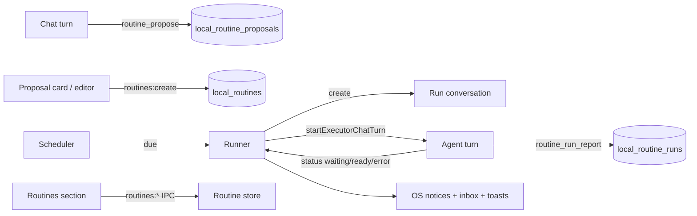

# Routines scheduled from chat — design

## Goal

Let the person create, from any desktop chat, a routine: an instruction that an agent runs on its own at set times on
this computer, with the browser, the terminal and every other tool a normal chat has. Bots keep their own routines;
these need no bot, no gateway and no container.

Every run is a full agent turn in a conversation of its own, like a bot's routine runs: the person can open it later,
see images and files, and keep talking to the agent there.

## Decisions

| Topic | Decision |
| --- | --- |
| What runs | An agent turn every time (no deterministic scripts). The run prompt carries the instruction and the previous runs' reports. |
| Where | This computer or any connected server `workspaces` environment that advertises `host-routines` (chosen with the "Runs on" host selector, defaulting to the source chat's host). Each host stores its own definitions and runs in its own SQLite database; the desktop UI aggregates routines across hosts. No per-routine workspace or worktree: every run still works in the routine's own folder, `userData/routines/<routineId>`, inside the chosen host. An instruction that needs a project names its path; the permission mode decides the access. |
| Permissions | The app's three modes (`ask`, `auto`, `full`) with their existing labels and descriptions, plus a note on what each means when nobody is watching. "Always allow" during a run saves to the routine (`routine:<id>`), so every later run reuses it. No per-tool switches. |
| Model | Provider, model, reasoning effort and Fast, chosen with the composer's own pickers. A new routine inherits the source chat's selection and permission mode. |
| Creation | Agent-proposed from chat (a card the person must confirm), the composer's + menu ("Schedule as routine…"), or the Routines section. Nothing runs before the person creates it; an agent can never create or change a routine by itself. |
| Schedule | The bots' shapes: weekly (`HH:MM`, ISO days, IANA timezone) or interval (15–1440 minutes). The same math as the gateway, shared. |
| Missed slots | Per routine: `catchup` (default; run once when back, up to 2 h after the slot, marked late) or `skip`. Missed slots are recorded as skipped (`skipped_closed` when Maestrly was not running, `skipped_asleep` when it was running but the computer slept). |
| Busy | One run per routine. A slot that comes while the previous run is running or waiting for approval is `skipped_busy`. |
| Background | A routines setting keeps Maestrly in the tray when the window closes while any routine is enabled (default on), and an optional "open at login" (macOS and Windows). |
| Alerts | Failures and approval requests always alert. `notify`: `notable` (default) also alerts runs with news, `all` alerts every finished run, `none` alerts nothing else. |
| Retention | Per routine, 30 (default), 60 or 90 days, or always. Deleting a run's conversation keeps its files in the routine folder and its report in the history. Pinned runs are never deleted automatically. |
| Hosts | This computer and server `workspaces` environments advertising `host-routines` (excluding legacy containers without the feature and peer computers). The gateway keeps environments with enabled routines (`health.routines.enabled > 0`) from idle-stopping while still applying scheduled updates once `busy === false`. |

## Multi-host server execution (v2)

- **Server-mode scheduling**: Server `workspaces` environments run the same desktop main-process routines stack (`shouldRunLocalRoutines()` enables desktop and server modes while keeping bot mode blocked). `holdAwake`, tray keep-running, and login items do not apply in server mode; `recoverInterruptedRoutineRuns` marks in-flight runs as failed after container restarts or updates.
- **Capability & health**: Server hosts advertise `host-routines` (`FLEET_HOST_ROUTINES_FEATURE`) and `hostInfo.routines = true`, and report `routines: { enabled, nextRunAt }` on `/v1/health`. The gateway's `checkIdle` skips idle stop while `routines.enabled > 0`.
- **Notifications without desktop open**: Server `chat-attention` respects the routine's `notify` policy (`notable` / `all` / `none`) for finished routine runs, while approvals, questions, and failures always notify. When the desktop is connected, remote `routines:toast` events are forwarded to `RoutineNotices` with the host label and deduplicated.
- **Desktop multi-host UI**: Routines are keyed as `hostKey(hostId, routineId)`. Proposal cards and the editor dialog offer a "Runs on" host selector (defaulting to the source chat's host), validate provider/model availability against the destination host's `chatConfig`, support cross-host creation (`routines:create` on target + `routines:markProposalCreated` on origin, storing `origin_host_id` / `routine_host_id`), and open remote routine folders in a file-browser dialog. Moving existing routines between hosts and mobile routine management UI remain follow-up work.

## Non-goals (v1 / follow-ups)

- Peer computers, moving existing routines between hosts, and mobile routine management UI (mobile receives server push notifications for alerts).
- Agent tools that list, change or delete routines. The agent proposes, and it reports a run.
- Changing bot routines or the bot UI, apart from sharing schedule math and gateway idle-stop awareness via `health.routines`.
- The prototype's demo aids: the Demo button and panel, the fictional data, the simulated agent, the composer's
  suggestion chips and its alternative placeholder.

## Prototype (the design to match)

The approved UX prototype lives outside Git (excluded by `.git/info/exclude`):

```
/home/bot/.config/maestrly-app-dev/worktrees/c9bbedf6-72b5-4c95-aab8-de0106e4149f/feat-schedules-tasks/prototypes/chat-routines/
```

Run it with `python3 <that folder>/serve.py <port>` and open `http://127.0.0.1:<port>/`. Its files are the reference
for layout, states, interactions and Portuguese copy:

- `views.js`: rail, list panel, chat, proposal card, composer, timeline, agenda, routine detail.
- `run-view.js`: run conversation (trigger card, tools, approval, report, failure), inbox, placeholders.
- `editor.js`: editor dialog, model and reasoning popovers, confirmations, toasts.
- `data.js`: outcome labels and tones, permission-mode notes, notify and missed options.
- `styles.css`: measurements, colors and the timeline's look.

Implement to parity: the same sections, order, states, controls and pt-BR copy. Write the English copy to match.
Whatever the real app cannot do as the prototype shows must be listed as a deviation, with the reason.

## Terms

- **Routine**: a stored instruction, schedule, permission mode, model and alert settings.
- **Run**: one execution of a routine. It has a row in `local_routine_runs`, and from the moment it starts, a
  conversation of its own.
- **Run conversation**: a standalone conversation with `routineId` and `routineRunId` set. It is hidden from the
  normal chat lists, is opened from the Routines section, and stays continuable after the run ends.
- **Proposal**: a routine the agent drafted in a chat; it exists as a routine only after the person creates it.

## Architecture



### 1. Shared code

- `packages/bot-fleet-protocol/src/schedule.ts` (new, exported from the package index): `nextWeeklyRun` and `nextRun`,
  moved verbatim from `apps/bot-gateway/src/routines.ts` (`nextWeeklyRun`, `nextRun`), throwing a plain `Error`, plus:

  ```ts
  /** The next `count` run times after `after`; `first` overrides the first one (an interval routine's stored next run). */
  export function upcomingRuns(schedule: FleetRoutineSchedule, after: Date, count: number, first?: Date): Date[]
  ```

  `apps/bot-gateway/src/routines.ts` keeps exporting `nextRun` and `nextWeeklyRun` as wrappers that rethrow
  `GatewayError('INVALID_REQUEST', …)`, so the gateway and `backups/service.ts` keep their behavior and tests.
- `apps/desktop/src/shared/routines.ts` (new): types, zod schemas for every IPC input, and limits.

  ```ts
  export type RoutineSchedule = FleetRoutineSchedule
  export type RoutineNotify = 'notable' | 'all' | 'none'
  export type RoutineMissed = 'catchup' | 'skip'
  export type RoutineRetentionDays = 30 | 60 | 90 | null // null = always
  export interface RoutineModel { providerId: string; modelId: string; reasoning: ChatReasoningEffort; fastMode: boolean }
  export interface RoutineOrigin { conversationId: string; title: string; via: 'proposal' | 'menu' }
  export interface LocalRoutine {
    id: string; title: string; instruction: string; schedule: RoutineSchedule
    enabled: boolean; pausedAt: number | null
    permMode: ChatPermMode; model: RoutineModel
    notify: RoutineNotify; missed: RoutineMissed; retentionDays: RoutineRetentionDays
    origin: RoutineOrigin | null; folder: string; nextRunAt: number | null
    createdAt: number; updatedAt: number
  }
  export type RoutineDraft = Pick<LocalRoutine,
    'title' | 'instruction' | 'schedule' | 'permMode' | 'model' | 'notify' | 'missed' | 'retentionDays'>
  export type RoutineRunStatus = 'running' | 'waiting' | 'notable' | 'nothing_new' | 'done' | 'failed' | 'stopped'
    | 'skipped_asleep' | 'skipped_closed' | 'skipped_busy'
  export type RoutineRunTrigger = 'schedule' | 'manual' | 'late'
  export interface RoutineRunReport { outcome: 'notable' | 'nothing_new' | 'done'; summary: string; pending: string | null; notes: string | null }
  export interface LocalRoutineRun {
    id: string; routineId: string; scheduledAt: number; startedAt: number | null; finishedAt: number | null
    trigger: RoutineRunTrigger; status: RoutineRunStatus; summary: string | null
    report: RoutineRunReport | null; error: string | null
    conversationId: string | null; conversationDeleted: boolean; pinned: boolean; unread: boolean
  }
  export interface RoutineProposal {
    id: string; conversationId: string; draft: RoutineDraft
    state: 'pending' | 'created' | 'discarded'; routineId: string | null; createdAt: number
  }
  export interface RoutineSettings { keepRunning: boolean; openAtLogin: boolean }
  export const ROUTINE_LIMITS = {
    titleMax: 80, instructionMax: 4000, routinesMax: 50, concurrentRuns: 3,
    onTimeGraceMs: 2 * 60_000, catchUpWindowMs: 2 * 3_600_000, tickMs: 15_000,
    skippedSlotsPerGap: 48, runRowsPerRoutine: 500, previousReports: 3, sweepMs: 10 * 60_000,
  } as const
  ```

  `summary` is at most `FLEET_ROUTINE_RUN_LIMITS.summaryMax`; `pending` and `notes` use the same limits as bots.
  `isAlerting(run, notify)` lives here too: `failed` and `waiting` always alert; `notable` alerts unless `notify === 'none'`;
  `nothing_new` and `done` alert only with `notify === 'all'`.

### 2. Storage (desktop SQLite)

`apps/desktop/src/main/routines/schema.ts`: `initializeRoutineSchema(db: DatabaseSync): void`, called from
`initializeSchema()` in `apps/desktop/src/main/store/db.ts` next to `initializePlanSchema(db)`. The pattern is
idempotent `CREATE TABLE IF NOT EXISTS`, plus `tableHasColumn` and `ALTER TABLE` for new columns.

- `local_routines`: `id TEXT PRIMARY KEY, title, instruction, schedule_json, enabled INTEGER, paused_at, perm_mode,
  provider_id, model_id, reasoning, fast_mode INTEGER, notify, missed, retention_days (NULL = always),
  origin_conversation_id, origin_title, origin_via, next_run_at, created_at, updated_at`.
- `local_routine_runs`: `id TEXT PRIMARY KEY, routine_id, scheduled_at, started_at, finished_at, trigger, status, summary,
  report_json, error, conversation_id, conversation_deleted INTEGER, pinned INTEGER, unread INTEGER`. Index on
  `(routine_id, scheduled_at DESC)` and on `conversation_id`.
- `local_routine_proposals`: `id TEXT PRIMARY KEY, conversation_id, draft_json, state, routine_id, created_at, updated_at`.
- `conversations`: add nullable `routine_id` and `routine_run_id`, and expose them as `routineId` and `routineRunId` on
  `StandaloneConversation` (`apps/desktop/src/shared/conversation.ts`).
- Routine settings: `app_settings` key `routines.settings`, parsed with a zod schema whose defaults are
  `{ keepRunning: true, openAtLogin: false }`.

`apps/desktop/src/main/routines/store.ts` holds the DAO: create, get, list, update, delete, setEnabled, setNextRunAt;
insertRun, updateRun, listRuns(`{ routineId, filter: 'all' | 'notable' | 'issues', limit, before? }`),
runsInRange(from, to), latestReports(routineId, n), runByConversation(conversationId), pruneRuns(routineId, keep);
proposal create, get and setState. "issues" means `failed`, `waiting`, `stopped` and `skipped_*`. Every write that changes
something the renderer shows emits `routines:changed`.

`listStandaloneConversations` (`apps/desktop/src/main/store/conversations.ts:182`) and every renderer chat list exclude
conversations with `routine_id`, as do the chat and workspace sources of the inbox and the rail attention marks. Their
attention counts toward the Routines tab instead.

### 3. Run conversations

- `apps/desktop/src/main/standalone-conversation-service.ts`: add

  ```ts
  export async function createRoutineRunConversation(input: {
    routineId: string; runId: string; name: string; folder: string
  }): Promise<StandaloneConversation>
  ```

  It works like `createStandaloneConversationInFolderOf` (`:72`), with `cwd = folder` and `routineId` and `routineRunId`
  set. `removeStandaloneConversationDirectory` (`:155`) returns early when `conversation.routineId` is set, so the
  routine folder survives its conversations.
- First message: the internal turn options in `apps/desktop/src/main/chat/service.ts` (`dispatchSeed` at `:4035`) gain
  `routineRun?: ChatRoutineRunMeta`. Add it to `startExecutorChatTurn`'s input (`:12014`). The user message is persisted
  with `source: 'routine-run'` and `routineRun` meta (`apps/desktop/src/shared/chat.ts`: extend `ChatMessageSource` at
  `:988`, add `routineRun?: ChatRoutineRunMeta` to `ChatMessage` at `:1028`):

  ```ts
  export interface ChatRoutineRunMeta {
    routineId: string; runId: string; title: string; instruction: string; schedule: FleetRoutineSchedule
    trigger: 'schedule' | 'manual' | 'late'; scheduledAt: number; startedAt: number; hasPreviousReport: boolean
  }
  ```

  The model receives the full prompt below; the chat renders the trigger card from the meta, never the raw prompt. Like
  `dispatchSeed` and `peerMessage`, a routine-run turn skips undelivered review reports and memory recall
  (`service.ts:4678-4681`), and `conversation-dispatch-authorization.ts:55` treats it as not human, so
  `start_conversations` and similar tools still need the person's confirmation.
- Run prompt (English, built in `apps/desktop/src/main/routines/prompt.ts`; modeled on `routinePrompt` in
  `apps/desktop/src/main/fleet/instance/queue.ts:638`):

  ```
  Scheduled routine "<title>", running on its own on this computer. Do this now:

  <instruction>

  [This run is late: it was scheduled for <local time> and starts now because the computer was asleep or Maestrly was closed.]

  Previous runs of this routine, newest first:
  - <local date time> · <status> · Did: <summary> · Pending: <pending> · Notes for this run: <notes>
  (or: This is the first run of this routine.)

  This conversation belongs to this run alone. Nobody watches it while it runs: work on your own with your tools; when
  a tool needs approval, the run waits for the person. Files you write stay in this routine's folder, which every run
  shares. The person can read this run later and ask you here for changes.

  When you finish, call routine_run_report once with outcome notable when the person should see what you found,
  nothing_new when nothing changed since the previous run, or done when you did the work and nothing needs attention;
  a one-line summary; anything still pending; and notes for the next run.
  ```

  It includes the last `ROUTINE_LIMITS.previousReports` reports.
- Deleting a run's conversation (by hand, by retention, or with its routine) first copies what the conversation holds
  outside the folder (generated images and attachments) into `<routine folder>/runs/<YYYY-MM-DD HHmm>/`. Generalize
  and reuse `keepRunFiles` from `apps/desktop/src/main/fleet/instance/run-files.ts:111` rather than duplicating it. The
  run row keeps its report and gets `conversationDeleted = true`.

### 4. Permissions

- `apps/desktop/src/shared/conversation-scope.ts:51`: `PermissionScope` gains `{ kind: 'routine'; id: string }`.
  `conversationPermissionScope` returns it for conversations with `routineId`, and `permissionScopeKey` maps it to
  `routine:<id>`. Every run of a routine then shares its `permission_saved` rows.
- The run conversation's permission mode is the routine's `permMode`, applied before the turn exactly as the bot
  runtime does (`patchConvUiPrefs` in `apps/desktop/src/main/fleet/instance/runtime.ts:1107-1132`).
- The permission prompt's "always" scope gets a `routine` value, labeled "Sempre permitir nesta rotina" / "Always allow
  in this routine" (`PermissionPrompt.tsx`, `permPrompt.*` in the chat namespace).
- `apps/desktop/src/main/chat/permission.ts`: `listSavedPermissions(scopeKey)` and `deleteSavedPermission(id)` (reuse
  them if they already exist), for the routine detail's "Sempre permitido" list. Deleting or duplicating a routine
  deletes or copies its rows.

### 5. Runner (`apps/desktop/src/main/routines/runner.ts`)

```ts
export interface RoutineRunner {
  start(routineId: string, trigger: RoutineRunTrigger, scheduledAt: number): Promise<LocalRoutineRun>
  stop(runId: string): void
  isBusy(routineId: string): boolean
}
export function createRoutineRunner(deps: RoutineRunnerDeps): RoutineRunner
```

1. If the routine has a `running` or `waiting` run, insert a `skipped_busy` row and return it. A manual run also shows
   the toast "Pulada: execução anterior em andamento".
2. Wait for a free slot among `ROUTINE_LIMITS.concurrentRuns` (FIFO). A run that waits longer than 15 minutes becomes
   `skipped_busy`.
3. Insert the run row (`running`, `startedAt`, `trigger`) and create the run conversation, named
   `<title> · <local date time>`. Apply the model with `primeChatTurnSelection` (`service.ts:2863`), `setChatMode(id,
   'agent')` and the permission mode.
4. `holdAwake('routine-run:<runId>')` until the run ends, released while it waits for approval
   (`apps/desktop/src/main/power-manager.ts:57`).
5. `startExecutorChatTurn({ conversationId, prompt, routineRun, signal })`. When `getMainWebContents()` is null, retry
   every 5 s for up to 60 s, then end the run as `skipped_closed`.
6. Follow the conversation's status through the registry `status` events (`apps/desktop/src/main/index.ts:1410`):
   `waiting` makes the run `waiting` and `unread`, and alerts; leaving `waiting` makes it `running` again.
7. On `handle.done`: `cancelled` becomes `stopped`. `error` becomes `failed`, with the error text. `success` takes the
   status from the run's report (`outcome`), or `done` when there is no report, with `summary` set to the first 200
   characters of the final assistant text (`assistantText` as in `runtime.ts:317`). Then set `finishedAt`, set `unread`
   to `isAlerting(run, notify)`, and alert when it is true.
8. `stop(runId)` calls `handle.cancel()`.

A run conversation stays a normal conversation: later turns there are the person's own and do not change the run's
status. A `routine_run_report` call in such a turn updates the run's report.

### 6. Scheduler and lifecycle (`apps/desktop/src/main/routines/scheduler.ts`)

Pure decision function, fully unit tested:

```ts
export interface SkippedSlot { scheduledAt: number; status: 'skipped_asleep' | 'skipped_closed' | 'skipped_busy' }
export type TickDecision =
  | { kind: 'wait' }
  | { kind: 'fire'; trigger: 'schedule' | 'late'; scheduledAt: number; skipped: SkippedSlot[] }
  | { kind: 'skip'; skipped: SkippedSlot[] }
export function decideTick(input: {
  routine: Pick<LocalRoutine, 'schedule' | 'missed' | 'enabled' | 'nextRunAt'>
  now: number; processStartedAt: number; busy: boolean
}): { decision: TickDecision; nextRunAt: number | null }
```

Rules:

- A disabled routine, a null `nextRunAt` or a `nextRunAt` after `now` waits.
- Otherwise, list the due slots from `nextRunAt` through `now` and keep the newest `skippedSlotsPerGap`.
- When busy, every slot is `skipped_busy`.
- When the newest slot is within `onTimeGraceMs`, fire it on schedule.
- With `missed === 'catchup'` and the newest slot within `catchUpWindowMs`, fire it late.
- Every other slot is skipped: `skipped_closed` when it is earlier than `processStartedAt`, otherwise `skipped_asleep`.
- `nextRunAt` becomes `nextRun(schedule, now)`.
- Enabling a routine, or changing its schedule, sets `nextRunAt = nextRun(schedule, now)`. Pausing sets `pausedAt`.

`createRoutineScheduler(deps).start()` ticks every `tickMs`, and at once on `powerMonitor` `resume` and
`unlock-screen`. Every `sweepMs` it applies retention:

- It deletes the conversations of unpinned runs older than `retentionDays`, keeping their files.
- It prunes run rows beyond `runRowsPerRoutine`, newest and pinned kept.
- It never touches a `running` or `waiting` run.

Neither the scheduler nor the tools start in a headless or bot instance (`isHeadlessInstance()`, `isBotMode()`). Wire
them in `apps/desktop/src/main/index.ts` after the chat service is ready.

Lifecycle (`apps/desktop/src/main/index.ts`):

- `keepsRunningInBackground()` (`:420`) also returns true when `routines.settings.keepRunning` is on and at least one
  routine is enabled. The first time a window close is kept in the tray because of routines, show a system notice once:
  "O Maestrly continua na bandeja para rodar suas rotinas."
- `openAtLogin`: on macOS and Windows, call `app.setLoginItemSettings({ openAtLogin, args: ['--routines-background'] })`.
  A launch at login (`app.getLoginItemSettings().wasOpenedAtLogin` on macOS, or the argument on Windows) creates the
  main window hidden. On Linux the row is disabled with the hint "Disponível no macOS e no Windows". Make sure
  `retireExecutorLoginItem` (`apps/desktop/src/main/store/db.ts:260`) cannot clear this login item: it must only act on
  the retired executor setting, and only once.
- The "Não deixar o computador dormir durante uma execução" row reads the existing `preventSleepWhileWorking` setting
  (read-only "Ligado"/"Desligado", with a link to the setting).

### 7. Agent tools (`apps/desktop/src/main/chat/tools/`)

Both use `defineTool`, are listed in `ALL_TOOLS` (`tools/index.ts`), and are allowlisted in `tool-policy.ts` and in
`permission.ts`'s no-approval list.

- `routine_propose` (`routine-propose.ts`). Available in local desktop conversations, standalone and project, but not
  in run conversations, bot or headless instances, or remote web chats. Its parameters:

  ```ts
  {
    title: string            // ≤ 80
    instruction: string      // ≤ 4000, self-contained for an unattended agent, including when to alert the person
    schedule:
      | { kind: 'weekly'; time: 'HH:MM'; days: number[] /* ISO 1–7, empty = every day */; timezone?: string /* IANA, default local */ }
      | { kind: 'interval'; every_minutes: number /* 15–1440 */ }
    notify?: 'notable' | 'all' | 'none'   // default 'notable'
    missed?: 'catchup' | 'skip'           // default 'catchup'
  }
  ```

  The permission mode and the model come from the conversation at call time; the tool takes neither, so the agent
  cannot escalate. Retention defaults to 30 days. The tool validates, stores a `pending` proposal and returns
  `{ ok: true, proposalId, draft }`. Its `toModelText` says the routine does not exist yet, the person creates, adjusts
  or discards it in the card, and the agent must not claim it was created. The description tells the agent:
  - Use it when the person asks for something to happen on its own at set times or intervals.
  - It may check access first, for example by opening the site.
  - Write the instruction as a standalone order to an agent that runs alone.
- `routine_run_report` (`routine-run-report.ts`), exposed only in run conversations. Its parameters are
  `{ outcome: 'notable' | 'nothing_new' | 'done'; summary; pending?; notes_for_next_run? }`, with the bots' limits. It
  stores the report on the run that owns the conversation and returns `{ reported: true }`.

### 8. IPC and preload

- `apps/desktop/src/main/routines/ipc.ts`: `registerRoutinesIpc(reg: IpcRegistrar, deps)`. Use `reg.handle` for reads
  and `reg.mhandle` for mutations, and validate every input with the shared zod schemas. Channels:
  - `routines:list`, `routines:get`, `routines:create(draft, origin?)`, `routines:update(id, patch)`, `routines:delete`,
    `routines:duplicate`, `routines:setEnabled`.
  - `routines:runNow`, `routines:stopRun`, `routines:listRuns`, `routines:runsInRange`, `routines:pinRun`,
    `routines:deleteRunConversation`, `routines:markRunSeen`.
  - `routines:listSavedPermissions`, `routines:removeSavedPermission`, `routines:openFolder` (`shell.openPath`).
  - `routines:getProposal`, `routines:createFromProposal(id, draft?)`, `routines:discardProposal`,
    `routines:restoreProposal`.
  - `routines:getSettings`, `routines:setSettings`, and the event `routines:changed`.

  `createFromProposal` is the only way a proposal becomes a routine, and it requires a pending proposal.
- `apps/desktop/src/preload/api-routines.ts`: spread into the preload API, typed in `api.d.ts`, with an updated
  `test/unit/__snapshots__/preload-contract.test.ts.snap`.

### 9. Notifications and inbox

- OS notices (`apps/desktop/src/main/notifications/`, `appNotifications.notices.show`) for alerting runs, unless the
  person is looking at that run (`presence`). Clicking one opens the run.
- Inbox (`apps/desktop/src/renderer/lib/inbox/`):
  - Add the source `routine` and the target `{ kind: 'routine-run'; routineId; runId }`.
  - Add a `routineObservations` builder in `inbox-sources.ts`, fed through `use-inbox-observations.ts`.
  - Map the source in `InboxPanel.tsx` (`SOURCES`, `HOME_TAB`), and open the target in `DesktopApp.tsx`'s
    `inboxActions.open`.
  - Opening a run marks it seen (`routines:markRunSeen`). A waiting run stays unread until it no longer waits.

### 10. Renderer

Tokens (`apps/desktop/src/renderer/styles.css`): `--routine: #9db7e8`, `--routine-soft: rgba(157, 183, 232, 0.13)` and
`--routine-line: rgba(157, 183, 232, 0.32)`, mapped in `@theme` to `--color-routine*`. Timeline styles too intricate for
utilities may live in one `.routine-timeline` block in `styles.css`. Otherwise use Tailwind with `cn()`, the existing UI
primitives (`Dialog`, `DropdownMenu`, `Select`, `SearchSelect`, `Switch`, `Button`) and lucide icons.

Data hook: `apps/desktop/src/renderer/lib/routines/use-routines.ts` loads routines and their latest runs, follows
`routines:changed`, and derives attention counts (waiting, plus failed and unread). Pure helpers go in
`lib/routines/`, each unit tested:

- `schedule-text.ts`: summaries such as "08:00 · todos os dias", "A cada 30 min", "Seg a Sex" and "fins de semana".
- `timeline.ts`: layout, day columns, nights, tick kind and position, clamped edges, and bars when the interval is under
  180 minutes.
- `relative-time.ts`: "em 21 h", "há 3 dias", "Hoje", "Ontem" and run dates.
- `editor-form.ts`: draft to form and back, with validation messages.

Toasts: the renderer has none yet. Add a minimal `components/ui/toaster.tsx`, an imperative `toast({ tone, icon,
title, description, action? })` that keeps at most 3 toasts, closes them after 7 s, and has a close button and
`aria-live="polite"`. Use it for the toasts in the prototype:

- Rotina criada / salva / duplicada / excluída.
- `<title> começou`, with "Acompanhar".
- Alerting run results, with "Abrir execução".
- Permissão removida.
- Pulada: execução anterior em andamento.
- Background turned on.

Sections (match the prototype):

1. **Rail and list panel** (`views.js` `rail`, `listPanel`, `routineRow`).
   - `sidebarTabs` becomes `['inbox', 'chats', 'workspaces', 'bots', 'routines']`, with the `CalendarClock` icon.
     Update `readSidebarTab`, `nextSidebarTab` and `conversationSidebarTab` (a run conversation belongs to
     `routines`), and their tests.
   - The rail badge shows attention counts in the routine color. A dot appears after a routine is created while
     another tab is open.
   - `RoutinesSidebarPanel` has an "Agenda" row and the groups "Ativas" and "Pausadas". Each routine row has a chevron
     that expands its 5 latest runs, plus the opened one; skipped runs are disabled. It shows the time or summary,
     "em 21 h", "rodando" or "pausada", and a status dot, followed by "Ver todas as N execuções".
   - The background banner appears when background is off and there are enabled routines, except on the agenda,
     which has its own.
   - The chat list shows a clock mark on chats that created routines, and the hint "As execuções das rotinas ficam em
     Rotinas." when any routine exists.
2. **Main views**: `useMainPanels` (`apps/desktop/src/renderer/lib/use-main-panels.ts`) gains
   `routinesView: { kind: 'agenda' } | { kind: 'routine'; id } | { kind: 'run-gone'; routineId; runId } | null` and the
   override `'routines'`. It handles the custom events `maestrly:open-routine` and `maestrly:open-routine-run`. Opening a
   run whose conversation exists selects that conversation, like any chat, with the Routines tab active.
3. **Agenda** (`viewAgenda`, `timeline`, `machineCard`):
   - The header has "Rotinas" and "Nova rotina", with the title and subtitle below it.
   - The background banner appears when background is off.
   - "Precisa de você" lists waiting runs and unread failed runs.
   - "Esta semana" is the timeline: 2 past days, today and 4 next days. It shades nights from 22h to 6h, draws a line
     at "now" with the time, and colors each tick by outcome; future slots are hollow, paused rows are hatched from
     `pausedAt`, and ticks become bars for intervals under 3 h. Ticks have tooltips, and a click on a past tick opens
     that run. The name column stays fixed while the timeline scrolls sideways, and a narrow timeline opens with "now"
     in view. Below it goes the legend.
   - "A seguir" shows each enabled routine's next run.
   - "Este computador" has the switches "Manter o Maestrly em segundo plano" and "Abrir ao iniciar o sistema", and the
     sleep row, followed by the line about bots running on the server and the link "Ver bots".
   - The empty state shows an example and the buttons "Pedir no chat" and "Criar aqui".
4. **Routine detail** (`viewRoutine`, `runItem`):
   - The hero has the large monospace time, the title, the schedule line and the next run, "Rodando agora" or
     "Pausada desde…". Next to it go the "Ativa" switch, "Executar agora" or "Parar", and a ⋯ menu with Editar,
     Duplicar and Excluir.
   - A single-row timeline follows.
   - "Execuções" has filters (Todas, Novidades, Problemas e puladas), the retention aside, 10 runs per page with
     "Mostrar mais", and pills, durations, pins, late (`→ 07:42`) and manual marks.
   - "Configuração" has Instrução, Agendamento, Horário perdido, Permissões (badge and note), Sempre permitido
     (removable chips, hidden for `full`), Modelo (name, provider, reasoning, Fast), Arquivos (with "Abrir pasta") and
     Avisos.
   - The origin line closes the page: "Criada no chat <link> · <date>" or "Criada em Rotinas".
5. **Editor dialog** (`editor.js`) for new, adjusted-proposal and edit.
   - Fields in prototype order:
     - Title and Instruction.
     - Agendamento (Horário fixo or Intervalo).
     - Time and timezone: `SearchSelect` over `Intl.supportedValuesOf('timeZone')`, as `BotRoutinesSection` does.
     - Days, or interval and unit.
     - "Próximas:" preview.
     - Missed policy.
     - Permissões: the three modes, `full` in amber with the risk note, the mode note, and saved chips when editing.
     - Modelo:
       - `ChatModelChip` controlled (no `conversationId`; `value` and `onSelect`).
       - `ChatReasoningPicker` with only the chosen model's efforts; a switch keeps the effort when the new model
         offers it.
       - `FastModeChip`, shown only when the model supports Fast, as `StandardPlanHandoffDialog.tsx:168-186` does.
       - The hint "Vem de “<chat>”. Todas as execuções usam este modelo e esta conta."
     - Avisos and Guardar execuções por.
   - Validation messages show in the footer and focus the invalid field. Escape closes popovers first.
   - `ChatPermModePicker` gets optional `value` and `onChange` props, or the dialog renders the same three choices
     from the same i18n keys, without duplicating copy.
6. **Chat** (`proposalCard`, `viewChat`, `composer`):
   - `ChatMessageList.tsx:341` renders `routine_propose` as `RoutineProposalCard`, which reads the proposal's live
     state over IPC:
     - **pending**:
       - The large time, the eyebrow "Nova rotina · aguardando você", the title, the schedule line and the next 3
         run tags.
       - A facts list with Instrução (clamped, with "Ver tudo" for long ones), Permissões (badge and note), Modelo and
         Avisos.
       - A background warning with "Ativar" when needed.
       - The buttons "Criar rotina", "Ajustar…" and "Descartar", and the note "Roda neste computador. Nada roda antes
         de você criar."
     - **created**: a compact card with the time, the eyebrow "Rotina criada", the title, the permission badge, the
       model tag, "Próxima: … · em …", "Última: <pill>" and "Abrir rotina".
     - **discarded**: one line with "Desfazer".
     - **deleted routine**: "Esta rotina foi excluída."
     - On another host: the read-only notice.
   - The composer's + menu (`ChatPlusMenu.tsx`) gets "Agendar como rotina…" ("Usa o texto da mensagem como
     instrução"), hidden for bots. It opens the editor with the composer text, the chat's model and permission mode,
     and the chat as origin (`via: 'menu'`). Saving creates the routine, clears the composer, and shows a
     `RoutineCreatedNotice` (the created card, eyebrow "Rotina criada pelo menu +"), interleaved in the chat by
     `createdAt`.
   - The chat header shows a routine-color chip, "1 rotina" or "N rotinas", for routines created there. It opens the
     routine, or the agenda when there are several.
7. **Run conversation** (`viewRun`, `part`):
   - When the selected conversation has `routineRunId`, `RoutineRunHeader` replaces the chat header.
     - Breadcrumbs: Rotinas › routine › date, with the status pill.
     - Actions: the "Mantida" chip, "Parar" while running, and a ⋯ menu with "Manter sempre" or "Deixar a retenção
       apagar", and "Apagar conversa", which confirms first.
   - User messages with `source: 'routine-run'` render as `RoutineRunTrigger`: the eyebrow "Rotina · <schedule>" or
     "Executada agora por você", the title, "Ver instrução", and "Recebeu o relatório da execução anterior", with the
     late note when there is one.
   - `routine_run_report` renders as `RoutineReportCard`: "Relatório da execução", a pill, Fez, Pendente (only when
     reported), "Notas para a próxima", and "A próxima execução recebe este relatório."
   - A failed run adds a card with the error and the buttons "Trocar o modelo da rotina" (opens the editor) and
     "Executar de novo".
   - In a run conversation, the permission prompt adds "A execução está pausada desde <time>, e o próximo horário é
     pulado se ela ainda estiver esperando."
   - Skipped runs and deleted conversations open `run-gone`: an icon, the status label or "Conversa apagada", the
     explanation, and "Abrir rotina".

### 11. Copy

- Add a new i18n namespace, `routines` (`apps/desktop/src/shared/i18n/en/routines.ts` and `pt-BR/routines.ts`),
  registered in `resources.ts`. `i18n-parity.test.ts` enforces matching keys.
- pt-BR copy comes from the prototype word for word; English follows it.
- The three modes' labels and descriptions reuse the existing chat keys; only the routine notes are new.
- Main-process strings shown to the person (system notices) go to the `main` namespace.

## Security

- Only the person creates or changes routines. The agent only proposes, `createFromProposal` needs a pending
  proposal, and every IPC mutation is a trusted-sender `mhandle` that validates its input in main.
- Proposals inherit the chat's permission mode and cannot raise it.
- Run turns count as non-human for every confirmation gate.
- `full` shows the prompt-injection risk note in the editor, the card and the detail.
- Saved permissions are scoped to the routine and deleted with it.
- `routine_propose` is not offered in run conversations, so a page a run reads cannot schedule more work.

## Failure handling

- Turn errors and an unavailable provider or account make the run `failed`, with the error, the alert, and "Trocar o
  modelo da rotina".
- A crash or quit during a run: at startup, `running` runs without a live handle become `failed` ("O Maestrly fechou
  durante a execução"), and `waiting` runs whose conversation has no pending request become `stopped`.
- A failed write keeps the previous routine data, and the editor shows the error without closing.
- A deleted origin chat leaves the origin title as plain text.

## Testing

- Unit tests (Vitest, `apps/desktop/test/unit/`):
  - Shared schedule: the moved gateway tests pass, `upcomingRuns` is covered, and so is DST in `America/Sao_Paulo` and
    `Europe/Lisbon`.
  - `decideTick`: on time, within grace, late catch-up, beyond the window, skip policy, closed versus asleep, busy,
    disabled, and the cap on skipped slots.
  - Store CRUD, filters, pruning and settings defaults, on real `node:sqlite`.
  - The runner's status mapping: report outcomes, no report, error, cancel, waiting and back, busy, the concurrency
    queue, and startup recovery.
  - The `routine:<id>` permission scope key, and saved-permission list and delete.
  - `routine_propose`: validation, inherited mode and model, availability gates; `routine_run_report` only in run
    conversations.
  - Hidden run conversations in the standalone list.
  - The renderer helpers: schedule text, timeline layout, relative time and editor validation.
  - Cards rendered with `renderToStaticMarkup`: the proposal card states, the trigger card, the report card and the
    detail rows.
  - Sidebar tab helpers, i18n parity and the preload contract snapshot.
- E2E (`apps/desktop/test/e2e/chat-routines.spec.ts`, with the fake provider the existing specs use):
  - Create from the + menu editor, then see the routine in the Routines tab and its chat chip.
  - "Executar agora" opens a run conversation that ends with a report.
  - Pause, edit the model, and delete.
  - Accept a proposal card seeded by a fake `routine_propose` call.
- Parity: screenshots of every prototype state, compared side by side with the app at 1000 px and at narrow width.

## Phases (one commit each, Conventional Commits in English)

1. `refactor(bot-fleet): share routine schedule math with the desktop app`: the shared schedule, the gateway wrappers
   and their tests.
2. `feat(desktop): store local routines and their runs`: shared types and schemas, schema, store, conversation
   columns, hidden run conversations, settings.
3. `feat(desktop): run local routines in conversations of their own`: run conversation, message meta and prompt,
   permission scope, runner, file keeping.
4. `feat(desktop): schedule local routines and keep Maestrly running for them`: scheduler, retention, lifecycle, login
   item, notices, startup recovery.
5. `feat(desktop): let the agent propose routines and report runs`: both tools and their gates.
6. `feat(desktop): expose routines to the renderer`: IPC, preload, the `routines` i18n namespace and toaster.
7. `feat(desktop): add the Routines section`: tokens, rail tab, list panel, main views, agenda, timeline, detail.
8. `feat(desktop): edit routines with the app's permission and model pickers`: the editor dialog.
9. `feat(desktop): propose and create routines from the chat`: proposal card, + menu, created notice, chat chip and mark.
10. `feat(desktop): show routine runs with their reports and approvals`: run header, trigger, report, failure, approval
    note, run-gone, inbox source, OS notices.
11. `test(desktop): cover routines end to end` and `docs: document routines` (user-facing `docs/routines.md`, linked
    where the other docs are listed).

## Risks

- **Main window dependency.** Turns need the main window's web contents. Background keeps it hidden, never destroyed;
  without background, closing quits and slots become `skipped_closed`.
- **Unattended `full` mode.** It is the person's explicit choice, with the warning on every surface.
- **Interval routines and history.** They produce many runs. Retention and the per-routine row cap bound them.
- **Login items vary by platform.** Electron has none on Linux, so the row is disabled there.
