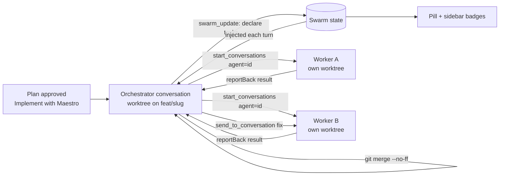

# Maestro as a conversation swarm — design

## Goal

Replace Maestro's delegate/subagent engine with a swarm of real conversations. A Maestro conversation becomes an
orchestrator that works like an Agent-mode conversation: it plans, opens one conversation per task in its own worktree
with `start_conversations`, reviews what comes back, sends fixes to the same conversation with `send_to_conversation`,
merges each worker branch locally into its feature branch, and delivers one branch at the end.

What Maestro keeps is its configuration: the Agent Pool, the strategies, the orchestrator profile, the strategy
profiles and the "Implement with Maestro" plan target. Each pool resource now describes a kind of conversation (model
candidates, mode and instructions) instead of a subagent.

The old engine falls short of this workflow because its workers share the orchestrator's working tree, cannot run in
Design mode, end with the turn that started them, and are not conversations the person can open.

## Decisions

| Topic | Decision |
| --- | --- |
| Engine | The delegate engine is deleted (`delegate`, `wait_delegation` for Maestro, Maestro live steering, worker scopes, delegation registry, the orchestration run card). Existing Maestro conversations keep `experience: 'maestro'` and run the new engine on their next turn. |
| Orchestrator capabilities | Agent-mode capabilities (read, edit, run, git, subagents through `task`), plus the conversation dispatch and link tools, plus `swarm_update`. It is no longer structurally read-only. |
| Worker selection | By pool resource id: in a Maestro conversation, each `start_conversations` task carries `agent: "<resource id>"` and no `settings`. The host resolves model, effort, Fast and mode from the resource and prepends its instructions. A resource outside the enabled pool is refused. |
| Resource shape | `capability: 'worker' \| 'read-only'` becomes `mode: 'agent' \| 'design' \| 'ask'`. Config version 2, migrated on read (`worker` → `agent`, `read-only` → `ask`). |
| Placement | Workers always get their own worktree, branched from the orchestrator's current HEAD (its feature branch). `shared` placement is refused in Maestro. `reportBack` is always on. |
| Concurrency | No limit. The orchestrator decides what runs in parallel from task dependencies. |
| Hop limit | Removed for every conversation, not only Maestro (`CONVERSATION_LINK_MAX_HOPS`, `hopAllowed`). The `hop` value is still recorded for diagnostics. The "Stop swarm" control is the brake. |
| Approval | Starting conversations from a Maestro conversation never asks for confirmation, including turns woken by a worker's result. Workers still cannot start conversations. |
| Integration | Local merge into the feature branch, done by the orchestrator in its own worktree. No sub-PRs. |
| Merge conflict | The orchestrator aborts the merge and sends the task back to its author, who merges the current feature branch, resolves the conflict, re-runs the quality gate and reports again. The board shows "Changes · conflict". |
| Worker lifecycle | Nothing is archived or deleted automatically. The person cleans up, as today. |
| Swarm state | Stored by the host per orchestrator conversation and injected into every orchestrator turn, so compaction does not lose it. |
| UI | One activity pill in the orchestrator with two sections, "Swarm" and "Subagents", and a "Stop swarm" control. The sidebar's dispatch folder shows each worker's phase as a badge. |
| Strategy | The four presets stay. Their guidance is rewritten for choosing resources and review depth. |
| Mobile | The protocol does not change. Mobile shows Maestro and its workers as ordinary conversations, already grouped (#463). |

## Prerequisite

`start_conversations` must accept a conversation mode per task so a `design` resource opens in Design mode. This is
being added in a separate branch (`feat/select-operation-model`). This work merges `main` after it lands and resolves
resource `mode` through that field. Until then only `agent` resources can be dispatched (dispatch forces Agent mode
today). The host refuses `design` and `ask` resources with `mode-unavailable`. It never silently falls back to Agent
mode.

## Architecture

### Orchestrator conversation

- **From a plan.** "Implement with Maestro" creates the orchestrator through the dispatch allocator with worktree
  placement and a new branch `feat/<plan-slug>` (with a numeric suffix on collision), based on the source
  conversation's HEAD. The source's uncommitted work (a prototype made while planning, for example) is carried in a
  first commit built through a temporary index, without touching the source checkout. It no longer creates a
  shared-cwd sibling. The plan, the strategy profile and the orchestrator
  profile are applied as today.
- **From "Use Maestro" in a new chat.** The conversation is created with the placement the person chose. If its branch
  is the workspace's default branch, the contract tells the orchestrator to create a feature branch before dispatching.
- **Behavior.** Maestro turns get Agent capabilities. The Maestro-specific prompt is replaced with the swarm contract
  (below), the pool catalog and the frozen strategy. Every runner gets the same tool set it gives Agent mode, plus the
  dispatch and link tools, plus `swarm_update`.

### Pool resolution

For a task with `agent: id`:

1. Find the enabled resource `id` in the conversation's pool as read at dispatch time (so pool edits apply to the next
   dispatch), or refuse with `unknown-agent`.
2. Take the first candidate that `resolveConversationDispatchSettings` accepts (provider configured, model present,
   effort and Fast valid). With no candidates, use the orchestrator profile. With none valid, refuse with
   `agent-unavailable` and list why each candidate failed.
3. Use the resource's `mode` as the conversation mode (see Prerequisite).
4. Build the worker prompt: resource instructions, then the orchestrator's task, then the host worker footer.

The **worker footer** is fixed host text, so the orchestrator does not have to repeat it:

- Work on this branch only. Commit before reporting.
- Before reporting, run the build, typecheck/lint and the affected tests, or add tests that cover the task, and report
  each result.
- For UI work, start the dev server in a drawer terminal, verify the result in the embedded browser against the
  reference, and say what you checked.
- The final answer is the report: what changed, the branch, the last commit SHA, validation results, and open points.

### Swarm state

A new table `maestro_swarm_tasks`, created in `initStore` like the other tables:

| Column | Meaning |
| --- | --- |
| `orchestrator_conversation_id`, `task_key` | Primary key. `task_key` is chosen by the orchestrator and is also the `requestKey` of the dispatch. |
| `title`, `resource_id` | What the task is and which pool resource runs it. |
| `depends_on_json` | Keys of the tasks that must be merged first. |
| `conversation_id`, `branch` | Filled in when the dispatch starts. |
| `phase` | `queued`, `implementing`, `delivered`, `reviewing`, `changes`, `merged`, `blocked`, `failed`. |
| `changes_reason` | `review` or `conflict` while in `changes`. |
| `review_round` | Incremented each time the task enters `changes`. |
| `note` | Last short note from the orchestrator (a blocker, say). |
| `merged_commit`, `created_at`, `updated_at` | |

Transitions:

| Event | Who | Phase |
| --- | --- | --- |
| `swarm_update` declares a task | orchestrator | `queued` |
| Dispatch with that `requestKey` starts | host | `implementing` |
| A message from the orchestrator starts a worker turn | host | `implementing` |
| The worker's result is delivered back | host | `delivered` (`failed` if the turn errored) |
| `swarm_update` marks review, changes or blocked | orchestrator | `reviewing`, `changes` (with reason), `blocked` |
| The worker branch tip is an ancestor of the orchestrator's HEAD, checked when an orchestrator turn ends | host | `merged` |
| "Stop swarm" | person | in-flight tasks become `blocked` with note "stopped" |

`swarm_update` takes `{ tasks: [{ key, title?, agent?, dependsOn?, phase?, reason?, note? }] }`. The host owns
`implementing`, `delivered`, `failed` and `merged`, and refuses them from the tool.

Each orchestrator turn starts with a host block `<maestro-swarm>` rendering the table (key, title, resource,
conversation, branch, phase, round, note), the same way other host context is injected.

### Swarm contract (orchestrator prompt)

It replaces `MAESTRO_SYSTEM_SPEC`. It is shared by every runner and only wrapped, never forked:

1. Plan: split the work into tasks with closed contracts (exact files, types and interfaces, acceptance criteria) and
   declare them with `swarm_update`, with dependencies.
2. Choose a resource per task from the pool catalog by its description, specialties, mode and instructions.
3. Dispatch every task whose dependencies are merged, in one `start_conversations` call, with `requestKey = task key`.
   Write each prompt self-contained: workers do not see this conversation.
4. When a result arrives: mark it `reviewing`, review the diff (`git diff HEAD...<branch>`) against the plan, typing,
   edge cases and the reported validation. Send fixes to the same conversation with `send_to_conversation`
   (`reportBack: true`) and mark the task `changes`.
5. Approved: `git merge --no-ff <branch>` in this worktree. On conflict: `git merge --abort`, mark the task
   `changes`/`conflict`, and ask the author to merge the current feature branch, resolve, re-run the gate and report
   again.
6. Dispatch the tasks that became unblocked.
7. When every task is merged: run the build and tests on the feature branch, fix or delegate failures, and report per
   task which resource did it, the review rounds and any open points. Push and open one PR only when the approved plan
   or the person asks for it; repository instructions prevail.

### UI

- **Pill.** `MaestroActivityPill` is rewritten. It shows `Swarm merged/total`, plus the active subagent count when
  there is one. The popover has a Swarm section (one row per task: phase colour, title, resource, phase label with
  round, click opens the conversation) and a Subagents section that reuses the `SubagentActivityPill` rows.
  `ChatView` stops choosing between the two pills for Maestro conversations. "Stop swarm" asks for confirmation, then
  cancels the orchestrator's turn and every running worker turn of the swarm.
- **Sidebar.** In a dispatch folder whose root is a Maestro conversation, child rows get a phase badge (`fila`,
  `review r2`, `ajuste`, `merged`, …) from the swarm state.
- **Updates.** The main process emits `maestro:swarm-changed` with the orchestrator id. The renderer refetches that
  swarm.
- **Removed.** `OrchestrationRun` and the Maestro live banner.
- **Settings.** The pool editor replaces the capability selector with a mode selector. Imported physical agents
  (`agentName`) no longer exist: migration drops the binding and keeps the resource's own `instructions`. Config
  validation lives in `shared/` and cannot read physical agent files, and a worker conversation already gets the full
  conversation system prompt.

### Removal

Delete: `maestro-delegation.ts`, `maestro-delegation-registry.ts`, `maestro-agent-execution.ts`, `maestro-live.ts`,
`maestro-live-store.ts`, `maestro-worker-tools.ts`, `maestro-worker-scope.ts`, `maestro-family.ts`,
`harness/profiles/claude-opus-5/ultra.maestro.md`, `OrchestrationRun.tsx`, the Maestro injection points in the six
runners, and their tests. `maestro-prompt.ts` is rewritten as the swarm contract. `maestro-supervision-tools.ts` stays,
because standard `task` subagents use it, minus its Maestro-only branches.

The `chat_maestro_runs` and live tables are no longer written or read. They are not dropped, so old databases still
open. Old messages with `delegate` parts render through the generic tool rendering.

## Error handling

- Resolution failures (`unknown-agent`, `agent-unavailable`, `mode-unavailable`) fail only that task of the batch, as other dispatch failures do. The orchestrator sees the reason in the tool result.
- A worker whose turn errors becomes `failed`. The orchestrator decides whether to resend or mark it `blocked`.
- A failed merge-detection check (git error) leaves the phase unchanged and logs it. It never marks a task merged.
- "Stop swarm" when nothing is running changes nothing and is idempotent.
- When the app restarts during a swarm, phases persist. Interrupted worker turns follow the existing interrupted-turn
  recovery, and the next orchestrator turn sees the state block.

## Testing

- Unit: config v1 → v2 migration (capability → mode, `agentName` dropped); pool resolution (first valid candidate,
  fallback, orchestrator default, `unknown-agent`, `agent-unavailable`, non-agent modes refused before the
  prerequisite); `start_conversations` in Maestro refuses `settings` and `shared` and forces `reportBack`; swarm
  transitions (host-owned phases refused from the tool, dispatch/result/error/merge events); merge detection with a
  temporary git repo; no confirmation for Maestro dispatches in human and linked turns; hop enforcement removed
  (existing hop tests rewritten to assert that long chains are delivered); tool policy (Maestro gets Agent, dispatch,
  link and `swarm_update` tools; workers and subagents never get dispatch tools).
- Renderer contract tests: the pill renders both sections and the stop action; the sidebar badge.
- E2E: the conversation-link spec is updated for the removed hop limit. A new `maestro-swarm.spec.ts` uses the scripted
  provider of `conversation-dispatch.spec.ts` (it already scripts `start_conversations` calls) for plan → orchestrator →
  two worker conversations → results → `swarm_update` → merge → both tasks `merged`, and a refused `settings` task.

## Non-goals

- Concurrency limits, automatic archiving or deletion, sub-PRs.
- A swarm UI on mobile.
- Swarms across several workspaces.
- Moving a running swarm to another computer.
