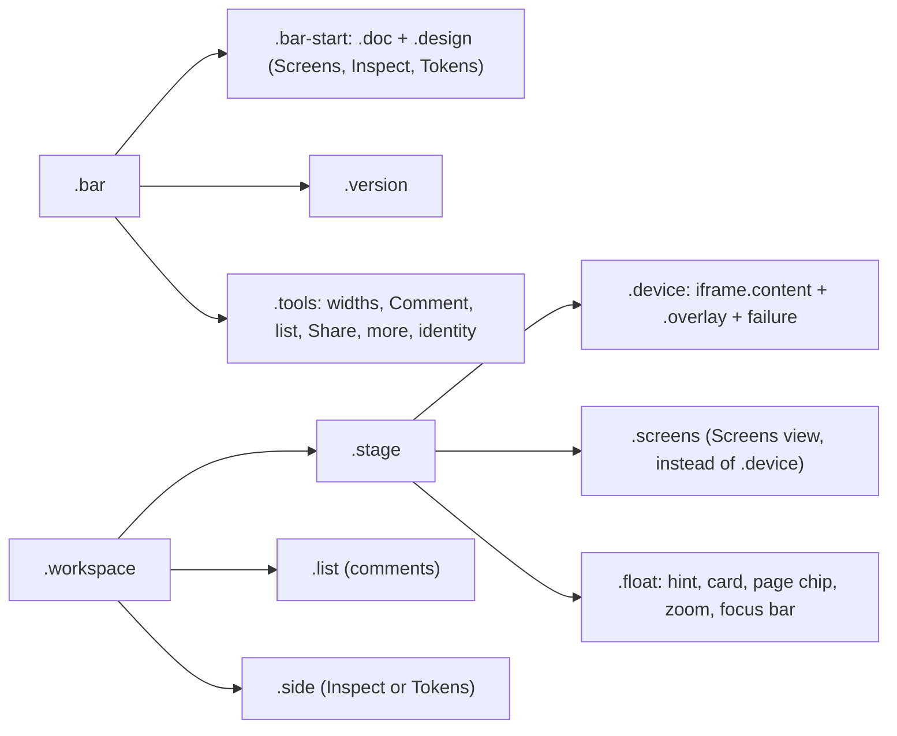

# Design viewer prototype: handoff

UX prototype of Design mode v2 in the artifact viewer: **Inspect**, **Screens** and **Tokens**, drawn inside the
viewer's own bar, stage and panels. The product design is
[`docs/superpowers/specs/2026-11-20-design-mode-v2-design.md`](../../docs/superpowers/specs/2026-11-20-design-mode-v2-design.md).
This folder is the reference for the UI part of the core implementation in
[`packages/artifact-host/src/shell`](../../packages/artifact-host/src/shell).

## Files

| File | What it is | Port it? |
| --- | --- | --- |
| [`index.html`](index.html) | Entry page. Loads the two stylesheets, the texts and the script. | No |
| [`viewer.css`](viewer.css) | Unchanged copy of `shell/viewer.css`. | Already there |
| [`proto.css`](proto.css) | Only the new rules, with the variables and conventions of `viewer.css`. | Append to `viewer.css` |
| [`messages.js`](messages.js) | `en` and `pt-BR` texts. Keys that exist in `shell/i18n.ts` keep their name and wording. | New keys to `i18n.ts` |
| [`proto.js`](proto.js) | The viewer, built with the shell's `h()`, `put()`, `icon()`, `avatar()` and popover patterns, plus every state. | Parts, see below |
| [`probe.js`](probe.js) | Stands in for the bridge extension: inspect, inventory and token preview inside each frame. | Behavior only |
| [`sample/`](sample/) | "Crumb orders", a fictional app that follows the prototype contract. | No |
| [`plain/index.html`](plain/index.html) | "Autumn menu", a page without the contract. | No |
| [`capture.mjs`](capture.mjs) | Captures every state into `reference/`. | No |
| [`reference/`](reference/) | PNG of each state at 1440×900, and of the panel states at 390×844. | No |

Run it from this folder with any static server on loopback, for example
`python3 -m http.server 4800 --bind 127.0.0.1`, then open `http://127.0.0.1:4800/index.html#<state>`. Add `?lang=pt-BR`
(or `?lang=en`) to force a language; otherwise it follows `navigator.languages`. Add `?capture` to hide the state
picker and the delays that captures do not need. Every state sets `document.documentElement.dataset.ready` to its id
once it has settled. To capture again, from the repository root after `npm ci`:
`node prototypes/artifact-design-viewer/capture.mjs [state ...]`; it fails on any console warning or error.

Published as an artifact, the page runs in the viewer's sandbox (`self.origin === 'null'`): the frames then load
their files as `srcdoc`, with the route set before the page's scripts run and in-page `#` links kept inside the
frame. Locally, frames load by URL, as the real viewer does.

## States

Each state opens from the hash: `index.html#<id>`. The state picker at the bottom right (not part of the design)
lists them.

| Id | What it shows | 1440×900 | 390×844 |
| --- | --- | --- | --- |
| `page` | Page view with the design tools in the bar | [png](reference/1440x900/page.png) | [png](reference/390x844/page.png) |
| `inspect-hover` | Inspect on, pointing at a component | [png](reference/1440x900/inspect-hover.png) | |
| `inspect-instance` | An instance selected: props, tokens with values, computed styles | [png](reference/1440x900/inspect-instance.png) | [png](reference/390x844/inspect-instance.png) |
| `inspect-nested` | A component inside another, with the components around it | [png](reference/1440x900/inspect-nested.png) | |
| `inspect-main` | The main component in `components.html`, with its uses per screen | [png](reference/1440x900/inspect-main.png) | [png](reference/390x844/inspect-main.png) |
| `inspect-main-counting` | Uses still being measured, screen by screen | [png](reference/1440x900/inspect-main-counting.png) | |
| `inspect-uses` | The uses on one screen highlighted | [png](reference/1440x900/inspect-uses.png) | |
| `inspect-plain` | A page without the contract: only computed styles | [png](reference/1440x900/inspect-plain.png) | [png](reference/390x844/inspect-plain.png) |
| `screens` | Every screen on the canvas | [png](reference/1440x900/screens.png) | [png](reference/390x844/screens.png) |
| `screens-focus` | One screen in focus | [png](reference/1440x900/screens-focus.png) | [png](reference/390x844/screens-focus.png) |
| `screens-loading` | Screens loading, and one that failed | [png](reference/1440x900/screens-loading.png) | |
| `tokens` | Tokens, no changes | [png](reference/1440x900/tokens.png) | [png](reference/390x844/tokens.png) |
| `tokens-loading` | Reading the tokens file | [png](reference/1440x900/tokens-loading.png) | |
| `tokens-error` | The tokens file could not be read | [png](reference/1440x900/tokens-error.png) | |
| `tokens-changes` | Changes previewed, with the list of changes | [png](reference/1440x900/tokens-changes.png) | [png](reference/390x844/tokens-changes.png) |
| `tokens-theme` | Editing the dark theme; every frame shows it | [png](reference/1440x900/tokens-theme.png) | [png](reference/390x844/tokens-theme.png) |
| `tokens-screens` | The preview on every screen | [png](reference/1440x900/tokens-screens.png) | |
| `tokens-save` | The owner confirms a new version | [png](reference/1440x900/tokens-save.png) | [png](reference/390x844/tokens-save.png) |
| `tokens-saving` | Saving | [png](reference/1440x900/tokens-saving.png) | |
| `tokens-saved` | Saved as a new version | [png](reference/1440x900/tokens-saved.png) | |
| `tokens-conflict` | Saving failed: a newer version was published | [png](reference/1440x900/tokens-conflict.png) | |
| `tokens-guest` | An invited person's changes | [png](reference/1440x900/tokens-guest.png) | |
| `tokens-suggest` | The invited person suggests them | [png](reference/1440x900/tokens-suggest.png) | [png](reference/390x844/tokens-suggest.png) |
| `tokens-suggest-sent` | The suggestion was sent | [png](reference/1440x900/tokens-suggest-sent.png) | |
| `tokens-readonly` | Comments are off: preview only | [png](reference/1440x900/tokens-readonly.png) | |
| `thread-suggestion` | A comment with a suggestion the owner can apply | [png](reference/1440x900/thread-suggestion.png) | [png](reference/390x844/thread-suggestion.png) |
| `thread-preview` | The owner previews the suggestion | [png](reference/1440x900/thread-preview.png) | |
| `thread-apply` | The owner confirms applying it | [png](reference/1440x900/thread-apply.png) | |
| `thread-applied` | The suggestion was applied as a new version | [png](reference/1440x900/thread-applied.png) | |
| `thread-summary` | A suggestion sent without a note: the body is the automatic summary | [png](reference/1440x900/thread-summary.png) | |
| `thread-stale` | A suggestion over a value that changed since | [png](reference/1440x900/thread-stale.png) | |
| `thread-apply-stale` | Applying failed because a token changed meanwhile | [png](reference/1440x900/thread-apply-stale.png) | |

## Where it lives in the viewer



- The design tools are a third group in the bar, after the document name. Nothing else in the bar moves.
- `.side` is a new column beside `.list`, 340 px wide like it. Only one of the two is open: opening Inspect's panel or
  Tokens closes the comment list, and opening the list closes the panel.
- The Inspect highlight is drawn by the shell in `.overlay`, above the frame, from rectangles the bridge reports. The
  page never draws it and never receives markup or styles from the shell.
- Without a valid `maestrly-design.json` on the current version, Screens and Tokens are not in the bar; Inspect
  stays, and shows only computed styles. Whiteboards are unchanged.

## Core interface

The core controller exposes the calls below; every control in the prototype maps to one of them, and nothing in the
UI needs more.

| Call | Triggered by |
| --- | --- |
| `setView('page' \| 'screens')` | Screens button and `S`; Escape or Open from a focused screen returns to the page. |
| `focusScreen(id \| null)` | Clicking a screen, arrow keys, the focus bar's steppers; `0` or Escape clears it. |
| `openScreen(id)` | Open in the focus bar, Enter, double click; a usage row in Inspect. |
| `setInspecting(on)` | Inspect button and `I`; Escape leaves it. |
| `openMainComponent(name)` | Go to main component. |
| `requestInventory(name)` | Selecting a main component; drives the per-screen uses. |
| `setTokensOpen(open)` | Tokens button and `T`; a token in Inspect opens it on that token. |
| `setActiveTheme(id)` | The theme tabs in Tokens. |
| `setTokenValue(key, value)` | Typing, the color picker, arrow-key steps. |
| `resetToken(key)` | The reset button on a row or in the list of changes. |
| `discardTokens()` | Discard. |
| `previewSuggestion(id, on)` | Preview on a suggestion. |
| `saveTokens()` | Save as version N, then Save version N in the dialog. |
| `suggestTokens(note)` | Suggest, then Send in the suggestion card; an empty note is allowed. |
| `applySuggestion(id)` | Apply…, then Save version N in the dialog. |

A token is keyed by its name on the default block (`--color-accent`) and by `theme:name` inside a theme
(`dark:--color-accent`). The prototype's `probe.js` posts `ready`, `hover`, `pick`, `layout` (rectangles) and
`inventory`, and receives `inspect`, `hover`, `select`, `matches`, `tokens` and `measure`; the core's bridge messages
replace these.

## Inspect

**Bar.** `button.button.design-button.inspect-button[aria-pressed]` with `icon('inspect')` and
`span.button-label`. Pressed, it fills with `--cream` like Comment does. Inspect and Comment are exclusive modes.

**On the page.** While on, `.stage.is-inspecting` draws a 2 px inset ring in `--select` around the device and the hint
(`.hint`, as in comment mode) reads "Point at the page to inspect it, then click to select", with Exit.

- Pointing: the nearest `[data-ds]` ancestor, or the element itself when there is none. `.inspect-box` (1 px
  `--select`, radius 2 px) and `.inspect-tag` (20 px high, radius 4 px, `--select` background, white 11 px/600 text,
  the component's name and `W × H` in `.inspect-tag-size`). An element without a component gets `.is-element`
  (`--bar` background, `--cream` text, `tag.class`). The tag sits 24 px above the box, below it when there is no room,
  inside it as a last resort, and never past the frame's edges.
- Selected: `.inspect-box.is-selected` (2 px plus a 1 px white outer ring), the tag stays.
- Uses on one screen: `.inspect-box.is-match`, dashed, filled with `--select-soft`.
- Clicks, pointer and submit events on the page are stopped while Inspect is on; links and buttons do nothing.

**Panel** (`aside.side.inspect-panel[aria-label="Inspect"]`):

```text
header.side-head
  span.side-mark            30×30, radius 8, --select-soft / --select-ink; .is-element when not a component
  div.side-title > h2 (name or tag.class) + p.side-sub ("Instance on Today" · "Main component · components.html")
  button.icon-button        close
div.side-body
  nav.inspect-path          components around it, outermost first; each a button.inspect-crumb, current one a span
  section.side-section      button.button.go-main "Go to main component" (disabled without a components page)
  section.side-section      h3.side-heading "Properties" + dl.props > div.prop > dt + dd > span.prop-chip
  section.side-section      "Variants" (main only): ul.variants > li.variant, mono 11 px pills
  section.side-section      "Uses" (main only): p.usage-total[role=status], div.usage-meter[role=progressbar],
                            ul.usage > li > button.usage-row (icon by viewport, .usage-name, .usage-count or .usage-state)
  section.side-section      "Tokens": ul.token-uses > li > button.token-use (.token-use-name, .token-use-value)
  section.side-section      "Computed styles": dl.props with a copy button per value
```

- Sections: 14 px padding, a `--line` rule between them, headings 11.5 px/600 in `--mute`.
- Token rows: 30 px, radius 7 px, mono 11.5 px; a changed token gets `.is-changed` (a 6 px `--warn` dot). Clicking
  one opens Tokens on that row, in the theme on screen (or the default one when the theme does not declare it).
- Computed styles: font family · weight, size / line height, color, background, radius, padding, box size. Each value
  copies on click (toast "{value} copied").
- When the page's stylesheets cannot be read, tokens come from `componentTokens` in the manifest with the note "From
  the manifest: the page's styles could not be read."
- Go to main component loads `components.html`, selects the `[data-ds-main]` element and shows `.page-chip` ("Back to
  Today", top left of the stage, 30 px, `--bar`) to return to the same element on the screen it came from. If the
  main is missing, a toast says so and the page stays.

**Uses.** The viewer measures the screens in the background: at most 2 loading at a time, and at most 6 frames live
at once overall; screens already live answer at once. Each row shows its state:

| Row state | Shows |
| --- | --- |
| `done` | The count, 600 weight; `0` in `--mute` and the row is disabled |
| `measuring` | `.usage-state` with a 14 px spinner and "Measuring" |
| `queued` | `.usage-state.is-queued`, "Waiting" in `--mute` |
| `failed` | "Not counted" in `--warn` |

While measuring, the summary reads "{n} so far · {done} of {total} screens measured" above a 3 px `.usage-meter`
filled in `--select`; when done it reads "18 instances on 6 screens" (or the one-screen and none variants). A row
with uses opens that screen and highlights them (`inspect-uses`).

## Screens

**Bar.** `button.design-button.screens-button[aria-pressed]`, `icon('screens')`. In Screens, Inspect and Comment are
disabled with the titles "Open a screen to inspect it" and "Open a screen to comment on it"; Tokens stays.

**Canvas** (`div.screens[role=region][aria-label="All screens"][tabindex=0]` replaces `.device` in `.stage`):

```text
div.screens-world            transform: translate(x, y) scale(z); --zoom = z
  div.screen[role=button][aria-pressed][aria-label="Today, 1440 × 900"]   roving tabindex
    div.screen-label         b (name) + span.screen-size (mono 11 px); counter-scaled so it stays 12 px
    div.screen-frame         iframe at the screen's real size, radius 6 px on screen, shadow; placeholder over it
      div.screen-placeholder > div.screen-placeholder-body   spinner + "Loading…", or the failure + Try again
```

- Layout: rows of screens at their viewport size, 160 px apart, 240 px between rows (more when the names need it: at
  least 32 px on screen). Rows wrap at 4800, 3200 or 1600 px, whichever shows the screens largest in the stage, so a
  phone gets two per row instead of six. Names never run past their screen: the size gives way first, then the name
  ellipsizes.
- Fit on open: 56 px side margins (16 px under 720 px), 76 px top and bottom. Zoom 4 % to 200 %.
- Only screens in or near the view (25 % margin) load, nearest to the center first, at most 6 live; the others are
  placeholders. A screen that fails shows "This screen could not be loaded." and Try again.
- Focus: clicking a screen focuses it (`.is-focused`, `--select-ink` name, 2 px ring) and zooms to fit it. The focus
  bar (`div.screen-focus[role=group]`, top center 14 px, 42 px high, radius 12 px, `--bar`) has the stepper ("3 of 6"),
  the name and size, Open (primary, with `↵`) and close. Under 720 px it spans the width and drops size and key.
- Zoom (`div.zoom[role=group]`, bottom left 14 px, 36 px high, radius 10 px): minus, the percentage (fits all on
  click), plus.
- Pointer: drag pans, wheel pans, Ctrl or Cmd + wheel zooms at the pointer, double click opens.

## Tokens

**Bar.** `button.design-button.tokens-button[aria-pressed]` with `icon('tokens')` and `span.count.is-pending` (the
number of unsaved changes, `--warn` on `--pending`). Its title becomes "Tokens (T): 3 changes not saved".

**Panel** (`aside.side.tokens-panel[aria-label="Tokens"]`):

```text
header.side-head             side-mark.is-tokens, h2 "Tokens", p.side-sub "tokens.css · 46 tokens", close
div.tabs.theme-tabs[role=group][aria-label="Theme"]    only when the file has themes
  button.tab[aria-pressed]   "Default 46", "Dark 18", with span.theme-dot when that theme has changes
div.tokens-filter            search icon + input.input[type=search]
div.side-body
  section.token-group        button.token-group-head[aria-expanded] (chevron, label, tab-count) + ul.token-list
    li.token-row.is-{color|length|number|text}[.is-changed][.is-invalid]
      label.token-name       mono 11.5 px, ellipsized; changed rows get a 6 px --warn dot
      div.token-field        label.token-swatch (input[type=color]) + input.token-input
      button.token-reset     visible when changed
      p.token-error          "Not a valid value for this token."
  p.tokens-inherit           in a theme: "28 other tokens keep their Default value in this theme." + Show Default
footer.tray                  list of changes, note, Discard + Save as version N (or Suggest)
p.side-foot                  hint when there are no changes
```

- Rows: grid `minmax(0, 1fr) 124px 24px`, 34 px min height, radius 8 px; `.is-text` rows (font stacks, shadows,
  curves) put the value on its own line. Inputs: 28 px, radius 7 px, mono 11.5 px, 18 px swatch inside.
- Groups follow the prefixes: Color, Font, Text, Space, Radius, Shadow, Duration, Easing, Other.
- Editing: a valid value previews immediately in every open frame (the page and the screens on the canvas). Arrow Up/Down step
  numbers (Shift for 10×), Enter commits, Escape restores the value from before focusing. Invalid values show the error
  and do not preview.
- Themes: a theme lists only the tokens it declares. The theme picked is also the theme every frame shows, so what you
  edit is what you see; Default returns the page to how it renders itself. Changes keep their theme: the list of
  changes, the save dialog and suggestions tag them (`span.theme-tag`, "Dark"), and summaries write
  `--color-accent (Dark)`. A theme on `@media (prefers-color-scheme: …)` is labelled "Dark (system)" and cannot be
  forced, so its preview shows only while the device uses it.
- The tray (`footer.tray`, top border): `.tray-head` (42 px, `--warn` dot, "3 changes", collapse), `ul.change-list`
  (max 150 px, scrolls; each `.change` has the name, old value struck through, arrow, new value and reset), the note,
  and the actions. On an old version the owner's Save is disabled with "Go to the current version to save."

**Who can do what.**

| Person | Footer note | Primary action |
| --- | --- | --- |
| Owner | "Only you see these changes until you save them." | Save as version N |
| Invited, comments on | "Only you see these changes. Suggest them to Rafa in a comment." | Suggest |
| Comments off | "Only you see these changes. Comments are off, so they cannot be suggested." | none |

**Saving** (`dialog.name-dialog.save-dialog`, `min(400px, 100vw - 32px)`): title "Save as version 4", what changes
("Only tokens.css changes…"), `ul.dialog-changes` with the new values, the version summary ("Tokens: --color-accent,
…"), Cancel and Save version 4. While saving the button shows a spinner and the dialog is `aria-busy`. Then the
dialog closes, the version switches to v4 and a toast says "Saved as version 4".

Errors in the dialog (`p.dialog-error[role=alert]`, `.is-warn` for conflicts):

- A newer version exists: "Version 4 was published while you were editing, so nothing was saved. Your changes are
  still here: load it to preview them on top of it." The primary becomes "Load version 4"; the changes stay and
  preview on top of it.
- Any other failure: "The version could not be saved. Try again." with the same Save button.

## Suggestions

- Suggest opens a draft card (`section.card.is-draft.suggest-card`) with the changes in `div.suggestion`, the hint
  "Without a note, the comment lists the changes." and the comment composer (note optional). Sending creates a page
  comment with the changes attached, clears the person's changes and toasts "Suggestion sent to Rafa" with View.
- Without a note, the host writes the body: `Tokens: --color-accent #B4532A → #0F766E, --color-accent (Dark) #E07A4B →
  #2DB5A6, --radius-md 10px → 14px`. The thread and the list show it as the comment's text (`thread-summary`).
- In the thread, `div.suggestion` sits under the body: `.suggestion-head` ("3 token changes"), `ul.suggestion-list`
  with old and new values, and `.suggestion-actions` with Preview (`aria-pressed`, eye icon) and, for the owner,
  Apply…. The list item gets the tag "3 token changes"; the owner sees an unread dot until it is applied.
- Applying opens the save dialog as "Apply as version 4" ("Saves Marina Souza's changes as version 4…"), summary
  "Tokens suggested by Marina Souza: …". Once applied the block reads "Applied in version 4" with a check.
- A suggestion over a value that changed since shows "Now 12px on this version" under that change, and the owner's
  action becomes Edit in Tokens instead of Apply… (`thread-stale`).
- If a token changes while the owner confirms, applying fails: "--radius-md changed after Marina suggested this, so
  nothing was saved. Edit it in Tokens to save it on top of the current version." with Edit in Tokens as the primary
  (`thread-apply-stale`).
- Edit in Tokens copies the suggestion's values into the owner's own changes, opens Tokens on the current version and
  toasts "Marina's values are now your changes in Tokens"; the owner reviews them and saves as usual.

## Narrow windows

| Width | Change |
| --- | --- |
| ≤ 1180 px | Design buttons drop their labels (8 px padding), like the viewer's own at 860 px |
| ≤ 720 px | The design group moves to the bar's second row, right of the version |
| ≤ 720 px | `.side` becomes a bottom sheet: full width, `max-height: 80%` (Inspect 58 %, so the page stays in sight), radius 14 px on top, a 36×4 px grabber, `z-index: 20` |
| ≤ 720 px | With a card open, the sheet hides; opening a thread from the list closes the list |

## Layers

| Layer | `z-index` | Where |
| --- | --- | --- |
| `.overlay` (inspect boxes and tags) | 2 | `viewer.css` |
| `.stage.is-inspecting .device::after` (ring) | 3 | `proto.css` |
| `.float` (hint, card, page chip, focus bar, zoom) | 5 | `viewer.css` |
| `.side` and `.list` as sheets, ≤ 720 px | 20 | both |
| `.popover` | 50 | `viewer.css` |
| `.toasts` | 60 | `viewer.css` |

New variables in `proto.css`: `--select: #2563eb` (white text on it passes 4.5:1), `--select-ink: #8fb3ff`,
`--select-soft: rgba(37, 99, 235, 0.14)` and `--pending: rgba(242, 180, 92, 0.18)`. Everything else uses `--bar`,
`--panel`, `--pop`, `--line`, `--line-2`, `--ink`, `--ink-2`, `--mute`, `--cream`, `--warn`, `--shadow`, `--ease` and
`--mono`.

## Keyboard, focus and accessibility

| Key | Action | Where |
| --- | --- | --- |
| `S` | Screens on or off | anywhere outside a field |
| `I` | Inspect on or off | page view |
| `T` | Tokens open or closed | with the contract |
| `C`, `F` | Comment, full screen (unchanged) | |
| Escape | Closes, in order: popover, card, selection, Inspect, Comment, screen focus, full screen | |
| Arrows | Previous or next screen; Up and Down change row | Screens |
| Enter | Opens the focused screen | Screens |
| `+`, `-`, `0` | Zoom in, out, fit all | Screens |
| Arrow Up/Down, Shift | Step a number by 1 or 10 | token input |
| Enter, Escape | Commit, restore | token input |

- The keys also work while focus is in the frame: the bridge forwards `c`, `f`, `i`, `s`, `t` and Escape, never while
  typing in a field.
- Focus: Screens focuses the canvas; a screen is a roving `tabindex` item. Tokens opened from Inspect focuses and
  selects that input. Theme tabs keep focus on the pressed tab. Dialogs focus their primary button (the dialog itself
  while saving) and return focus on close. Popovers return focus to their trigger.
- Names: every icon button has `aria-label` and `title`; toggles use `aria-pressed`, collapsibles `aria-expanded`;
  inputs point to their error with `aria-describedby` and set `aria-invalid`. Progress and summaries are
  `role="status"`, errors `role="alert"`, the uses meter is a `progressbar`.
- Inspect tags are `aria-hidden` and boxes are empty; the panel says what is selected.
- In a sandboxed frame the browser refuses focus before the person interacts with the page; the shell only moves
  focus by itself after that (the prototype logs this for dialogs opened by a state, never after a click).

## Motion

Only the existing `--ease` curve. Panels open in place on wide windows; as sheets they rise (`sheet`, 0.22 s). The
focus bar rises (0.18 s), the page chip fades (0.16 s), and the canvas camera eases (0.32 s) only for focus and fit,
never while panning or zooming with the wheel. The uses meter grows in 0.24 s and the highlight of a token opened from
Inspect lasts 1.6 s. `viewer.css` already collapses every animation and transition under
`prefers-reduced-motion: reduce`, which covers these rules too.

## Limits the UI respects

- Up to 50 screens; screen ids, names, paths and viewports as in the spec. An invalid or missing manifest hides
  Screens and Tokens.
- Up to 200 tokens across all blocks; names and values as in [`docs/design-mode.md`](../../docs/design-mode.md): values
  with `;`, `{`, `}`, `<`, `\`, `url(`, `image-set(`, `src(`, a CSS comment or `!important` are never read nor
  previewed, and typing one shows the field's error.
- At most 6 live frames on the canvas and 2 measuring in the background.
- Saving fails with a conflict when a newer version exists; applying fails when a suggested token changed since.

## Real and simulated

| Real, as the core should do it | Simulated |
| --- | --- |
| Bar, panels, canvas, dialogs and cards: DOM, classes, styles, keys and focus | Saving and applying: versions are kept in memory and nothing is written |
| Reading the manifest and the tokens file, themes included, with the limits | Conflicts and stale suggestions: the states trigger them |
| Preview: each value replaces the declaration in its own block through the CSSOM; the theme is set on the root | Comments: two fixed threads; replies and Resolve do nothing |
| Inspect: hover, selection, tokens from readable rules, computed styles, the components around it | The bridge: `probe.js`, which the prototype injects into each frame |
| Screens: layout, lazy frames (6 live), pan, zoom, focus and open | Identity and permissions: each state picks the owner, a guest or comments off |
| Uses: background measuring, 2 at a time, with per-screen states | Times: fixed at 20 November 2026, 15:00 UTC |

The sample's [`tokens.css`](sample/tokens.css) gained a dark theme in `[data-theme='dark']` (16 colors and both
shadows), and its pages link every local stylesheet with `crossorigin` so Inspect and the preview can read and edit
their rules from the frame's opaque origin. The viewer adds only the four variables listed under Layers.

## Texts

Every new key, in `en` and `pt-BR`, is in [`messages.js`](messages.js) under the comments "New: …", grouped as the
bar's design tools, Inspect, Screens, Tokens, saving a version and suggestions. "Board"/"Quadro" is never used in the
UI, since whiteboards already have that name: the feature is "Screens"/"Telas".

## Open questions

- Media-query themes cannot be forced in the frame. The prototype only labels them "(system)"; the core may want to
  preview them by copying their declarations into the default block while picked.
- Adding a declaration to a theme (overriding a default token in a theme that does not declare it) is not offered:
  saving rewrites existing declarations only.
- Whether the theme picked in Tokens should stay on screen after closing the panel. The prototype keeps it, like the
  page width.
- Counting uses on screens that are already live could also refresh after a token preview; the prototype counts
  each screen once per version.
